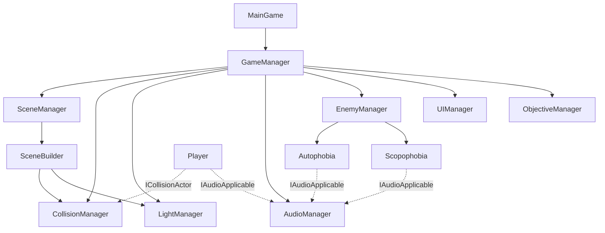

# Imaginophobia — Game Concept & Architecture

**Version:** 1.0 | **Last Updated:** 2026-10-14 | **Owner:** เตชินท์ เจริญสิงห์ (682110116)

## 1. Introduction

### Elevator Pitch

Imaginophobia คือเกมแนว 2D pixel-art survival horror ผู้เล่นรับบทเป็นช่างบำรุงรักษาที่ถูกส่งมาซ่อมท่อน้ำในชั้นใต้ดินที่มืดและชื้นแฉะตามลำพัง มีเพียงไฟฉายเป็นเพื่อน ต้องซ่อมท่อให้ครบทุกจุดและหาทางออกจากที่นี่ให้ได้ — ท่ามกลางสิ่งที่ตามล่าเขาในความมืด แต่สิ่งเหล่านั้นไม่มีอยู่จริง มันคือภาพหลอนที่เกิดจากความกลัวของตัวเขาเอง ยิ่งอยู่ในความมืดนานเท่าไหร่ เขาก็ยิ่งแยกไม่ออกว่าอะไรจริง อะไรหลอน

### Target Audience

- **กลุ่มหลัก:** ผู้เล่นที่ชื่นชอบเกมสยองขวัญเชิงจิตวิทยา (Psychological Horror)
- **กลุ่มรอง:** Achievement Hunter — ผู้เล่นที่ตามเก็บข้อความตาย/ชนะให้ครบทุกแบบ
- **ช่วงวัย:** 16+ (มีฉากกระตุกขวัญและบรรยากาศกดดัน ไม่มีเนื้อหารุนแรง)

### Genre & Platform

- **Genre:** Survival Horror (Psychological Horror, 2D pixel art)
- **Platform:** PC (Windows)
- **Engine:** MonoGame (DesktopGL) — ดูรายละเอียดใน [Technical Stack](#2-technical-stack)
- **มุมมอง:** Side-view 2D

### Inspiration & References

| เกม/สื่อ | แรงบันดาลใจที่นำมาใช้ |
|---|---|
| **SIGNALIS** | โครงสร้างการเล่าเรื่องแบบกระจายชิ้น (fragmented storytelling) ผ่านสภาพแวดล้อม เอกสาร และสัญลักษณ์ · ความ scarcity ของ resource ทำให้เกิด tension แม้ไม่มีศัตรู · ความไม่แน่นอนเชิงจิตวิทยามากกว่าการไล่ล่า |
| **Lone Survivor** | มุมมอง side-view · การเบลอเส้นแบ่งระหว่างความจริงกับภาพหลอน · เนื้อเรื่องที่ผูกกับสภาวะจิตของตัวละคร · การเลือกหนี/สู้เป็นกลยุทธ์ไม่ใช่แค่การต่อสู้ |
| **Dead by Daylight** | จังหวะ Skill Check (กดให้ตรงจังหวะบนแถบ) ที่นำมาปรับใช้ในมินิเกมซ่อมท่อ |
| **Metroidvania ทั่วไป** | โครงสร้างแผนที่แบบมี progression และการปลดล็อกพื้นที่ |

**บทเรียนหลักจาก SIGNALIS vs Lone Survivor:** SIGNALIS ทำให้ผู้เล่น *กลัวสภาพแวดล้อม* ส่วน Lone Survivor ทำให้ผู้เล่น *ตั้งคำถามกับความเป็นจริงของตัวละคร* — Imaginophobia เลือกแนวทางหลังเป็นแกนหลัก เพราะสิ่งที่ไล่ล่าผู้เล่นคือความกลัวของตัวเขาเอง ไม่ใช่สัตว์ประหลาดจริง ๆ

## 2. Technical Stack

| Layer | Technology | Notes |
|---|---|---|
| Engine | MonoGame (MonoGame.Framework.DesktopGL) | 3.8.* |
| Runtime | .NET 9.0 | `net9.0`, `WinExe`, DesktopGL |
| Extended libs | MonoGame.Extended + Content.Pipeline | 6.1.1 |
| UI | Gum.MonoGame | 2026.9.6.1-preview.1 |
| Lighting | MonoGame.Penumbra.DesktopGL | 3.0.0 |
| Level editor | LDtk | ไฟล์ `.ldtk` ใน `Content/Tilemaps/` |
| Content pipeline | MGCB | `Content/Content.mgcb` |
| IDE | Visual Studio | — |

> **หมายเหตุ:** โปรเจกต์นี้ **ไม่ใช้ Unity** แม้ในช่วงแรกทีมจะลองทำต้นแบบบน Unity มาก่อน (ดู [Game Jam history](../05_Wiki/history/README.md)) ตรรกะทั้งหมดถูกพอร์ตมาเขียนใหม่บน MonoGame

## 3. Game Pillars

| Pillar | ความหมาย |
|---|---|
| **Anxious** | "มีอะไรอยู่กับเราไหม ที่นี่ปลอดภัยหรือเปล่า" — ความกังวลที่ไม่คลาย |
| **Uneasy** | พื้นที่แคบ บรรยากาศสกปรก อึดอัด |
| **Mysterious** | "สิ่งที่ตามเรามันคืออะไรกันแน่" — ไม่มีคำตอบชัดเจน |

## 4. Goals & Progression

- **Short term:** แก้ puzzle (ซ่อมท่อ/ซ่อมไฟ)
- **Medium term:** เผชิญหน้ากับ phobia ต่าง ๆ
- **Long term:** หนีออกไปให้ได้

**Progression**
- **Explore** — หาของเพื่อปลดล็อกพื้นที่และหาทางออก
- **Difficulty** — สุ่ม (randomization) และจะยากขึ้นเรื่อย ๆ เมื่อเวลาผ่านไป

**Satisfaction**
- เก็บข้อความตาย/ชนะให้ครบทุกแบบ
- การหนีออกไปได้สำเร็จ

## 5. Story & Premise

มีช่างบำรุงรักษาที่มาซ่อมท่อน้ำในชั้นใต้ดินแห่งหนึ่งด้วยตัวคนเดียว ระหว่างการซ่อมเขาได้เผชิญหน้ากับสิ่งประหลาดต่างๆ เขาไม่รู้ว่าพวกมันคืออะไร และสิ่งที่เขาต้องทำคือหนีให้ไวที่สุดหลังจบการซ่อมท่อน้ำสำเร็จ

สิ่งที่เกิดขึ้นในเกมทั้งหมดไม่ใช่เรื่องเหนือธรรมชาติจริงๆ แต่เป็นภาพหลอนที่เกิดจากความกลัวของตัวช่างเอง ยิ่งอยู่ในความมืดนานเท่าไหร่ ความกลัวก็ยิ่งเล่นตลกกับสายตา ทำให้แยกไม่ออกว่าอะไรจริงอะไรหลอน

**Game Premise:** ผู้เล่นต้องซ่อมท่อให้เสร็จท่ามกลางความมืดและเสียงที่ไม่รู้ว่ามาจากไหน พร้อมรับมือกับสิ่งที่ (อาจจะ) ไม่มีอยู่จริง พร้อมหาทางออกจากที่นี่

รายละเอียดเพิ่มเติม: [Narrative](07-narrative.md)

## 6. Setting

- **สถานที่:** ชั้นใต้ดิน (basement) ของอาคารหนึ่ง ประกอบด้วย **ห้องไฟฟ้า** และ **ห้องท่อน้ำ/โถงอุโมง**
- ห้องท่อน้ำมืดสนิท มีแสงสลัวลอดมาจากห้องไฟ
- **ห้องไฟฟ้า** เป็นพื้นที่ที่สว่างกว่าที่อื่น — แสงสลัวอบอุ่น ให้ความรู้สึกปลอดภัยเหมือน safe zone
  (เปลี่ยนแนวคิดจากช่วง Game Jam ที่ห้องไฟสามารถมี entity ได้)

## 7. System Architecture

เกมขับเคลื่อนด้วยชุด **Manager** ที่ `MainGame` ดูแลอยู่ โดยแต่ละ manager รับผิดชอบ subsystem เดียว และ `GameObject` ทำหน้าที่เป็น base ของทุกอย่างที่อยู่ในฉาก (มี child/parent และ `Update`/`Draw` เป็น virtual)

| Subsystem | Class | หน้าที่ |
|---|---|---|
| Game loop / orchestration | `MainGame`, `GameManager` | `Initialize` → `LoadContent` → `Update` → `Draw`; ถือ manager ทั้งหมดและคุม state ของเกม |
| Scene | `SceneManager`, `SceneBuilder`, `Enums/Scene` | โหลด `.ldtk` สร้าง collider + แสงตาม tilemap; สลับฉาก (`tilemap_electrical_room`, `tilemap_electrical_room_2`, `tilemap_sewer`) |
| Collision | `CollisionManager`, `ICollisionActor`, `Wall`, `Trigger`, `Collectible`, `LightArea` | จัดการ collider แบบมี layer; ตรวจการชนระหว่างผู้เล่น/ศัตรู/วัตถุ |
| Lighting | `LightManager`, `LightArea`, `SpriteEffects/VignetteOverlay`, `BottomFadeOverlay` | แสง 2D (Penumbra) และเอฟเฟกต์การถูกความมืดกลืนกิน |
| Audio | `AudioManager`, `AudioSource`, `IAudioApplicable`, `Enums/Sound` | SFX, ambience, และ spatial (3D) audio ตามระยะห่างจากผู้เล่น |
| Input | `InputManager` (static) | รวมการอ่านคีย์บอร์ดไว้ที่เดียว |
| Enemies | `EnemyManager`, `Autophobia`, `Scopophobia` | สุ่ม spawn และอัปเดตพฤติกรรมของ phobia |
| Objectives | `ObjectiveManager`, `SpawnPoint` | ติดตามภารกิจที่ต้องซ่อมให้ครบ |
| Minigames | `Screen/SkillCheckScreen`, `ConnectTheDotsScreen`, `SpinTheValveScreen`, `GameplayScreen`, `DotsGenerator`, `GeneratedDotsMap`, `GridCell`, `WirePath` | มินิเกมทั้งสามแบบ |
| UI | `UIManager` | HUD (Objective / Sanity / Battery) และเมนู |
| Dialogue | `DialogueManager` | ข้อความในเกม |
| Player | `Player`, `CharacterAction`, `Enums/MentalState` | การเดิน, การซ่อน, สถานะทางจิต (Normal 75 / Anxious 50 / Insane 25) |
| Support | `Time`, `Timer`, `CameraShaker`, `GameObject` | ตัวจับเวลา, การสั่นกล้อง, base class |

รายละเอียดเชิงลึก: [System Design](../03_Software/01-system-design.md) · [Class Diagram](../03_Software/02-class-diagram.md)

## 8. Related Documents

- Core Loop: [Core Loop & Gameplay](01-core-loop.md)
- Scope: [Scope & Feature List](02-scope-features.md)
- Mechanics: [Mechanics](03-mechanics.md)
- Narrative: [Narrative](07-narrative.md)
- Art: [Art Direction](08-art-direction.md) · Audio: [Audio Direction](09-audio-direction.md)
- Software: [System Design](../03_Software/01-system-design.md) · [Class Diagram](../03_Software/02-class-diagram.md) · [Data Schema](../03_Software/03-data-schema.md)
- Backlog: [Product Backlog](../04_Agile/01-product-backlog.md)
- Index: [Project Index](../index.md)
