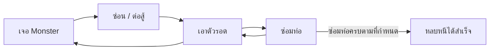
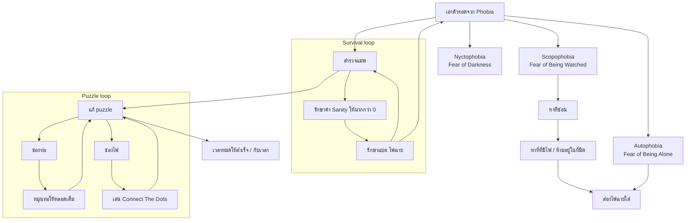
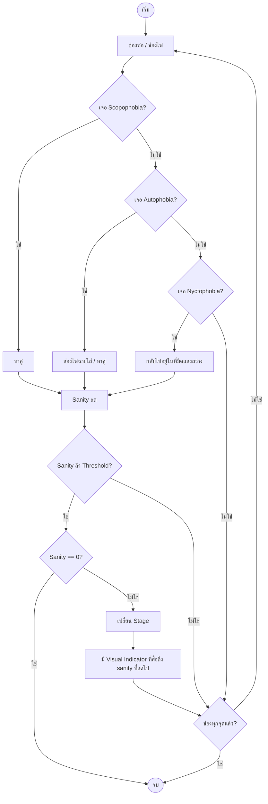

# Imaginophobia — Core Loop & Gameplay

**Version:** 1.0 | **Last Updated:** 2026-10-14

## Core Loop

เจอ Monster → ซ่อน / ต่อสู้ → เอาตัวรอด → ซ่อมท่อ → (ซ่อมครบตามที่กำหนด) → หลบหนีได้สำเร็จ

## Nested Loop (3 ระดับ)

เกมมี loop ซ้อนกันสามชั้น — ชั้นนอกคือการเอาตัวรอดจาก phobia, ชั้นกลางคือการรักษาสภาพตัวเอง, ชั้นในคือการแก้ puzzle

## Flowchart รวม (เงื่อนไขการดำเนินเกม)

## Player Actions

| Action | Input | Result | Notes |
|---|---|---|---|
| เดิน | Arrow / WASD | ตัวละครเคลื่อนที่ | `CharacterAction.Walking` |
| ซ่อน | กด Hide (ใกล้ตู้) | เข้าสู่ตู้ซ่อนตัว | `CharacterAction.ReadyToHide` → `Hiding` |
| ซ่อม | กด Fix / Space | เข้ามินิเกมซ่อม | `CharacterAction.Repairing` |
| ส่องไฟฉาย | — | ทำให้ Autophobia หายไป / ใช้ในความมืด | `CharacterAction.Checking` |

> **TBD:** ตารางปุ่มจริง (key binding) ยังไม่ยืนยัน — `InputManager` เป็นที่เดียวที่ผูกปุ่มทั้งหมด ให้ตรวจสอบจากโค้ดก่อนแก้ตารางนี้

## Win / Lose Conditions

- **ชนะเมื่อ:** ซ่อมท่อ/ช่องไฟครบทุกจุดตามที่กำหนด แล้วหลบหนีออกไปได้สำเร็จ (`หลบหนีได้สำเร็จ`)
- **แพ้เมื่อ:**
  - ถูก Autophobia / Scopophobia จับได้
  - ค่า Sanity ลดถึง 0 (`MentalState` มี 3 ระดับ: Normal 75 / Anxious 50 / Insane 25)
  - Nyctophobia — อยู่ในความมืดนานเกินไปหรือหมดเวลา แล้วถูกความมืดกลืนกิน

> **TBD:** ค่า threshold ของ Sanity ที่ทำให้แพ้ และอัตราการลด Sanity ต่อวินาที ต้องยืนยันจากโค้ด/การทดสอบ — ดู [Data Schema](../03_Software/03-data-schema.md)

## Related Documents

- Mechanics: [Mechanics](03-mechanics.md)
- Concept: [Game Concept](00-concept.md)
- System Design: [System Design](../03_Software/01-system-design.md)
