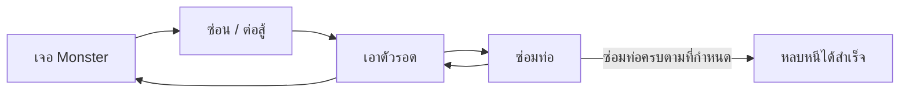
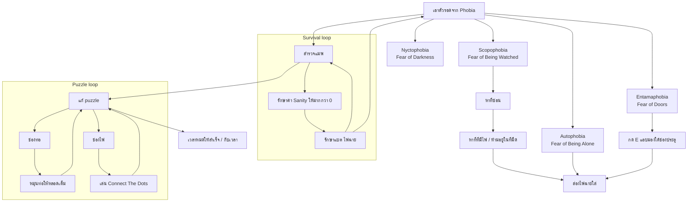
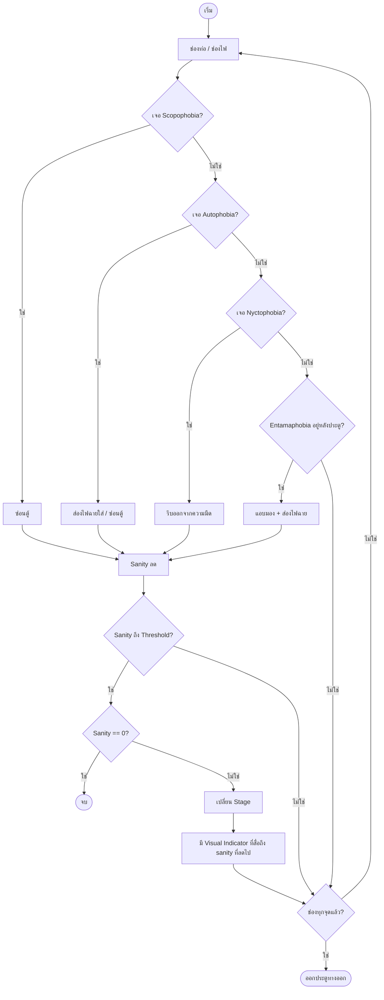

# Imaginophobia — Core Loop & Gameplay

**Version:** 2.0 (Release 1.0.0) | **Last Updated:** 2026-11-02

## Core Loop

เจอ Monster → ซ่อน / ต่อสู้ → เอาตัวรอด → ซ่อมท่อ → (ซ่อมครบตามที่กำหนด) → หลบหนีได้สำเร็จ

## Nested Loop (3 ระดับ)

เกมมี loop ซ้อนกันสามชั้น — ชั้นนอกคือการเอาตัวรอดจาก phobia, ชั้นกลางคือการรักษาสภาพตัวเอง, ชั้นในคือการแก้ puzzle

## Flowchart รวม (เงื่อนไขการดำเนินเกม)

## Player Actions

| Action                                    | Input                                      | Result                                                                                          | Notes                                                                                                |
| ----------------------------------------- | ------------------------------------------ | ----------------------------------------------------------------------------------------------- | ---------------------------------------------------------------------------------------------------- |
| เดิน                                  | `A` / `D`                              | ตัวละครเคลื่อนที่ (`MoveSpeed = 250`) — **แกน X เท่านั้น** | `CharacterAction.Walking`                                                                          |
| ซุ่มเดิน                          | `Left Ctrl` + ทิศทาง               | เดินช้าลง (÷ 1.7) และล็อกทิศการหันหน้า (animation `sneak-forward` / `sneak-backward`) | ไม่เปลี่ยน state —`CurrentAction` ยังเป็น `Walking`                     |
| เปิด/ปิดไฟฉาย                 | `F`                                      | เปิด `Spotlight` (Battery ลด 1/วินาที) · ระยะสายตา (`EyeSight`) 400px              | ใช้ส่อง Autophobia ให้หาย · ไฟฉายปิดเองเมื่อ Battery หมด                          |
| โต้ตอบ / ซ่อน / ซ่อม        | `Space`                                  | เข้าตู้ซ่อน · เริ่มมินิเกมวาล์ว / ซ่อมไฟ · อ่านคลิปบอร์ด · ใช้ประตู                          | `Hiding` · `Repairing` · `Reading`                                                       |
| มองซ้าย-ขวาขณะซ่อม       | `A` / `D`                              | เลื่อนกล้อง 400px                                                                        | `CharacterAction.Checking`                                                                         |
| พลิกหน้าคลิปบอร์ด           | `A` / `D` (ขณะ `Reading`)         | ย้อนหน้า / หน้าถัดไป (1–4)                                                        | หน้าที่ 4 มีโอกาส 3% ที่จะเจอหน้าลับ                                        |
| แอบมองใต้ช่องประตู      | `E` (ขณะอยู่ที่ประตู)     | เปิด `DoorPeekingScreen`                                   | `CharacterAction.Peeking` · ใช้ไม่ได้ในฉาก `tilemap_sewer` |
| ออกจากมินิเกม / หน้าจอ      | `Q`                                      | ปิดหน้าจอ (progress ถูกบันทึกไว้)                            | ใช้กับ Spin The Valve / Connect The Dots / Door Peeking / Clipboard                                        |
| หยุดพัก / ตั้งค่าเสียง | `ESC` (หรือปุ่มมุมขวาบน) | เปิด pause overlay ใน `GameplayScreen` (`GameState = Pause` + `Time.TimeScale = 0`)                                                  | อ่านผ่าน `GumService.Default.Keyboard`                                                     |
| กลับเมนู                     | ปุ่ม "< Return to Menu"                 | ใช้ได้จาก pause overlay / จอตาย / จอชนะ                                   | กลับสู่ `MainMenuScreen`                                                     |
| Cheat (debug)                        | `Ctrl` + `Right Shift` + `+` / `-`       | Sanity +10 / −10                                                                                 | `GameManager.Cheat()`                                                                                |
| Cheat (debug)                        | `F10` ค้างขณะเปิดประตู `end`    | ผ่านประตูทางออกได้โดยไม่ต้องซ่อมครบ                                  | `GameManager.OnDoorInteracted`                                                                      |

> **Input ที่รวมไว้ที่ `InputManager`** มีแค่ `A` / `D` (`Direction`) ส่วน `Left Ctrl`, `F`, `Space`, `Q`, `E`, `ESC` และ cheat keys อ่านตรงใน `Player.cs`, `CollisionManager.cs`, หน้าจอมินิเกม, `GameplayScreen.cs` และ `GameManager.cs` ตามลำดับ

## Win / Lose Conditions

- **ชนะเมื่อ:** ซ่อมวาล์วครบ 5 จุด (`ObjectiveManager.AllValvesRepaired`) **และ** ไฟในโถงอุโมงติดครบ (`SaveManager.AllSewerLightsAreOn()` ซึ่งต้องซ่อมแผงไฟสำเร็จ) แล้วออกจากประตูทางออก (`Destination == "end"` ที่อยู่ในห้องไฟฟ้า 1) สำเร็จ → เปิด `WinScreen` (แสดงเวลาที่เหลือ)
- **แพ้เมื่อ:**
  - ถูก Autophobia จับได้ (Sanity −10) หรือถูก Scopophobia พุ่งชน (Sanity −25)
  - ค่า Sanity ลดถึง 0 (`SanityState` มี 3 ระดับ: Normal 80 / Anxious 40 / Insane 0) → เปิด `DeathScreen`
  - Nyctophobia — อยู่ในความมืดที่ไฟดับนานเกินไป จน vignette ปิดสนิท (`Sanity = 0`)
  - หมดเวลาหลัก 721 วินาที (`MainTimer` เรียก `Player.Dead()` ซึ่งตั้ง Sanity = 0) → เปิด `DeathScreen`
- **Jump scare (ไม่ใช่แพ้):** เปิดประตูขณะที่ Entamaphobia ยัง active → เปิด `JumpScareScreen` 1.6 วินาที แล้วกลับเข้า gameplay ต่อ

## Related Documents

- Mechanics: [Mechanics](03-mechanics.md)
- Concept: [Game Concept](00-concept.md)
- System Design: [System Design](../03_Software/01-system-design.md)
