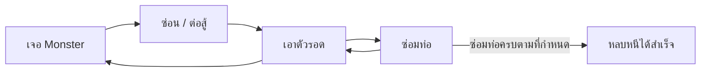
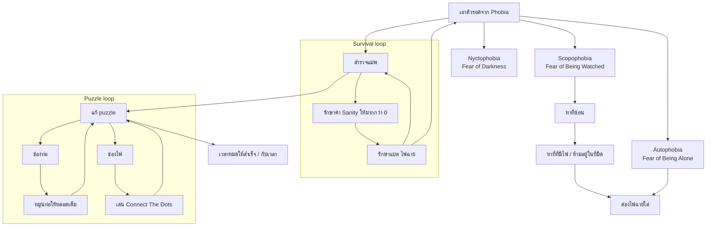
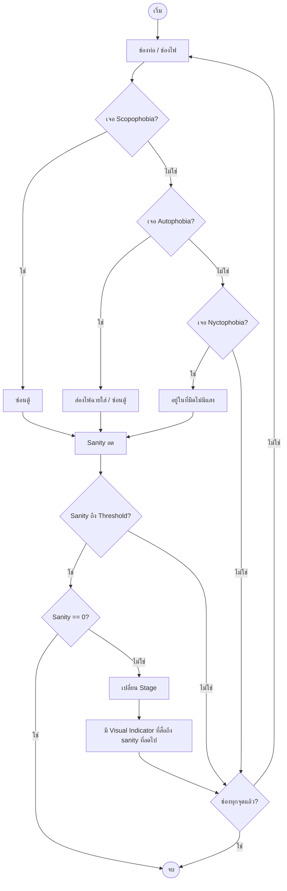

# Imaginophobia — Core Loop & Gameplay

**Version:** 1.2 | **Last Updated:** 2026-10-25

## Core Loop

เจอ Monster → ซ่อน / ต่อสู้ → เอาตัวรอด → ซ่อมท่อ → (ซ่อมครบตามที่กำหนด) → หลบหนีได้สำเร็จ

## Nested Loop (3 ระดับ)

เกมมี loop ซ้อนกันสามชั้น — ชั้นนอกคือการเอาตัวรอดจาก phobia, ชั้นกลางคือการรักษาสภาพตัวเอง, ชั้นในคือการแก้ puzzle

## Flowchart รวม (เงื่อนไขการดำเนินเกม)

## Player Actions

| Action                              | Input                        | Result                                                                 | Notes                                          |
| ----------------------------------- | ---------------------------- | ---------------------------------------------------------------------- | ---------------------------------------------- |
| เดิน                            | `A` / `D`                | ตัวละครเคลื่อนที่ (`MoveSpeed = 250`) — **แกน X เท่านั้น**               | `CharacterAction.Walking`                    |
| ซุ่มเดิน                    | `Left Ctrl` + ทิศทาง | เดินช้าลง (÷ 1.7) และล็อกทิศการหันหน้า   | ไม่เปลี่ยน state — `Sneaking` ถูกถอดออกจาก enum แล้ว |
| เปิด/ปิดไฟฉาย           | `F`                        | เปิด `Spotlight` (Battery ลด 3.5/วินาที) · ระยะสายตา 400px                 | ใช้ส่อง Autophobia ให้หาย         |
| โต้ตอบ / ซ่อน / ซ่อม  | `Space`                    | เข้าตู้ซ่อน · เริ่มมินิเกม · ใช้ประตู | `ReadyToHide` → `Hiding` · `Repairing` |
| มองซ้าย-ขวาขณะซ่อม | `A` / `D`                | เลื่อนกล้อง 400px                                           | `CharacterAction.Checking`                   |
| แอบมองใต้ช่องประตู | `E` (ขณะอยู่ที่ประตู) | เปิด `DoorPeekingScreen` หลังดีเลย์ 1 วินาที | `CharacterAction.Peeking` · ใช้ไม่ได้ในฉาก `tilemap_sewer` (ยังเป็น draft) |
| ออกจากมินิเกม          | `Q`                        | ปิดหน้าจอมินิเกม (progress ถูกบันทึกไว้)   | ใช้กับ Spin The Valve / Connect The Dots / Door Peeking |
| หยุดพัก / ตั้งค่าเสียง | `ESC` (หรือปุ่มมุมขวาบน) | เปิด pause overlay ใน `GameplayScreen` | อ่านผ่าน `GumService.Default.Keyboard` |

> **TBD:** ปุ่มทั้งหมดยังไม่ถูกรวมไว้ที่ `InputManager` — มีแค่ `A` / `D` ที่อยู่ที่นั่น ส่วนที่เหลืออ่านตรงใน `Player.cs`, `CollisionManager.cs` และหน้าจอมินิเกม ควรย้ายมารวมกันก่อนแก้ตารางนี้ให้เป็นทางการ

## Win / Lose Conditions

- **ชนะเมื่อ:** ซ่อมวาล์วครบ 5 จุดตามที่กำหนด แล้วออกจากประตูทางออก (`Destination == "end"` ที่อยู่ในห้องไฟฟ้า 1) สำเร็จ → เปิด `WinScreen`
- **แพ้เมื่อ:**
  - ถูก Autophobia จับได้ (Sanity −10) หรือถูก Scopophobia พุ่งชน (Sanity −25)
  - ค่า Sanity ลดถึง 0 (`SanityState` มี 3 ระดับ: Normal 85 / Anxious 40 / Insane 0) → เปิด `DeathScreen`
  - Nyctophobia — อยู่ในความมืดที่ไฟดับนานเกินไป จน vignette ปิดสนิท (`Sanity = 0`)

> ⚠️ **ค่าที่ต้องตัดสินใจ:** ตัวจับเวลาหลักในโค้ดตั้งไว้ **481 วินาที** และเมื่อหมดเวลาจะเปิด `WinScreen` (ไม่ใช่จอตาย) — ดูเหมือนค่าทดสอบที่ค้างอยู่ ยังไม่มีเอกสารยืนยันว่าดีไซน์ต้องการให้หมดเวลา = ชนะ หรือ = จบรอบแบบแพ้ (ดู [Mechanics](03-mechanics.md#objectives))
> ⚠️ การตายยังไม่มีปุ่มเริ่มรอบใหม่ในจอตาย — ต้องกลับเมนูหลักแล้วกด Start (ปุ่ม Shift 1) อีกครั้ง
> **TBD:** อัตราการลด Sanity ต่อวินาทีและค่า threshold ถูกยืนยันจากโค้ดแล้ว (ดู [Data Schema](../03_Software/03-data-schema.md#6-ค่าปรับแต่งเกม-tuning-values)) แต่ยังไม่ผ่านการทดสอบบาลานซ์

## Related Documents

- Mechanics: [Mechanics](03-mechanics.md)
- Concept: [Game Concept](00-concept.md)
- System Design: [System Design](../03_Software/01-system-design.md)
