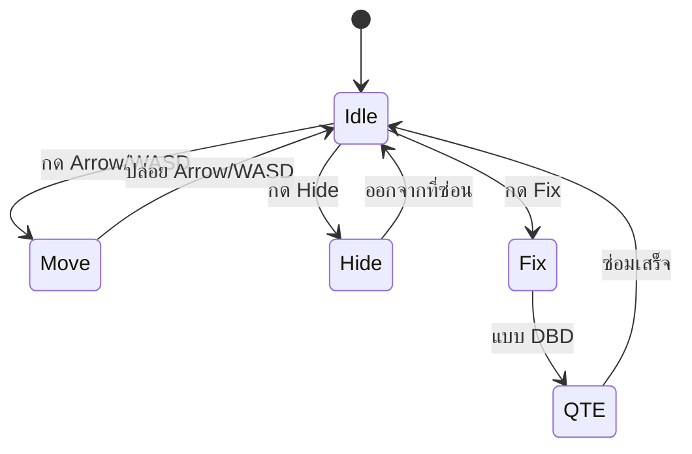

# Imaginophobia — Mechanic Design

**Version:** 1.0 | **Last Updated:** 2026-10-14

## State Diagram

## Rules

| State | เข้าเงื่อนไข | ออกเงื่อนไข | Note |
| ----- | ----------------------------------------------- | ------------------------------------------------------------------- | --------------- |
| Idle  | เริ่มเกม / หยุดเคลื่อนที่ | กด input ใดๆ | Animation loop |
| Move  | กดปุ่มทิศทาง | ปล่อยปุ่ม | Speed = slow |
| Hide  | กด Hide | โดนผลักออก / กดออกจากที่ซ่อน | Have time limit |
| Fix   | กด Fix | ซ่อมไม่สำเร็จหลายครั้ง / ซ่อมสำเร็จ | Have QTE |

สถานะเหล่านี้ตรงกับ `enum CharacterAction` ในโค้ด: `Idle`, `Walking`, `Sneaking`, `ReadyToHide`, `Hiding`, `Repairing`, `Checking`

## Sanity (Mental State)

ค่า Sanity เป็นทรัพยากรหลักที่ผูกกับ "ความกลัว" ของตัวละคร แบ่งเป็น 3 ระดับตาม `enum MentalState`:

| ระดับ | ค่า | ความหมาย |
|---|---|---|
| `Normal` | 75 | ปกติ — มองเห็นได้ตามปกติ |
| `Anxious` | 50 | เริ่มกังวล — ควรมีผลต่อการมองเห็น/ภาพ |
| `Insane` | 25 | สติแตกระดับวิกฤต |

- Sanity ลดลงเมื่อ: เจอ phobia, อยู่ในความมืดนานเกินไป, ซ่อมไม่สำเร็จ
- Sanity ถึง 0 = แพ้
- **Battery** — พลังงานไฟฉาย เป็นทรัพยากรที่สอง หมดแล้วจะอยู่ในความมืด (ซึ่งเร่งการลด Sanity)

> ⚠️ **Known issue จาก Playtest:** ปัจจุบันค่า Sanity ถูกแสดงเป็นตัวเลขแต่ **ยังไม่ส่งผลต่อ gameplay จริง** และผู้ทดสอบบางคนไม่รู้ด้วยซ้ำว่ามีระบบนี้อยู่ — ต้องแก้ (ดู [Scope: Risks](02-scope-features.md#risks--assumptions))

## Phobias (ศัตรู)

แต่ละ phobia ถูกออกแบบโดยนำ "คำอธิบายของความกลัว" มาแปลงเป็นสิ่งที่มองเห็นได้ แล้วใช้ concept นั้นเป็น mechanic โดยตรง — สีดำขาวสไตล์ contrast ให้ความรู้สึกเกินจริง

| Phobia | ความกลัว | ลักษณะที่เห็น | การเกิด | วิธีรับมือ | ไฟล์โค้ด |
|---|---|---|---|---|---|
| **Autophobia** | Fear of Being Alone (กลัวการอยู่โดดเดี่ยว) | เงาร่างดำ | เงาเดินตามผู้เล่น ใช้การ map การเดินพร้อมกับผู้เล่น แต่ **speed มากกว่าผู้เล่น** | หันไปมอง หรือส่องไฟฉายใส่ → เงาหายไป · สุ่มระยะการมองเห็น เมื่อ enemy เดินถึงระยะนั้นจึงมองกลับได้ | `Enemies/Autophobia.cs` |
| **Scopophobia** | Fear of Being Watched (กลัวการถูกมอง) | หนอน/มวลที่มีลูกตาหลายดวง | มีเสียงนำมาก่อน แล้วไฟกระพริบ จะมีเวลาให้ซ่อน จากนั้นเงาจะพุ่งผ่าน | หลบในตู้ให้ทัน · ทำลาย/ซ่อมแสงที่มันทำพัง (จะตามไปแม้เข้า electrical room) | `Enemies/Scopophobia.cs` |
| **Nyctophobia** | Fear of Darkness (กลัวความมืด) | ความมืดที่ขยายตัว | เมื่ออยู่ในพื้นที่มืดนานเกินไป หรือเวลาทำภารกิจหมด | ออกจากความมืด กลับไปที่ที่มีแสง | *(ยังไม่มีคลาส — อยู่ในแผน)* |
| **Claustrophobia** | Fear of Tight Spaces (กลัวที่แคบ) | — (เป็นเงื่อนไข ไม่ใช่ศัตรู) | เมื่อซ่อนในตู้นานเกินไป | ต้องกะ timing การซ่อนให้พอดีกับจังหวะที่ enemy พุ่งผ่าน | *(ยังไม่มีคลาส)* |
| **Entamaphobia** | Fear of Doors (กลัวประตู) | — | **ข้อเสนอใหม่** หลัง playtest | "Peek through door" — กด E เพื่อแอบมองผ่านประตู | *(ยังไม่มีคลาส)* |

**ผลข้างเคียงจาก phobia**
- Autophobia: ลดขนาดแสงรอบตัวและลด Saturation เมื่อเดินชนขอบแสง · มี animation การหลับตาแล้วจึง reset ขนาดแสงและ Saturation
- Scopophobia: จอสั่น (ใช้ `CameraShaker`) และเสียงดังขึ้นเมื่อมันเข้าใกล้

## Minigames

มินิเกมทั้งสามอยู่ใน `Scripts/Screen/` และสืบทอดจาก `Screen` (มี `Update(GameTime)` / `Draw(GameTime)`)

| Minigame | ใช้กับ | วิธีเล่น | รายละเอียด |
|---|---|---|---|
| **Skill Check** | ซ่อมท่อ (pipe) | กด Spacebar เมื่อเข็มชี้ที่แถบสีดำ | ขึ้น UI ทุกครั้งที่กด Spacebar ไม่ว่าสำเร็จหรือไม่ จะสุ่มพื้นที่สำเร็จใหม่และกลับทิศการหมุน |
| **Connect The Dots** | ซ่อมไฟ (electric panel) | เชื่อมจุดตามสี | กระดาน 7×7 (`GridCell` / `GeneratedDotsMap` / `DotsGenerator`) มี panel Puzzle และ Solution — **สถานะ: WORK IN PROGRESS** |
| **Spin The Valve** | หมุนวาล์ว | หมุนวาล์วเพื่อขยับเข็มให้อยู่ในเส้นสีเขียว | ปรับมาจาก Skill Check (`SpinTheValveScreen`) |

> ⚠️ **Known issue จาก Playtest:** มินิเกมได้คะแนนความยาก 4/5 — ยากเกินไป และไม่มี guide สอนวิธีเล่น ทำให้ผู้เล่นใหม่ค้าง

## Hide / Escape

- กด Hide ขณะอยู่ใกล้ตู้ (locker) เพื่อเข้าไปซ่อน
- มีเวลาจำกัด — ซ่อนนานเกินไปจะถูกบังคับออก (Claustrophobia)
- ตู้ซ่อนตัวเป็นทางรับมือหลักของ Scopophobia

## Objectives

- **Repair** — ซ่อมสิ่งของในเวลาที่จำกัด
- **Hide / Escape** — หนีหรือซ่อนจากศัตรู
- **Navigation** — เพิ่มบอร์ด/ป้ายประกาศ เพื่อใช้รับเควส/บอกข้อมูล/นำทางผู้เล่น
- HUD แสดง: `Objective : Fix everything and leave` · `Sanity : 100` · `Battery : 100`

## Related Documents

- Core Loop: [Core Loop](01-core-loop.md)
- Concept: [Game Concept](00-concept.md)
- System Design: [System Design](../03_Software/01-system-design.md)
- Class Diagram: [Class Diagram](../03_Software/02-class-diagram.md)
- Data Schema: [Data Schema](../03_Software/03-data-schema.md)
