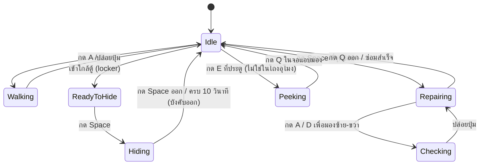

# Imaginophobia — Mechanic Design

**Version:** 3.0 | **Last Updated:** 2026-10-25

> เอกสารนี้อัปเดตจากโค้ดจริงใน `src/Imaginophonia/Imaginophonia/Scripts/` (commit `cf024ef`, 2026-10-24)
> อ้างอิง: [System Design](../03_Software/01-system-design.md) · [Data Schema](../03_Software/03-data-schema.md)

## State Diagram

สถานะของผู้เล่นตรงกับ `enum CharacterAction` ใน `Scripts/CharacterAction.cs`

## Rules

| State | เข้าเงื่อนไข | ออกเงื่อนไข | Note |
| ----- | ----------------------------------------------- | ------------------------------------------------------------------- | --------------- |
| `Idle` | เริ่มเกม / หยุดเคลื่อนที่ | กด input ใด ๆ | Animation loop `idle` (12 เฟรม) |
| `Walking` | กด A / D | ปล่อยปุ่ม | `MoveSpeed = 250` · **เดินได้เฉพาะแกน X** (ไม่มี W/S) |
| *(ไม่เปลี่ยน state)* | กด Left Ctrl ขณะเดิน | ปล่อย Left Ctrl | ความเร็ว ÷ 1.7 · ล็อกทิศทางการหันหน้า · `CurrentAction` ยังเป็น `Walking` (ค่า `Sneaking` ถูกคอมเมนต์ออกจาก enum แล้ว) |
| `ReadyToHide` | เข้าใกล้ collider tag `hideout` | ออกจากพื้นที่ / กด Space | ยังไม่เข้าไปในตู้ |
| `Hiding` | กด Space ขณะ `ReadyToHide` | กด Space ออก / ครบ 10 วินาที | บังคับออกอัตโนมัติ (Claustrophobia) · cooldown 3 วินาทีก่อนซ่อนใหม่ · ระหว่างซ่อนผู้เล่น `SetActive(false)` |
| `Repairing` | กด Space ที่ collider tag `skillcheck` / `dots` | กด Q / ซ่อมสำเร็จ | หยุดการเคลื่อนที่ + ปิดไฟฉาย + `FocusLevel = 1.25` |
| `Checking` | กด A / D ขณะ `Repairing` | ปล่อยปุ่ม | เลื่อนกล้องมองซ้าย-ขวา 400px (lerp 0.1) |
| `Peeking` | กด E ที่ประตู (ยกเว้นฉาก `tilemap_sewer`) | กด Q ในจอ `DoorPeekingScreen` | `FocusLevel = 1.75` · ปิดไฟฉาย · ปุ่มอื่นใช้ไม่ได้ระหว่างแอบมอง |

> **TBD:** ตารางปุ่มจริงยังไม่ครบ — `InputManager` ผูกแค่ `A` / `D` (ทิศทาง) ส่วน `Left Ctrl` (ซุ่ม), `F` (ไฟฉาย), `Space` (interact), `E` (แอบมองประตู), `Q` (ออกมินิเกม) อ่านตรงใน `Player.cs` / `CollisionManager.cs` / หน้าจอมินิเกม และ `ESC` อ่านผ่าน `GumService.Default.Keyboard` ในแต่ละหน้าจอ ควรย้ายมาที่ `InputManager` ให้เป็นที่เดียว

## Sanity (SanityState)

ค่า Sanity เป็นทรัพยากรหลักที่ผูกกับ "ความกลัว" ของตัวละคร เริ่มต้นที่ **100** และแบ่งเป็น 3 ระดับตาม `enum SanityState` (`Scripts/Enums/SanityState.cs`)

| ระดับ | ค่า threshold | ความหมาย | ผลที่เห็น |
|---|---|---|---|
| `Normal` | 85 | ปกติ | vignette ปกติ (`Scale 0.9 × 0.5`, สีดำ) |
| `Anxious` | 40 | เริ่มกังวล | vignette หด (`0.55 × 0.4`) + เสียง `Painting`/`HeartBeat` เริ่มดัง |
| `Insane` | 0 | สติแตกระดับวิกฤต | vignette หดสุด (`0.45 × 0.35`) + เปลี่ยนสีเป็น `#2e0202` + heartbeat วนทุก 10–16 วินาที |

> ⚠️ ค่า threshold ถูกปรับจาก 70/30/0 → **85/40/0** — เอกสารหรือบาลานซ์ที่อ้างค่าเก่าต้องอัปเดต

**อัตราการลด Sanity**

| สาเหตุ | ค่า | ที่มา |
|---|---|---|
| อยู่ในโถงอุโมง (sewer) | 0.5 / วินาที (Normal) · 0.2 (Anxious) · 0 (Insane) | `Player._availableSanityRedectionSpeed` |
| ชน Autophobia | −10 (ครั้งเดียว แล้ว Autophobia หายไป) + จอสีซีด (`MainGame.Saturation = 0`) | `CollisionManager` |
| ถูก Scopophobia พุ่งชน | −25 (ครั้งเดียว แล้ว Scopophobia หายไป) | `CollisionManager` |
| Nyctophobia — อยู่ในพื้นที่ที่ไฟดับ | vignette ปิดลงเรื่อย ๆ จน `Scale` เหลือ 0 → `Sanity = 0` ทันที | `UIManager` |

- **ห้องไฟฟ้าไม่ลด Sanity** — การลดต่อวินาทีผูกกับฉาก sewer เท่านั้น (ตรงกับ tip ใน Death screen)
- Sanity ถึง 0 = แพ้ → `MainGame.ScreenManager.ReplaceScreen(new DeathScreen())` (ไม่มี restart ในรอบเดิม — ต้องกลับเมนูแล้วเริ่มใหม่)
- **Battery** — พลังงานไฟฉาย เริ่ม 100 ลด 3.5 / วินาทีขณะเปิดไฟฉาย หมดแล้วเปิดไม่ได้ (ต้องอยู่ในความมืด ซึ่งเร่งการลด Sanity) · ขณะเปิดไฟฉาย ระยะสายตา (`EyeSight`) ยาว 400px

> ⚠️ **Known issue จาก Playtest:** ผู้ทดสอบบางคนไม่รู้ด้วยซ้ำว่ามีระบบนี้อยู่ — HUD ปัจจุบันเป็นแถบสี (เขียว/เหลือง/แดง) ไม่มีตัวเลข ต้องทำให้ชัดขึ้น (ดู [Scope: Risks](02-scope-features.md#risks--assumptions))

## Phobias (ศัตรู)

แต่ละ phobia ถูกออกแบบโดยนำ "คำอธิบายของความกลัว" มาแปลงเป็นสิ่งที่มองเห็นได้ แล้วใช้ concept นั้นเป็น mechanic โดยตรง — สีดำขาวสไตล์ contrast ให้ความรู้สึกเกินจริง

| Phobia | ความกลัว | ลักษณะที่เห็น | การเกิด | วิธีรับมือ | ไฟล์โค้ด |
|---|---|---|---|---|---|
| **Autophobia** | Fear of Being Alone (กลัวการอยู่โดดเดี่ยว) | เงาร่างดำ (spritesheet เดียวกับผู้เล่น ย้อมดำ) | สุ่ม spawn ในโถงอุโมงทุก **4.96 วินาที** (โอกาส 20/40/55% ตามสติ) · เดินเข้าหาผู้เล่นด้วย `MoveSpeed = 400` (เร็วกว่าผู้เล่นที่ 250) · หายเองใน 28 วินาที | หันไปมอง (แนวสายตา `EyeSight` ตัดกับตัวมัน) → กระพริบตาแล้วมันหายไป · เดินชน = Sanity −10 | `Enemies/Autophobia.cs` |
| **Scopophobia** | Fear of Being Watched (กลัวการถูกมอง) | หนอน/มวลที่มีลูกตาหลายดวง | สุ่ม spawn ทุก **4.98 วินาที** (โอกาส 5/12/20%) · มีเสียงนำ (inner 600 / outer 15000) + ไฟทุกดวงกลายเป็นสีแดง (`LightManager.ScopoAlarmAll`) + จอดำ 1 วินาที · รอ 8 วินาทีก่อนเริ่มพุ่ง · หายเองใน 15 วินาที | หลบในตู้ให้ทัน · ไฟที่มันแตะจะดับและนับ `LightBrokeCount` (ครบ 12 = ไม่นับว่ายัง active) · ซ่อมไฟที่ห้องไฟฟ้าเพื่อคืนแสง | `Enemies/Scopophobia.cs` |
| **Nyctophobia** | Fear of Darkness (กลัวความมืด) | ความมืดที่ขยายตัวกลืนจอ (vignette, `Softness = 15`) | เมื่อผู้เล่นยืนใน `LightArea` ที่ไฟดับ (`On == false` และไม่กำลัง flicker) | ออกจากความมืด กลับไปที่ที่มีแสง — flag `Nyctophobia` ถูกล้างทุกเฟรมแล้วคำนวณใหม่ | `Enemies/Nyctophobia.cs` (marker class) + `LightArea` + `UIManager` |
| **Claustrophobia** | Fear of Tight Spaces (กลัวที่แคบ) | — (เป็นเงื่อนไข ไม่ใช่ศัตรู) | ซ่อนในตู้นานเกิน 10 วินาที | ถูกบังคับออกจากตู้อัตโนมัติ + cooldown 3 วินาทีก่อนซ่อนใหม่ | *(ไม่มีคลาส — อยู่ใน `Player.ToggleHide`)* |
| **Entamaphobia** | Fear of Doors (กลัวประตู) | ร่างสูงผอมสีดำ หน้าเบี้ยว มีมือและขายาวผิดสัดส่วน | **ยังไม่ทำงาน** — มีคลาส `Enemies/Entamaphobia.cs` เป็น stub, `SpawnEntamaphobia()` ไม่ถูกเรียกจาก timer ไหน และยังไม่มี asset | "Peek through door" — กด `E` แอบมองใต้ช่องประตู (มี `DoorPeekingScreen` เป็น draft) | `Enemies/Entamaphobia.cs` (stub) |

**ผลข้างเคียงจาก phobia**

- Autophobia: ชนแล้วทั้ง Sanity −10 และทั้งเฟรมกลายเป็นขาวดำ (`MainGame.Saturation = 0`) แล้วค่อย ๆ กลับเป็นสีปกติใน ~3.3 วินาที
- Scopophobia: ไฟในฉากเปลี่ยนเป็นสีแดง + จอดำตอนมันเกิด · ระหว่างที่มันยัง active ประตูจะเปิดไม่ได้ (เล่นเสียง `DoorStuck`)
- Nyctophobia เกิด → ไฟทุกดวงในฉากกระพริบ 3 วินาทีแล้วดับถาวร (`LightManager.NyctoAlarmAll`) + save ของห้องไฟฟ้าถูกรีเซ็ต
- Enemy ทุกตัวชนกับ `LightArea`: Autophobia ทำให้ไฟ **กระพริบ** (`StartFlicker`) ส่วน Scopophobia ทำให้ไฟ **ดับ** (`TurnOff`)

---

### Entamaphobia — รายละเอียดคอนเซปต์

> **ที่มา:** ข้อเสนอใหม่หลังผล playtest (ดู [standup week 14](../04_Agile/standups/standup-week-14.md)) — คอนเซปต์ฉบับเต็มอยู่ในไฟล์ `entamaphobia concept.pdf`
> **สถานะ:** มีคลาสเป็น stub ในโค้ดแล้ว (`Enemies/Entamaphobia.cs`) แต่ยังไม่มี asset และยังไม่ถูก spawn — เป็นข้อเสนอที่ต้อง implement

**Concept — รูปกาย**

ร่างของความกลัวประตู หน้าตาเหมือน **ผีที่ยืนอยู่หลังตู้เสื้อผ้าที่ปิดอยู่** ตามจินตนาการตอนเด็ก — สูงมาก ผอมผิดปกติ หน้าเบี้ยว มีมือและขาใหญ่ยาว ให้ความรู้สึกว่า "ตัวมันใหญ่จนไม่น่าใส่ในที่แคบได้ แต่ก็ใส่ได้" (ตัวใหญ่กว่าผู้เล่นหลายเท่า — ดูภาพ size comparison ในไฟล์คอนเซปต์)

**Behavior**

- จะพยายามตามหาผู้เล่น
- คนที่เป็น Entamaphobia ไม่ได้กลัว *ประตู* แต่กลัว **"สิ่งที่อยู่หลังประตู"** ซึ่งมักเป็นผู้บุกรุกหรือผี
- **กลัวแสง — เข้าห้องที่มีแสงไม่ได้**

**Encounter**

- เกิดในโถงอุโมง (sewer) **ขณะที่ผู้เล่นอยู่ในห้องไฟฟ้าห้องใดห้องหนึ่ง** แล้วรอโจมตี
- มันจะเริ่มพึมพำ (mumbling) อยู่หน้าประตู — ถ้าเปิดประตูออกโดยไม่ตรวจสอบก่อน จะถูกโจมตี

**5 ระยะ (Stage 0–4)** — 0 คือยังไม่เกิด, 1 น้อยที่สุด, 4 อันตรายที่สุด

| Stage | สิ่งที่เห็น | คำอธิบาย |
|---|---|---|
| **0** | ด้านนอกว่างเปล่า | **It** ยังไม่เกิด |
| **1** | เห็นแค่ขา | **It** เกิดแล้ว ยืนอยู่หน้าประตู หันหน้าเข้าหาผู้เล่น เอนตัวลงมาที่ช่องประตู |
| **2** | เห็นมือกดที่ช่องประตู | **It** พยายามดันมือผ่านช่องประตูเข้ามา ใกล้ขึ้นจนมองไม่เห็นเท้าแล้ว |
| **3** | เห็นมือบีบผ่านช่อง | **It** กำลังพยายามบีบตัวผ่านช่องประตู ใกล้ขึ้นอีก |
| **4** | เห็นหน้า | **It** กำลังมองผู้เล่นอยู่ |

**กลไกการเกิดและเลื่อนระยะ**

- มีโอกาสเกิด ~**10% ทุก 5 วินาที** (ค่าที่ตั้งไว้ใน `EnemyManager`: interval 5 วินาที · chance 10/50/65 ตามสติ)
- เมื่อเกิดแล้ว ค่าหนึ่งจะเพิ่มขึ้นเรื่อย ๆ จนถึงค่าสูงสุดที่สุ่มไว้ — ถ้าถึงค่าสูงสุด **It** จะเลื่อน stage ขึ้น
- stage ที่สูงขึ้นมีค่าสูงสุดที่สุ่มได้สูงกว่า → ใช้เวลานานขึ้นในการเลื่อน stage ถัดไป
- **โอกาสเกิดและค่าสูงสุดได้รับผลจาก sanity state**

**วิธีรับมือ (Solution)**

- **แอบมองใต้ช่องประตู** (ปุ่ม `E` — ผูกใน `CollisionManager` แล้ว) แล้ว **ส่องไฟฉาย** — จะรู้ว่ามันอยู่ตรงนั้นหรือไม่
- เมื่อมันหายไปแล้วให้มี **cooldown** เพื่อไม่ให้มันเกิดกลับมาทันทีที่เปิดประตู
- ระหว่างแอบมอง **ค่าการเพิ่ม stage จะหยุดชั่วคราว**
- ถ้าส่องไฟฉายใส่ **It** ค่าจะรีเซ็ตกลับเป็น 0
- ถ้าส่องไฟฉายต่อเนื่องเป็นระยะเวลาหนึ่ง stage จะ **ลดลง** จนถึง 0 → **It** หายไป + เริ่ม cooldown ก่อนจะเกิดใหม่ได้
- ทุกครั้งที่ stage ลดลง **จอจะพัลส์เป็นสีดำ**
- stage ที่สูงกว่าจะใช้เวลาส่องไฟฉายนานขึ้นกว่าจะลด stage — อย่าปล่อยให้มันเลื่อน stage เลย
- **เวลาที่ใช้ส่องไฟฉายไม่ได้รับผลจาก sanity state**

**Inspirations:** Mandela Catalogue · SCP-096 · Kitty Backrooms · จินตนาการของผู้เขียน

> **TBD:** ค่าตัวเลขทั้งหมด (โอกาสเกิด, ช่วงของค่าสูงสุด, cooldown, เวลาส่องไฟฉายต่อ stage) ยังเป็นข้อเสนอ — ต้องตัดสินใจและย้ายไปไว้ใน data file ตาม [Data Schema](../03_Software/03-data-schema.md)
> **TBD:** `DoorPeekingScreen` ปัจจุบันวาดแค่สี่เหลี่ยมสีเขียว (`Draw` ยังไม่มีอาร์ต) — ต้องทำ UI แอบมองจริงก่อน mechanic นี้จะเล่นได้

---

## Minigames

มินิเกมที่ใช้จริงอยู่ใน `Scripts/Screen/` และสืบทอดจาก `Screen` ของ MonoGame.Extended (มี `Update(GameTime)` / `Draw(GameTime)`)

| Minigame | ใช้กับ | Trigger tag | วิธีเล่น | รายละเอียด |
|---|---|---|---|---|
| **Spin The Valve** | ซ่อมวาล์ว/ท่อ (pipe) | `skillcheck` | กดเมาส์ค้างในระยะวาล์วแล้วลากเป็นวงกลม ให้เข็มอยู่ในเส้นสีเขียว | เป้าหมาย 5 วาล์ว (`ObjectiveManager.TargetValves`) · progress 0–200 (โซนเขียว +20/วินาที, โซนแดง/เหลือง −35/−15) · เข็มสุ่มความเร็วใหม่ทุก 5 วินาที · `SpinTheValveScreen.cs` |
| **Connect The Dots** | ซ่อมไฟ (electric panel) | `dots` | ลากเมาส์เชื่อมจุดสีเดียวกันให้ครบทุกคู่ | กระดาน **6×6** (`GridCell` / `GeneratedDotsMap` / `DotsGenerator`) · สูงสุด 5 สีจาก 6 สี · ทำครบ 5 รอบ (`_maxRepairStage`, รอบละ +40) จึงเต็ม · คลิกขวา = ล้างเส้นที่ลากไว้ · ซ่อมสำเร็จแล้ว `SaveManager.TurnAllLightsOn()` · `ConnectTheDotsScreen.cs` |
| **Door Peeking** | แอบมองใต้ช่องประตู | `door` (ปุ่ม `E`) | — | **draft** — `DoorPeekingScreen.cs` วาดแค่สี่เหลี่ยมสีเขียว ยังไม่มี mechanic จริง |
| **Skill Check** | *(ไม่ได้ใช้แล้ว)* | — | กด Spacebar เมื่อเข็มชี้ที่แถบสำเร็จ | `Scraped/SkillCheckScreen.cs` **ไม่มีที่ไหนเรียกใช้** และ asset ที่อ้างถึงไม่มีในโปรเจกต์ (ดู [System Design § 14](../03_Software/01-system-design.md#14-known-issues--technical-debt)) |

> ⚠️ **Known issue จาก Playtest:** มินิเกมได้คะแนนความยาก 4/5 — ยากเกินไป และไม่มี guide สอนวิธีเล่น ทำให้ผู้เล่นใหม่ค้าง (แก้บางส่วนแล้วด้วยระบบ tutorial — ดูหัวข้อ Objectives)

## Hide / Escape

- กด Space ขณะอยู่ใกล้ตู้ (locker) เพื่อเข้าไปซ่อน — ผู้เล่นจะถูกย้ายไปที่กลาง collider ของตู้ และถูก `SetActive(false)` (ศัตรูผ่านไปได้)
- ซ่อนได้นาน **10 วินาที** แล้วถูกบังคับออกอัตโนมัติ (`Time.AddTimer(ToggleHide, 10, "hideTime")` — Claustrophobia) · ออกแล้ว cooldown **3 วินาที** ก่อนซ่อนใหม่
- ระหว่างซ่อน กล้องซูมเข้า (`FocusLevel = 1.25`) และ vignette หด (`0.375 × 0.175`)
- ตู้ซ่อนตัวเป็นทางรับมือหลักของ Scopophobia · ประตูจะเปิดไม่ได้ (`DoorStuck`) ระหว่างที่ Scopophobia ยัง active

## Objectives

- **Repair** — ซ่อมวาล์ว 5 จุดในโถงอุโมง (`ObjectiveManager.TargetValves = 5`) และซ่อมแผงไฟในห้องไฟฟ้า
- **Hide / Escape** — หนีหรือซ่อนจากศัตรู
- **Navigation** — ประตู (`LoadNextScene`) พาไปฉากถัดไป · ประตูทางออกในห้องไฟฟ้า (`Destination == "end"`) ใช้ได้เมื่อซ่อมวาล์วครบเท่านั้น
- **Tutorial** — `TutorialManager` อ่าน `Content/Datas/tutorial.json` แสดงข้อความทีละขั้นตาม objective ที่ทำสำเร็จ (10 ขั้น ตั้งแต่ "Press A/D to walk around" จนถึง "Thank you for playing")
- HUD แสดง: แถบ Sanity (สีเปลี่ยนตามระดับ) · แถบ Battery · ตัวนับวาล์ว (`Valves repaired: n/5` — แสดงหลังเข้าฉาก sewer) · ตัวจับเวลา (`MainTimer`)

**เงื่อนไขการดำเนินเกม**

| เหตุการณ์ | สิ่งที่เกิดขึ้น |
|---|---|
| ซ่อมวาล์วครบ 5 แล้วออกประตู `end` ในห้องไฟฟ้า | `Complete("exit-ladder")` → **`WinScreen`** |
| ออกประตู `end` ทั้งที่วาล์วยังไม่ครบ | ข้อความ "I still have work to do." 2 วินาที (ไม่จบเกม) |
| Sanity ถึง 0 | **`DeathScreen`** |
| หมดเวลา 481 วินาที (`MainTimer`) | **`WinScreen`** ← ⚠️ ค่าสงสัย ดูหมายเหตุ |

> ⚠️ **ค่าที่ต้องตัดสินใจ:** `MainTimer = 481 วินาที` และเมื่อหมดเวลาจะเปิด `WinScreen` (ไม่ใช่ Lose/Death) — ดูเหมือนค่าทดสอบที่ค้างอยู่ในโค้ด ต้องยืนยันว่าดีไซน์คือ "หมดเวลา = แพ้/จบรอบ" หรือ "หมดเวลา = รอด" แล้วแก้ให้ตรง
> ⚠️ การตายยังไม่มีเส้นทางเริ่มรอบใหม่ (`GameManager.Restart()` ไม่ถูกเรียกแล้ว) — ต้องกลับเมนูแล้วกด Start ใหม่

## Related Documents

- Core Loop: [Core Loop](01-core-loop.md)
- Concept: [Game Concept](00-concept.md)
- Narrative (phobia เป็นตัวละคร): [Narrative](07-narrative.md)
- Art Direction (การออกแบบ phobia): [Art Direction](08-art-direction.md)
- System Design: [System Design](../03_Software/01-system-design.md)
- Class Diagram: [Class Diagram](../03_Software/02-class-diagram.md)
- Data Schema: [Data Schema](../03_Software/03-data-schema.md)
