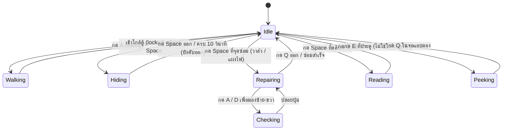

# Imaginophobia — Mechanic Design

**Version:** 4.0 (Release 1.0.0) | **Last Updated:** 2026-11-02

> เอกสารนี้อัปเดตจากโค้ดจริงใน `src/Imaginophobia/Imaginophobia/Scripts/` (HEAD `3a300ec`, 2026-11-02)
> อ้างอิง: [System Design](../03_Software/01-system-design.md) · [Data Schema](../03_Software/03-data-schema.md)

## State Diagram

สถานะของผู้เล่นตรงกับ `enum CharacterAction` ใน `Scripts/Enums/CharacterAction.cs`
(`Repairing` · `Checking` · `Reading` · `Peeking` · `Hiding` · `Walking` · `Idle`)

## Rules

| State                            | เข้าเงื่อนไข                                       | ออกเงื่อนไข                     | Note                                                                                                                                                                                      |
| -------------------------------- | -------------------------------------------------------------- | ------------------------------------------ | ----------------------------------------------------------------------------------------------------------------------------------------------------------------------------------------- |
| `Idle`                         | เริ่มเกม / หยุดเคลื่อนที่                | กด input ใด ๆ                         | Animation loop `idle` (12 เฟรม)                                                                                                                                                     |
| `Walking`                      | กด A / D                                                     | ปล่อยปุ่ม                         | `MoveSpeed = 250` · **เดินได้เฉพาะแกน X** (ไม่มี W/S)                                                                                                        |
| *(ไม่เปลี่ยน state)* | กด Left Ctrl ขณะเดิน                                  | ปล่อย Left Ctrl                       | ความเร็ว ÷ 1.7 · ล็อกทิศทางการหันหน้า ·`CurrentAction` ยังเป็น `Walking` (enum ไม่มีค่า `Sneaking`) |
| `Hiding`                       | กด Space ขณะ collider ทับ trigger tag `hideout` (ตู้)     | กด Space ออก / ครบ 10 วินาที | ก่อนเข้า ตำแหน่งเดิมถูกเก็บใน `PreviousPos` และผู้เล่นถูกย้ายไปกลาง collider · บังคับออกอัตโนมัติ · cooldown 3 วินาทีก่อนซ่อนใหม่ · ระหว่างซ่อนผู้เล่น `SetActive(false)`                     |
| `Repairing`                    | กด Space ที่ collider tag `skillcheck` (วาล์ว) / `dots` (แผงไฟ)       | กด Q / ซ่อมสำเร็จ              | หยุดการเคลื่อนที่ + ปิดไฟฉาย +`FocusLevel = 1.25`                                                                                                              |
| `Checking`                     | กด A / D ขณะ `Repairing`                                | ปล่อยปุ่ม                         | เลื่อนกล้องมองซ้าย-ขวา 400px (tween 0.5 วินาที · กลับ 2.5 วินาที) · ระหว่างนี้มินิเกมหยุดรับ input (`MinigameActive = false`)                                                              |
| `Reading`                      | กด Space ที่ collider tag `report` (คลิปบอร์ด)      | กด Q ออก                              | `FocusLevel = 1.25` · ปิดไฟฉาย · ระหว่างอ่าน `MainTimer` และ `EntamaSpawnTimer` ถูก pause                                                                                 |
| `Peeking`                      | กด E ที่ประตู (ยกเว้นฉาก `tilemap_sewer`) | กด Q ในจอ `DoorPeekingScreen`      | `FocusLevel = 1.75` · ปิดไฟฉาย · ระหว่างแอบมองค่าความคืบหน้าของ Entamaphobia หยุดเพิ่ม ลดได้เมื่อเปิดไฟฉาย                 |

## Sanity (SanityState)

ค่า Sanity เป็นทรัพยากรหลักที่ผูกกับ "ความกลัว" ของตัวละคร เริ่มต้นที่ **100** และแบ่งเป็น 3 ระดับตาม `enum SanityState` (`Scripts/Enums/SanityState.cs`)

| ระดับ  | ค่า threshold | ความหมาย                 | ผลที่เห็น                                                                                                         |
| ----------- | ---------------- | -------------------------------- | -------------------------------------------------------------------------------------------------------------------------- |
| `Normal`  | 80               | ปกติ                         | vignette ปกติ (`Scale 0.9 × 0.5`, สีดำ) · แถบ HUD สีขาว                                                                         |
| `Anxious` | 40               | เริ่มกังวล             | vignette หด (`0.55 × 0.4`, tween 3 วินาที) + แถบ HUD `#a89e6c` + เสียง `Painting` เริ่มดัง (volume 0.025, วนทุก 20–26 วินาที)                                   |
| `Insane`  | 0                | สติแตกระดับวิกฤต | vignette หดสุด (`0.45 × 0.35`, tween 2 วินาที) + เปลี่ยนสีเป็น `#2e0202` + แถบ HUD `#752d22` + `HeartBeat` วนทุก 10–16 วินาที |

**อัตราการลด Sanity**

| สาเหตุ                                              | ค่า                                                                                                    | ที่มา                                |
| --------------------------------------------------------- | --------------------------------------------------------------------------------------------------------- | ----------------------------------------- |
| อยู่ในโถงอุโมง (sewer)                      | 0.5 / วินาที (Normal) · 0.2 (Anxious) · 0 (Insane)                                                | `Player._availableSanityRedectionSpeed` |
| ชน Autophobia                                           | −10 (ครั้งเดียว แล้ว Autophobia หายไป) + จอสีซีด (`MainGame.ScreenManager.Saturation = 0`) | `CollisionManager`                      |
| ถูก Scopophobia พุ่งชน                           | −25 (ครั้งเดียว แล้ว Scopophobia หลบไป)                                               | `CollisionManager`                      |
| Entamaphobia ถูกไล่ไปจนหาย (ตอนเปิดประตู)  | −25 / −30 / −35 / −40 ตาม stage ที่มันไปถึงก่อนหาย                                     | `Entamaphobia.OnDestroyed`              |
| Nyctophobia — อยู่ในพื้นที่ที่ไฟดับ | vignette ปิดลงเรื่อย ๆ (25 วินาที) จน `Scale` เหลือ 0 → `Sanity = 0` ทันที               | `UIManager`                             |
| หมดเวลาหลัก (721 วินาที)                    | `Sanity = 0` ทันที                                                                              | `GameManager` → `Player.Dead()`         |

- **ห้องไฟฟ้าไม่ลด Sanity** — การลดต่อวินาทีผูกกับฉาก sewer เท่านั้น (ตรงกับ tip ใน Death screen)
- Sanity ถึง 0 = แพ้ → `MainGame.ScreenManager.ClearScreens(new DeathScreen(), 0, 2, 1)` และตั้ง `GameState = Lose` (ไม่มี restart ในรอบเดิม — ต้องกลับเมนูแล้วเริ่มใหม่)
- **Battery** — พลังงานไฟฉาย เริ่ม 100 ลด 1 / วินาทีขณะเปิดไฟฉาย หมดแล้วเปิดไม่ได้ (ต้องอยู่ในความมืด ซึ่งเร่งการลด Sanity) · ขณะเปิดไฟฉาย ระยะสายตา (`EyeSight`) ยาว 400px
- `Player.CheckSanityStage()` ตรวจทุกเฟรมและยิง event `SanityStateChanged` เฉพาะตอน**เปลี่ยนระดับ** — `UIManager` และ `EnemyManager` ผูกกับ event นี้

## Phobias (ศัตรู)

แต่ละ phobia ถูกออกแบบโดยนำ "คำอธิบายของความกลัว" มาแปลงเป็นสิ่งที่มองเห็นได้ แล้วใช้ concept นั้นเป็น mechanic โดยตรง — สีดำขาวสไตล์ contrast ให้ความรู้สึกเกินจริง

`EnemyManager` สร้าง timer 4 ตัวใน constructor และ **pause ไว้ทั้งหมด** จากนั้นเปิด/ปิดตามฉากใน `Update`:

| ฉาก | timer ที่ทำงาน | timer ที่ pause |
| --- | --- | --- |
| `tilemap_sewer` | `ScopoSpawnTimer` · `AutoSpawnTimer` · `NyctoSpawnTimer` | `EntamaSpawnTimer` |
| ฉากอื่น (ห้องไฟฟ้า) | `EntamaSpawnTimer` | `ScopoSpawnTimer` · `AutoSpawnTimer` · `NyctoSpawnTimer` |

| Phobia                   | ความกลัว                                                | ลักษณะที่เห็น                                                                       | การเกิด                                                                                                                                                                                                                                                                                                      | วิธีรับมือ                                                                                                                                                                                         | ไฟล์โค้ด                                                          |
| ------------------------ | --------------------------------------------------------------- | ------------------------------------------------------------------------------------------------ | ------------------------------------------------------------------------------------------------------------------------------------------------------------------------------------------------------------------------------------------------------------------------------------------------------------------- | ------------------------------------------------------------------------------------------------------------------------------------------------------------------------------------------------------------ | ------------------------------------------------------------------------- |
| **Autophobia**     | Fear of Being Alone (กลัวการอยู่โดดเดี่ยว) | เงาร่างดำ (spritesheet เดียวกับผู้เล่น ย้อมดำ)                     | สุ่ม spawn ในโถงอุโมงทุก**4.96 วินาที** (โอกาส 20/40/55% ตามสติ) · เกิดจากขอบ world bound ห่างออกไป 100–500px (แกน Y ตามตำแหน่งผู้เล่น หรือ `PreviousPos` ถ้ากำลังซ่อน) · เดินเข้าหาผู้เล่นด้วย `MoveSpeed = 400` (เร็วกว่าผู้เล่นที่ 250) · หายเองใน 28 วินาที                                                           | หันไปมอง (แนวสายตา `EyeSight` ตัดกับตัวมัน) → กระพริบตาแล้วมันหายไป · เดินชน = Sanity −10                                                        | `Enemies/Autophobia.cs`                                                 |
| **Scopophobia**    | Fear of Being Watched (กลัวการถูกมอง)             | หนอน/มวลที่มีลูกตาหลายดวง                                                | สุ่ม spawn ทุก**4.98 วินาที** (โอกาส 5/12/20%) · มีเสียงนำ (`ScopoIndicator` inner 5000 / outer 26500) + ไฟทุกดวงกลายเป็นสีแดง (`LightManager.ScopoAlarmAll`) + จอดำ 1 วินาที + รีเซ็ต save ของห้องไฟฟ้าทั้งสอง · รอ 8 วินาทีก่อนเริ่มพุ่ง (`MoveSpeed = 5000`) · ครบ 16 วินาทีแล้วหายเอง | หลบในตู้ให้ทัน · ไฟที่มันแตะจะดับและนับ `LightPassedCount` (ครบ 12 = ไม่นับว่ายัง active) · ซ่อมไฟที่ห้องไฟฟ้าเพื่อคืนแสง | `Enemies/Scopophobia.cs`                                                |
| **Nyctophobia**    | Fear of Darkness (กลัวความมืด)                      | ความมืดที่ขยายตัวกลืนจอ (vignette,`Softness = 15`)                      | timer ทุก**29.95 วินาที** (โอกาส 35/50/65%) แต่จะเกิดจริงเฉพาะเมื่อผู้เล่นยืนใน `LightArea` ที่ไฟดับ (`On == false` และไม่กำลัง flicker)                                                                                                                                                                                                  | ออกจากความมืด กลับไปที่ที่มีแสง — flag `Nyctophobia` ถูกล้างทุกเฟรมแล้วคำนวณใหม่ · ระหว่างความมืดค้าง vignette จะหดลง 25 วินาทีจนครบ = สติ 0 | `Enemies/Nyctophobia.cs` (marker class) + `LightArea` + `UIManager` |
| **Claustrophobia** | Fear of Tight Spaces (กลัวที่แคบ)                    | — (เป็นเงื่อนไข ไม่ใช่ศัตรู)                                             | ซ่อนในตู้นานเกิน 10 วินาที                                                                                                                                                                                                                                                                    | ถูกบังคับออกจากตู้อัตโนมัติ + cooldown 3 วินาทีก่อนซ่อนใหม่                                                                                                     | *(ไม่มีคลาส — อยู่ใน `Player.ToggleHide`)*            |
| **Entamaphobia**   | Fear of Doors (กลัวประตู)                             | ร่างสูงผอมสีดำ หน้าเบี้ยว มีมือและขายาวผิดสัดส่วน | timer ทุก**3.97 วินาที** (โอกาส 15/20/25%) เฉพาะตอนอยู่ **นอก** ฉาก sewer · ไม่เกิดถ้ามี cooldown, มีตัวเก่าอยู่แล้ว, หรือผู้เล่นกำลัง `Peeking` / `Reading` | กด `E` แอบมองใต้ช่องประตูแล้วส่องไฟฉาย (ดูหัวข้อถัดไป) · เปิดประตูขณะมัน active = jumpscare + Sanity ลดตาม stage | `Enemies/Entamaphobia.cs`                                        |

**ผลข้างเคียงจาก phobia**

- Autophobia: ชนแล้วทั้ง Sanity −10 และทั้งเฟรมกลายเป็นขาวดำ (`Saturation = 0`) แล้วค่อย ๆ กลับเป็นสีปกติ (+0.3/วินาที ≈ 3.3 วินาที)
- Scopophobia: ไฟในฉากเปลี่ยนเป็นสีแดง + จอดำตอนมันเกิด · ระหว่างที่มันยัง active (และ `LightPassedCount < 12`) ประตูจะเปิดไม่ได้ (เล่นเสียง `DoorStuck`)
- Nyctophobia เกิด → ไฟทุกดวงในฉากกระพริบ 3 วินาทีแล้วดับถาวร (`LightManager.NyctoAlarmAll`) + save ของห้องไฟฟ้าทั้งสองถูกรีเซ็ต
- Enemy ทุกตัวชนกับ `LightArea`: Autophobia ทำให้ไฟ **กระพริบ** (`StartFlicker`, 1.5 วินาที) ส่วน Scopophobia ทำให้ไฟ **ดับ** (`TurnOff`) แล้วนับ `LightPassedCount++`
- **Scopophobia แบบบังคับ:** เมื่อผู้เล่นซ่อมวาล์วครบ 5 (`ObjectiveManager.AllValvesRepaired`) `EnemyManager` จะเรียก `ForceSpawnScopophobia()` หนึ่งครั้งต่อรอบเล่น

---

### Entamaphobia

> **ที่มา:** ข้อเสนอใหม่หลังผล playtest (ดู [standup week 14](../04_Agile/standups/standup-week-14.md))

**Concept — รูปกาย**

ร่างของความกลัวประตู หน้าตาเหมือน **ผีที่ยืนอยู่หลังตู้เสื้อผ้าที่ปิดอยู่** ตามจินตนาการตอนเด็ก — สูงมาก ผอมผิดปกติ หน้าเบี้ยว มีมือและขาใหญ่ยาว ให้ความรู้สึกว่า "ตัวมันใหญ่จนไม่น่าใส่ในที่แคบได้ แต่ก็ใส่ได้"

**Behavior**

- จะพยายามตามหาผู้เล่น
- คนที่เป็น Entamaphobia ไม่ได้กลัว *ประตู* แต่กลัว **"สิ่งที่อยู่หลังประตู"** ซึ่งมักเป็นผู้บุกรุกหรือผี
- **กลัวแสง — เข้าห้องที่มีแสงไม่ได้**

**Encounter**

- เกิดในโถงอุโมง (sewer) **ขณะที่ผู้เล่นอยู่ในห้องไฟฟ้าห้องใดห้องหนึ่ง** (timer ของมันทำงานเฉพาะตอนอยู่นอก sewer) แล้วรออยู่หน้าประตู
- มันจะเริ่มพึมพำ (mumbling, `EntamaPresence`) อยู่หน้าประตู — ถ้าเปิดประตูออกโดยไม่ตรวจสอบก่อน จะถูกโจมตี

**5 ระยะ (Stage 0–4)** — 0 คือยังไม่เกิด, 1 น้อยที่สุด, 4 อันตรายที่สุด
stage ถูกเก็บลง `Trigger.Progress` ของประตูนั้น (`_door.Progress = _stage`) ทำให้ `DoorPeekingScreen` เลือกภาพ `entama_stage_{progress}` ได้ตรงกับสถานะจริง

| Stage       | สิ่งที่เห็น                     | คำอธิบาย                                                                                                                                     |
| ----------- | ------------------------------------------ | ---------------------------------------------------------------------------------------------------------------------------------------------------- |
| **0** | ด้านนอกว่างเปล่า           | **It** ยังไม่เกิด — `SetActive(false)` แล้วถูกลบออกจาก `EnemyManager`                                                                                                                    |
| **1** | เห็นแค่ขา                         | **It** เกิดแล้ว ยืนอยู่หน้าประตู หันหน้าเข้าหาผู้เล่น เอนตัวลงมาที่ช่องประตู |
| **2** | เห็นมือกดที่ช่องประตู | **It** พยายามดันมือผ่านช่องประตูเข้ามา ใกล้ขึ้นจนมองไม่เห็นเท้าแล้ว                 |
| **3** | เห็นมือบีบผ่านช่อง       | **It** กำลังพยายามบีบตัวผ่านช่องประตู ใกล้ขึ้นอีก (+ เริ่มเล่น `EntamaPresence` วนซ้ำ)                                                     |
| **4** | เห็นหน้า                           | **It** กำลังมองผู้เล่นอยู่ (เพิ่มเสียง `EntamaPresence` เป็น 0.75)                                                                                                  |

**กลไกการเกิดและเลื่อนระยะ**

- โอกาสเกิดจาก `EnemyManager`: interval **3.97 วินาที** · chance **15 / 20 / 25** ตามระดับสติ (Normal / Anxious / Insane)
- ตัวมันไม่เกิดซ้ำระหว่างที่มีตัวเก่าอยู่ หรือระหว่าง `EntamaCooldown` (10 วินาที หลังตัวเก่าหาย)
- ค่า `_increaseValue` เพิ่มขึ้นด้วย `_increaseSpeed = 60` ต่อวินาที จนถึง `_increaseStageValue` ที่สุ่มไว้ → เลื่อน stage
  - stage 1: สุ่มเป้าหมาย 343–492
  - stage 2: สุ่มเป้าหมาย 521–678
  - stage 3: สุ่มเป้าหมาย 60–1500
  - stage 4: หยุดเลื่อน (สูงสุด)
- ถ้าสติอยู่ระดับ `Insane` ตอนเกิด `_increaseSpeed` จะถูกคูณ 1.2
- **โอกาสเกิดได้รับผลจาก sanity state** (ส่วนความเร็วการเลื่อน stage ได้ผลแค่ตอน `Insane`)

**วิธีรับมือ (Solution)**

- **แอบมองใต้ช่องประตู** (ปุ่ม `E` — ผูกใน `CollisionManager`) แล้ว **ส่องไฟฉาย** (`F`) — จะรู้ว่ามันอยู่ตรงนั้นหรือไม่
- ระหว่างแอบมอง ค่าเพิ่ม stage จะหยุดชั่วคราว
- ขณะแอบมองและเปิดไฟฉาย ค่า `_decreaseValue` จะลดลง 1 ต่อวินาทีต่อเนื่อง เมื่อครบเพดาน stage จะลดลง 1 แล้วเพดานถูกตั้งใหม่สำหรับขั้นถัดไป
  - stage 4 → 3 ใช้เพดาน 4 (ค่าเริ่มต้น) · 3 → 2 ใช้เพดาน 4 · 2 → 1 ใช้เพดาน 3 · 1 → 0 ใช้เพดาน 3
- เมื่อลดถึง **stage 0** ตัวมัน `SetActive(false)` หายไป แล้วเริ่ม `EntamaCooldown` 10 วินาทีก่อนจะเกิดใหม่ได้
- ทุกครั้งที่ stage ลดลงมีเสียง `EntamaDecrease` ที่ตัวประตู
- **เวลาที่ใช้ส่องไฟฉายไม่ได้รับผลจาก sanity state**
- ถ้าเปิดประตูขณะที่มันยัง active (stage > 0) → `JumpScareScreen` และ Sanity ลดตาม stage ที่มันไปถึง (−25 / −30 / −35 / −40)

**Inspirations:** Mandela Catalogue · SCP-096 · Kitty Backrooms · จินตนาการของผู้เขียน

---

## Minigames

มินิเกมที่ใช้จริงอยู่ใน `Scripts/Screen/` และสืบทอดจาก `Screen` ของ MonoGame.Extended (มี `Update(GameTime)` / `Draw(GameTime)`)

| Minigame                   | ใช้กับ                         | Trigger tag               | วิธีเล่น                                                                                                              | รายละเอียด                                                                                                                                                                                                                                                                                                                                         |
| -------------------------- | ------------------------------------ | ------------------------- | ----------------------------------------------------------------------------------------------------------------------------- | ------------------------------------------------------------------------------------------------------------------------------------------------------------------------------------------------------------------------------------------------------------------------------------------------------------------------------------------------------------ |
| **Spin The Valve**   | ซ่อมวาล์ว/ท่อ (pipe)     | `skillcheck`            | กดเมาส์ค้างในระยะวาล์วแล้วลากเป็นวงกลม ให้เข็มอยู่ในเส้นสีเขียว | เป้าหมาย 5 วาล์ว (`ObjectiveManager.TargetValves`) · progress 0–200 (เขียว 255°–285° +20/วินาที, แดง 285°–313° −35/วินาที, เหลือง 225°–255° −15/วินาที) · เข็มสุ่มความเร็วใหม่ทุก 5 วินาที · สำเร็จแล้วตั้ง `Interactable = false` และเรียก `ObjectiveManager.RepairValve(id)` · `SpinTheValveScreen.cs`                                                                                                  |
| **Connect The Dots** | ซ่อมไฟ (electric panel)        | `dots`                  | ลากเมาส์เชื่อมจุดสีเดียวกันให้ครบทุกคู่                                                | กระดาน**6×6** (`GridCell` / `GeneratedDotsMap` / `DotsGenerator`) · สูงสุด 5 สีจาก 6 สี · ทำครบ 5 รอบ (`_maxRepairStage`, รอบละ +40) จึงเต็ม · คลิกขวา = ล้างเส้นที่ลากไว้ · ซ่อมสำเร็จแล้ว `SaveManager.TurnAllLightsOn()` · `ConnectTheDotsScreen.cs` |
| **Door Peeking**     | แอบมองใต้ช่องประตู | `door` (ปุ่ม `E`) | กด `E` ที่ประตู (ยกเว้นฉาก sewer) แล้ว `F` เปิดไฟฉายดูว่ามี Entamaphobia อยู่ไหม | วาด `entama_stage_{progress}` ตาม `Trigger.Progress` ของประตูนั้น + หลอด Battery + ปุ่มไฟฉาย/ออก · ถ้าไม่เปิดไฟฉายจอจะถูกบังด้วยสี่เหลี่ยมดำเมื่อ stage > 2 จะมีภาพมือเพิ่ม · `Q` = ออก · `DoorPeekingScreen.cs`                                                                                                |
| **Clipboard**        | อ่านเอกสารเล่าเรื่อง | `report` (`Space`) | กด `Space` ที่คลิปบอร์ด แล้ว `A` / `D` พลิกหน้า | 4 หน้าต่อห้อง (ชุดภาพ `sprite_clipboard_er1_page1..4` / `er2_page1..4`) + หน้าลับ `sprite_clipboard_secret` (โอกาส 3% เมื่อพลิกไปหน้าที่ 4) · เลื่อนเมาส์บนหน้าเพื่อใช้แว่นขยาย (หมุน scroll เปลี่ยนซูม 1.5×–8×) · ระหว่างอ่าน `MainTimer` และ `EntamaSpawnTimer` ถูก pause · `Q` = ออก · `ClipboardScreen.cs`                                                                                                               |

> **Skill Check / Pause screen:** ไม่มีในโปรเจกต์แล้ว — โฟลเดอร์ `Scraped/` ถูกนำออกทั้งโฟลเดอร์ (`SkillCheckScreen` ถูกแทนที่ด้วย `SpinTheValveScreen`, `PauseScreen` ถูกแทนที่ด้วย pause overlay ใน `GameplayScreen`)

## Hide / Escape

- กด Space ขณะ collider ทับตู้ (locker) เพื่อเข้าไปซ่อน — ผู้เล่นจะถูกย้ายไปที่กลาง collider ของตู้ และถูก `SetActive(false)` (ศัตรูผ่านไปได้)
- ซ่อนได้นาน **10 วินาที** แล้วถูกบังคับออกอัตโนมัติ (`Time.AddTimer(ToggleHide, HideTime, "hideTime")` — Claustrophobia) · ออกแล้ว cooldown **3 วินาที** ก่อนซ่อนใหม่
- ระหว่างซ่อน กล้องซูมเข้า (`FocusLevel = 1.25`) และ vignette หด (`0.375 × 0.175`)
- ระหว่างซ่อนมีแถบเวลาบน HUD: ตอนซ่อนเป็นสี `#cccccc64` ตอน cooldown เป็นสี `#61070786`
- ตู้ซ่อนตัวเป็นทางรับมือหลักของ Scopophobia · ประตูจะเปิดไม่ได้ (`DoorStuck`) ระหว่างที่ Scopophobia ยัง active

## Objectives

- **Repair** — ซ่อมวาล์ว 5 จุดในโถงอุโมง (`ObjectiveManager.TargetValves = 5`) และซ่อมแผงไฟในห้องไฟฟ้า
- **Hide / Escape** — หนีหรือซ่อนจากศัตรู
- **Navigation** — ประตู (`LoadNextScene`) พาไปฉากถัดไป · ประตูทางออกในห้องไฟฟ้า 1 (`Destination == "end"`) ใช้ได้เมื่อซ่อมวาล์วครบ **และ** ไฟ sewer ติดครบเท่านั้น
- **Tutorial** — `TutorialManager` อ่าน `Content/Datas/tutorial.json` แสดงข้อความทีละขั้นตาม objective ที่ทำสำเร็จ (10 ขั้น ตั้งแต่ "Press A/D to walk around. F to use flashlight" จนถึง "Head to the ladder in the right electric room and exit.")
- HUD แสดง: แถบ Sanity (สีเปลี่ยนตามระดับ) · แถบ Battery · ตัวนับวาล์ว (`Valves repaired: n/5` — แสดงหลังเข้าฉาก sewer) · ตัวจับเวลา (`MainTimer`, รูปแบบ mm:ss)

**เงื่อนไขการดำเนินเกม**

| เหตุการณ์                                                                | สิ่งที่เกิดขึ้น                                              |
| --------------------------------------------------------------------------------- | --------------------------------------------------------------------------- |
| ซ่อมวาล์วครบ 5 + ไฟ sewer ติดครบ แล้วออกประตู`end` ในห้องไฟฟ้า 1 | `Complete("exit-ladder")` → **`WinScreen`** (พร้อมเวลาที่เหลือ)                      |
| ออกประตู`end` ทั้งที่เงื่อนไขยังไม่ครบ                | ข้อความ "I still have work to do." 2 วินาที (ไม่จบเกม) |
| เปิดประตู (ที่ไม่ใช่ `end`) ขณะ Entamaphobia ยัง active | **`JumpScareScreen`** 1.6 วินาที แล้วกลับเข้า gameplay |
| เปิดประตู (ที่ไม่ใช่ `end`) ขณะ Scopophobia active | เสียง `DoorStuck` — ประตูไม่เปิด                                     |
| Sanity ถึง 0                                                                   | **`DeathScreen`**                                                   |
| หมดเวลา 721 วินาที (`MainTimer` → `Player.Dead()`)                                   | **`DeathScreen`**                                                   |

## Related Documents

- Core Loop: [Core Loop](01-core-loop.md)
- Concept: [Game Concept](00-concept.md)
- Narrative (phobia เป็นตัวละคร): [Narrative](06-narrative.md)
- Art Direction (การออกแบบ phobia): [Art Direction](07-art-direction.md)
- System Design: [System Design](../03_Software/01-system-design.md)
- Class Diagram: [Class Diagram](../03_Software/02-class-diagram.md)
- Data Schema: [Data Schema](../03_Software/03-data-schema.md)
