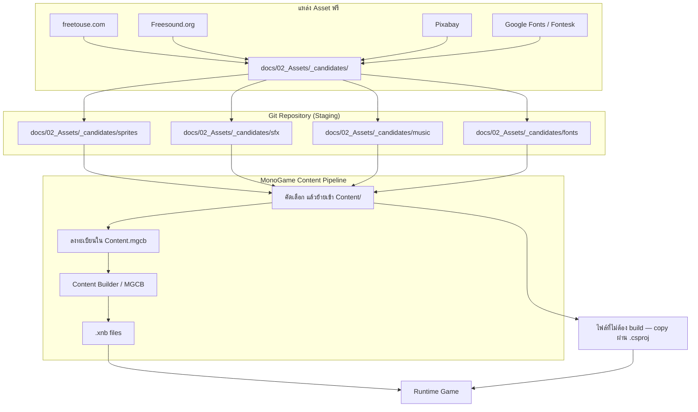

# Asset Pipeline Flow

**Version:** 2.0 (Release 1.0.0) | **Last Updated:** 2026-11-02

## ขั้นตอน

1. **หา asset** จากแหล่งที่อนุญาตให้ใช้ฟรี (freetouse.com, Freesound.org, Pixabay, Google Fonts/Fontesk)
2. **วางไฟล์ลง staging** ที่ `docs/02_Assets/_candidates/<ประเภท>/`
3. **บันทึกที่มา + license** ลงใน [Asset List](../01_GDD/04-asset-list.md) ทันทีที่โหลดมา
4. **คัดเลือก** — ตัวที่ไม่ใช้ลบออกจาก staging
5. **ตั้งชื่อตาม convention** ใน [GDD README](../01_GDD/README.md#-naming-convention) แล้วย้ายเข้า `src/Imaginophobia/Imaginophobia/Content/<ประเภท>/`
6. **ลงทะเบียนใน `Content/Content.mgcb`** — ถ้าไม่ลงทะเบียน asset จะไม่ถูก build (ไฟล์ที่ต้องอ่านดิบตอน runtime ใช้วิธีที่ 7 แทน)
7. **ไฟล์ที่ไม่ผ่าน pipeline** — `Content/Datas/tutorial.json` และ `Content/Fonts/TrueTypeFont/GenerationFonting.ttf` ถูก copy ไป output ด้วย `CopyToOutputDirectory=PreserveNewest` ใน `Imaginophobia.csproj` เพราะโค้ดอ่านจาก path ตรง ๆ (`TutorialManager`, `KernSmithFontCreator.RegisterFont`)
8. **Build ผ่าน MGCB** → ได้ `.xnb` ที่ runtime ใช้

## โครงสร้าง `Content/` ปัจจุบัน

**99 ไฟล์** (ไม่นับ `Content.mgcb` เอง, `bin/`, `obj/`) — `/build` ใน mgcb **87 entries**

| โฟลเดอร์ | เก็บอะไร                                                                                                                                                 | จำนวนไฟล์ |
| ---------------- | ---------------------------------------------------------------------------------------------------------------------------------------------------------------- | -------- |
| `Audio/`       | SFX (`sfx_*`) · ambience (`amb_*`) · BGM (`bgm_*`) — `.mp3` ทั้งหมด                                                    | 46       |
| `Character/`   | Spritesheet + animation json ของตัวละครหลัก                                                                                        | 2        |
| `Datas/`       | ข้อมูล JSON (`tutorial.json`) — copy ผ่าน csproj                                                                                                        | 1        |
| `Fonts/`       | Bitmap font (`.fnt` + `.png`) และ `TrueTypeFont/GenerationFonting.ttf` ที่ Gum ใช้สร้างฟอนต์ตอน runtime — **พหูพจน์**  | 3        |
| `Phobias/`     | Entity ของ phobia (`sprite_scopophobia.png` + atlas ของ Entamaphobia)                                                                           | 3        |
| `Shaders/`     | `.fx` (Vignette, BottomFade, Silhouette, HighlightComposite, Saturation)                                                                                       | 5        |
| `Tilemaps/`    | ไฟล์`.ldtk` (3) และ `mapassets/` (tileset 10)                                                                                                                | 13       |
| `UI/`          | องค์ประกอบ UI — พื้นหลัง/จอตาย/จอชนะ · จอแอบมองประตู · ปุ่ม/แถบ/slider · atlas ของคลิปบอร์ดและมินิเกม · ชุดดวงตาเมนู (`Eyes/`) | 26       |
