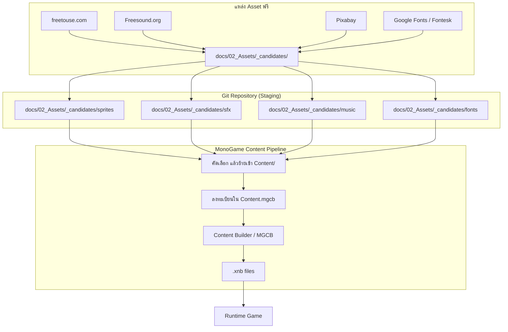

# Asset Pipeline Flow

**Version:** 1.2 | **Last Updated:** 2026-10-25

## ขั้นตอน

1. **หา asset** จากแหล่งที่อนุญาตให้ใช้ฟรี (freetouse.com, Freesound.org, Pixabay, Google Fonts/Fontesk)
2. **วางไฟล์ลง staging** ที่ `docs/02_Assets/_candidates/<ประเภท>/` — ยังไม่ต้อง rename ให้สมบูรณ์
3. **บันทึกที่มา + license** ลงใน [Asset List](../01_GDD/05-asset-list.md) ทันทีที่โหลดมา (ห้ามปล่อยว่าง)
4. **คัดเลือก** — ตัวที่ไม่ใช้ให้ลบออกจาก staging
5. **ตั้งชื่อตาม convention** ใน [GDD README](../01_GDD/README.md#-naming-convention) แล้วย้ายเข้า `src/Imaginophonia/Imaginophonia/Content/<ประเภท>/`
6. **ลงทะเบียนใน `Content/Content.mgcb`** — ถ้าไม่ลงทะเบียน asset จะไม่ถูก build
7. **Build ผ่าน MGCB** → ได้ `.xnb` ที่ runtime ใช้

## โครงสร้าง `Content/` ปัจจุบัน

| โฟลเดอร์ | เก็บอะไร |
|---|---|
| `Audio/` | SFX (`sfx_*`) · ambience (`amb_*`) · BGM (`bgm_*`) — **39 ไฟล์** (`.mp3` ทั้งหมด) |
| `Character/` | Spritesheet + animation json ของตัวละครหลัก (มี `New_version/` และ `Old_version/` ที่ยังไม่ถูกโหลด) |
| `Datas/` | ข้อมูล JSON (ปัจจุบันมี `tutorial.json`) |
| `Fonts/` | Bitmap font (`.fnt` + `.png`) และ `TrueTypeFont/GenerationFonting.ttf` ที่ Gum ใช้สร้างฟอนต์ตอน runtime — **พหูพจน์** |
| `Phobias/` | Entity ของ phobia ต่างๆ (ปัจจุบันมีแค่ `sprite_scopophobia.png`) |
| `Shaders/` | `.fx` (Vignette, BottomFade, Silhouette, HighlightComposite, Saturation) |
| `Tilemaps/` | ไฟล์ `.ldtk` และ `mapassets/` (tileset) |
| `UI/` | องค์ประกอบ UI (spacebar, valve, ปุ่ม pause, สไลเดอร์, พื้นหลัง/จอตาย/จอชนะ, atlas ของมินิเกม Connect The Dots) |

> ไฟล์ tileset ใน `Tilemaps/mapassets/` **ไม่ต้องลงทะเบียนใน `Content.mgcb`** — `LDtkTilemapImporter` โหลดให้จาก path ที่ระบุในไฟล์ `.ldtk`

## หมายเหตุ

- โฟลเดอร์ `Content/bin/` เป็นผลลัพธ์จากการ build (`.xnb`, `.ogg`) — **ไม่ควรแก้ด้วยมือ** และควรอยู่ใน `.gitignore`
- ถ้าเพิ่ม asset ใหม่แล้วเกมยังไม่เห็นไฟล์ ให้ตรวจสอบว่าลงทะเบียนใน `Content.mgcb` แล้วหรือยัง (สาเหตุที่พบบ่อยที่สุด)
