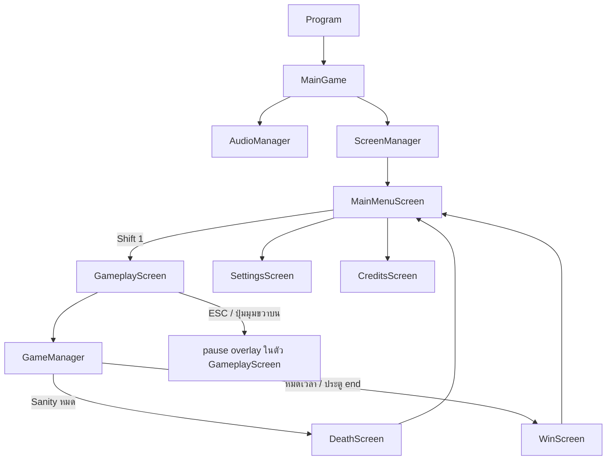
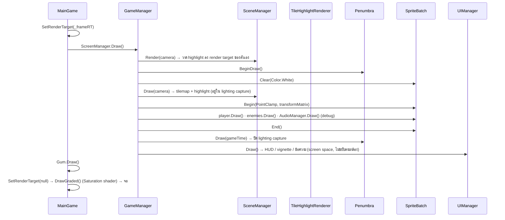
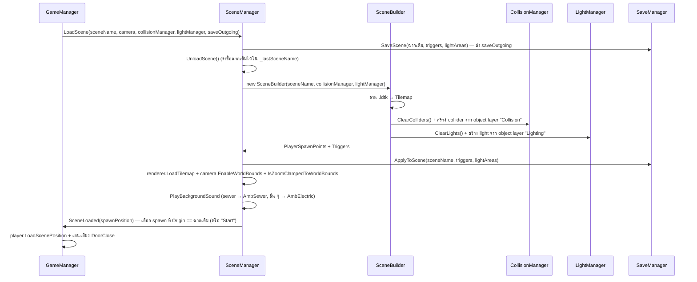

# Imaginophobia — System Design

**Version:** 3.0 | **Last Updated:** 2026-10-25

> เอกสารนี้อธิบายสถาปัตยกรรมจริงของโค้ดใน `src/Imaginophonia/Imaginophonia/`
> ตรวจจากโค้ด ณ commit `cf024ef` (2026-10-24)
> อ้างอิง: [Class Diagram](02-class-diagram.md) · [Data Schema](03-data-schema.md)

## 1. ภาพรวม

เกมรันบน **MonoGame (DesktopGL)** ด้วย **.NET 9** โครงสร้างเป็นแบบ **manager-based**: `GameManager` เป็นเจ้าของ manager ของ gameplay ส่วน `MainGame` เป็นเจ้าของระบบระดับเกม (Graphics, Content, Screen, Gum, Audio)

`MainGame` เปิดเกมที่ **`MainMenuScreen`** — ไม่ใช่ `GameplayScreen` แล้ว ผู้เล่นกดปุ่ม **Shift 1** บนเมนูจึงจะสร้าง `GameplayScreen` (ซึ่งห่อ `GameManager`) ขึ้นมา

`MainGame` เปิดเผย static ที่ทุกคลาสใช้ร่วมกัน: `Instance`, `Graphics`, `GraphicsDevice`, `SpriteBatch`, `Content`, `ScreenManager`, `Saturation`

**หมายเหตุสำคัญ:** `MainGame` บังคับให้มี instance เดียว — สร้างตัวที่สองจะ throw `InvalidOperationException` และ `AudioManager` ก็เป็น singleton แบบเดียวกัน (สร้างซ้ำ = throw) ตัวหลังถูกสร้างใน `MainGame.Initialize()` ไม่ใช่ใน `GameManager` แล้ว

### Post-process: Saturation (ทั้งเฟรม)

`MainGame.Draw` ไม่ได้วาดลง backbuffer ตรง ๆ แต่ใช้ 2 จังหวะ:

1. วาดทุกอย่าง (`ScreenManager.Draw` + `Gum.Draw`) ลง `_frameRT` (render target ขนาดเท่า viewport)
2. `DrawGraded()` วาด `_frameRT` ลงจอผ่าน effect `Shaders/Saturation` (เทคนิค `ApplySaturation`) โดยใช้ค่า `MainGame.Saturation`

`MainGame.Saturation` เป็น **static global** — `1.0` = สีปกติ, `0.0` = ขาวดำ `CollisionManager` ตั้งเป็น `0` ทันทีเมื่อผู้เล่นชน Autophobia และ `UIManager` ค่อย ๆ ไล่ค่ากลับขึ้น (+0.3/วินาที) จึงใช้เป็น feedback ของการโดนโจมตีได้

### Gum (UI toolkit)

เมนูและ HUD ทุกตัวในรอบนี้สร้างด้วย **Gum** (`Gum.MonoGame` + `KernSmith.MonoGameGum`):

- `GumService.Default` ถูก initialize ใน `MainGame.Initialize()` และอัปเดตทุกเฟรม (`Gum.Update` / `Gum.Draw`)
- ฟอนต์ถูกสร้าง runtime ผ่าน `KernSmithFontCreator` แล้วลงทะเบียนชื่อ **`generationfonting`** จาก `Fonts/TrueTypeFont/GenerationFonting.ttf`
- ปุ่ม/สไลเดอร์/ข้อความทั้งหมดประกอบด้วยโค้ดใน `GumUIHelper` (ตัวช่วยกลาง ไม่ให้แต่ละหน้าจอเขียน style ซ้ำ)
- ทุกหน้าจอ Gum สร้าง `Panel` → `Dock(Dock.Fill)` → `AddToRoot()` และ `RemoveFromRoot()` ตอน `Dispose`

## 2. Manager และความรับผิดชอบ

| Manager                   | หน้าที่                                                                                                                                                                                       | หมายเหตุ                                                                                                                                                          |
| ------------------------- | ---------------------------------------------------------------------------------------------------------------------------------------------------------------------------------------------------- | ------------------------------------------------------------------------------------------------------------------------------------------------------------------------- |
| `MainGame`              | ระบบระดับเกม: graphics, content, screen, Gum, saturation pass, ชีวิตของ `AudioManager`                                                                                         | เริ่มที่`MainMenuScreen`                                                                                                                                        |
| `GameManager`           | ศูนย์กลางของ gameplay — ถือ manager ย่อย, คุม state, โหลดฉาก, จัดการเหตุการณ์ (ประตู / enemy เกิด-ตาย)                                      | จุดเริ่มอ่านโค้ด · สร้างใน `GameplayScreen` constructor                                                                                         |
| `SceneManager`          | ดูแลฉากที่ active (`SceneBuilder`), สั่ง `Update`/`Draw`/`Render`, สลับฉาก, sync highlight renderer                                                                     | `static GetActiveScene()` · event `SceneLoaded`                                                                                                                      |
| `SceneBuilder`          | สร้างฉากจากไฟล์`.ldtk` — collider + แสง + highlight tile + `PlayerSpawnPoints`                                                                                                | ตัวเชื่อมระหว่าง LDtk กับเกม                                                                                                                        |
| `CollisionManager`      | ลงทะเบียน collider แบบมี layer, ตรวจการชน, จัดการ interaction (ตู้/มินิเกม/ประตู/แอบมองประตู)                                                 | `AddCollider(actor, layer)` · event `DoorInteracted`                                                                                                                 |
| `LightManager`          | ถือ light ทั้งหมด (Penumbra) และ `LightArea`, อัปเดตตาม transform ของกล้อง                                                                                           | `static Penumbra` · `ScopoAlarmAll()` · `NyctoAlarmAll()` · `CleanUpScopo()`                                                                                   |
| `AudioManager`          | SFX, ambience, BGM, spatial audio —**singleton** (`AudioManager.Instance`)                                                                                                                  | สร้างใน `MainGame.Initialize()` · สร้างซ้ำ = throw                                                                                                      |
| `EnemyManager`          | สุ่ม spawn และอัปเดต enemy ทุกตัว · เปิด/ปิด spawn timer ตามฉาก                                                                                                     | `SpawnEnemy()`→ แยกเป็น `SpawnScopophobia` / `SpawnAutophobia` / `SpawnNyctophobia` / `SpawnEntamaphobia` · events `EnemySpawned` / `EnemyRemoved` |
| `UIManager`             | HUD (แถบ Sanity / Battery / ตัวนับวาล์ว / ตัวจับเวลา), vignette 3 ตัว, blink, ข้อความ tutorial + ข้อความชั่วคราว, black screen, saturation recovery | ถือ `TutorialManager` + `TextManager`                                                                                                                              |
| `TextManager`           | วาดข้อความในเกม (tutorial + ข้อความชั่วคราว), ป้ายกำกับ HUD และตัวเลข `MainTimer`                                                                  | เดิมเอกสารเรียกว่า `DialogueManager`                                                                                                                  |
| `ObjectiveManager`      | **static** — ติดตาม objective แบบ id และความคืบหน้าของวาล์ว/แผงไฟ                                                                                         | `TargetValves = 5` · event `Completed`                                                                                                                               |
| `TutorialManager`       | อ่าน `Datas/tutorial` แล้วเลื่อน step ตาม objective ที่สำเร็จ                                                                                                            | ผูกกับ `ObjectiveManager.Completed`                                                                                                                               |
| `SaveManager`           | **static** — save/load สถานะ trigger + ไฟ ต่อฉาก ลง `%APPDATA%/Imaginophobia/save.json`                                                                                      | `SaveScene` / `ApplyToScene` / `TurnAllLightsOn` / `ResetScene` / `Delete`                                                                                      |
| `TileHighlightRenderer` | วาด highlight ของวัตถุที่โต้ตอบได้ (วาล์ว / ตู้ / แผงไฟ / ประตู / คลิปบอร์ด / บันได) ด้วย shader 2 ตัว                                 | `Silhouette` + `HighlightComposite` · 6 กลุ่ม                                                                                                                   |
| `InputManager`          | **static** — รวมการอ่านคีย์บอร์ด/เมาส์ไว้ที่เดียว (`A` / `D`) และเรียก `KeyboardExtended.Update()`                                           | ยังไม่ใช่ที่เดียวที่ผูกปุ่มทั้งหมด (ดู § 14)                                                                                         |
| `GumUIHelper`           | **static** — factory ของ control ทุกตัว (title, text, text button, pause button, slider, value label, dim panel, settings panel) ให้ style ตรงกัน                           | ใช้โดย `MainMenuScreen` / `SettingsScreen` / `GameplayScreen`                                                                                                 |
| `Layout`                | **static** — ค่าคงที่ design-space (1920×1080, ตำแหน่ง panel/title/menu/slider/ปุ่ม)                                                                                      | หน้าจอ Gum อ่านค่าจากที่นี่ ไม่กระจาย literal                                                                                              |

## 3. ลำดับการอัปเดต (Update Order)

`MainGame.Update` → `Time.Update(gameTime)` → `ScreenManager.Update` (→ `GameplayScreen.Update` → `GameManager.Update`) → `Gum.Update`

ภายใน `GameManager.Update` เรียงตามนี้:

1. `InputManager.Update()` — `KeyboardExtended.Update()` + `MouseExtended.Update()` ก่อนทุกอย่าง
2. `_player.Update()` — ขยับผู้เล่น, ไฟฉาย, สายตา, sanity, animation
3. `_enemyManager.Update(_camera.WorldBounds)` — ขยับศัตรู + เปิด/ปิด spawn timer ตามฉากปัจจุบัน
4. `_camera.LookAt(_player.CameraTarget + _cameraShaker.ShakeOffset)` + lerp zoom ตาม `player.FocusLevel` (เข้าเร็ว lerp 0.10, ออกช้า lerp 0.05)
5. `_collisionManager.Update()` — ตรวจการชนทั้งหมดหลัง object ขยับแล้ว
6. `_sceneManager.Update(_collisionManager)` — อัปเดต highlight ตาม `FocusedTrigger`
7. `_lightManager.Update(_camera.GetViewMatrix())` — อัปเดตแสงตามกล้อง
8. `AudioManager.Instance.Update(_player)` — เก็บกวาด `AudioSource` ที่จบแล้ว + อัปเดต spatial audio
9. `_uiManager.Update()` — saturation recovery, vignette, blink, nyctophobia overlay, tutorial text
10. `_cameraShaker.Update(gameTime)` — สั่นกล้อง
11. ถ้า `player.Sanity <= 0` → `MainGame.ScreenManager.ReplaceScreen(new DeathScreen())`
12. `DebugUpdate()` — ปุ่ม `K` สั่นกล้อง (debug)

> **เหตุผลของลำดับ:** input → ขยับ → ชน → แสง → เสียง → UI เพราะแต่ละขั้นต้องใช้ผลจากขั้นก่อนหน้า
> **`GameplayScreen` ตั้ง `UpdateWhenInactive` / `DrawWhenInactive = true`** — หน้าจอ gameplay จึงยังอัปเดต/วาดอยู่เบื้องหลังเมนูที่ push ทับ (เช่น `DoorPeekingScreen`)

## 4. ลำดับการวาด (Draw Order)

`GameManager.Draw` เรียงชั้นการวาดเพื่อให้ highlight อยู่ "หลังผู้เล่น" แต่ยังอยู่ใน lighting capture ของ Penumbra:

## 5. การโหลดฉาก (Scene Loading)

ฉากที่มีอยู่ (`enum Scene`): `tilemap_electrical_room`, `tilemap_electrical_room_2`, `tilemap_sewer`

**การเลือกจุดเกิด:** `SceneManager` ไล่ `PlayerSpawnPoints` แล้วเลือกตัวที่ `Name == _lastSceneName` (ชื่อฉากที่เพิ่งออกมา) หรือ `Name == "Start"` — ถ้าไม่เจอเลยจะไม่เรียก `SceneLoaded` (ผู้เล่นค้างอยู่ที่ตำแหน่งเดิม)

**`SceneBuilder.BuildCollision`** อ่าน object layer ชื่อ **`Collision`** แล้วแยกตาม `entity.Class` (= LDtk tag ตัวแรก ไม่ใช่ชื่อ entity):

| `entity.Class`                        | กลายเป็น                                            | ใช้ property |
| --------------------------------------- | ----------------------------------------------------------- | --------------- |
| `wall`                                | `Wall` (layer `walls`)                                  | —              |
| `dots` / `hideout` / `skillcheck` | `Trigger` (layer `triggers`)                            | —              |
| `door`                                | `Trigger` (layer `triggers`) ชื่อ = `Destination` | `Destination` |
| `report`                              | `Trigger` (layer `triggers`) ชื่อ = `Detail`      | `Detail`      |
| `spawn`                               | `SpawnPoint` ชื่อ = `Origin`                        | `Origin`      |

**`SceneBuilder.BuildLight`** อ่าน object layer ชื่อ **`Lighting`** โดยกำหนด `entity.Class == "light"` แล้วแยกต่อด้วย **`entity.Name`**: `PointLight` (ได้ `LightArea` + collider layer `lights`) · `DoorLight` (ได้ `PointLight` เฉย ๆ ไม่มี collider) · `SpotLight`

## 6. Collision Layer

`CollisionManager` ใช้ `CollisionWorld2D` ของ MonoGame.Extended (spatial hash 64×64) และสร้าง layer ใหม่ทุกครั้งที่โหลดฉาก (`ResetLayers()`)

| Layer        | Dynamic | ใส่อะไร                                                          |
| ------------ | ------- | ----------------------------------------------------------------------- |
| `walls`    | ❌      | `Wall` จาก tilemap                                                 |
| `triggers` | ❌      | `Trigger` (ตู้ / มินิเกม / ประตู / คลิปบอร์ด) |
| `enemies`  | ✅      | `Autophobia`, `Scopophobia`                                         |
| `lights`   | ❌      | `LightArea`                                                           |

การตั้งค่าการชนระหว่าง layer:

- ปิดการชนระหว่าง `enemies` ↔ `walls` และ `lights` ↔ `walls`
- เปิดการชนระหว่าง `enemies` ↔ `lights` (เพื่อให้ศัตรูทำให้ไฟกระพริบ/ดับ)

การตรวจการชนที่ทำทุกเฟรม (`CollisionManager.Update`):

| คู่                            | ผล                                                                                                                                                                                                                            |
| --------------------------------- | ------------------------------------------------------------------------------------------------------------------------------------------------------------------------------------------------------------------------------- |
| Player ↔`walls`                | `player.CollideWithWallMove(MTV)`                                                                                                                                                                                             |
| Player ↔`triggers`             | หา `FocusedTrigger` ที่ใกล้ที่สุด (เทียบระยะจาก bounding box) · ตั้ง `CanInteract` · จัดการ interaction ตาม tag (ดู § 7)                                                       |
| Player ↔`enemies`              | Autophobia →`Sanity −10`, ปิด enemy และตั้ง `MainGame.Saturation = 0` + เสียง `PhobiaHit` · Scopophobia (ที่ยัง `Visible`) → `Sanity −25` แล้วซ่อน enemy + เสียง `PhobiaHit` |
| Player `EyeSight` ↔ Autophobia | ถ้าตัดกัน →`AllowMovement = false`, ลบออกจาก collision world, `player.Blink = true` (กระพริบตา) แล้ว `SetActive` หลัง 0.15 วินาที                                                |
| Player ↔`lights`               | ตั้ง `player.Nyctophobia = false` ก่อน แล้วถ้า `LightArea.On == false` และไม่กำลัง flicker → เล่น `Darkness` + `player.Nyctophobia = true`                                               |
| `enemies` ↔ `lights`         | Scopophobia (ที่`ScopoHasPassed == false`) → `TurnOff()` + `LightBrokeCount++` + เสียง `LightBreak` แบบ 3D · Autophobia → `lightArea.StartFlicker()`                                                    |

## 7. Interaction (ปุ่มและผลลัพธ์)

| Trigger tag                     | ปุ่ม  | ผล                                                                                                                                         |
| ------------------------------- | --------- | -------------------------------------------------------------------------------------------------------------------------------------------- |
| `hideout` (ตู้)            | `Space` | ถ้ายังไม่ซ่อน → ย้ายผู้เล่นไปกลาง collider แล้ว `ToggleHide()`                                          |
| `skillcheck` (วาล์ว)     | `Space` | เปิด `SpinTheValveScreen` + `player.ToggleRepair()`                                                                                  |
| `dots` (แผงไฟ)           | `Space` | เปิด `ConnectTheDotsScreen` + เสียง `ElecRepairing` + `ToggleRepair()` + `ObjectiveManager.Complete("repair")`              |
| `door` (ประตู)           | `Space` | `ObjectiveManager.Complete("door")` แล้วยิง event `DoorInteracted` (`GameManager` สลับฉาก)                               |
| `door` (ประตู)           | `E`     | `player.TogglePeek()` + เปิด `DoorPeekingScreen` (ดีเลย์ 1 วินาที) — **ยกเว้นในฉาก `tilemap_sewer`** |
| `report` (คลิปบอร์ด) | —        | ยังไม่ผูก interaction (มีแค่ trigger + highlight)                                                                              |

`GameManager.OnDoorInteracted`:

- `Destination == "end"` → ถ้าวาล์วครบ (`AllValvesRepaired`) → `Complete("exit-ladder")` + เปิด `WinScreen` · ถ้าไม่ครบ → `UIManager.ShowMessage("I still have work to do.")` เป็นเวลา 2 วินาที
- ถ้ามี Scopophobia ที่ยัง active → เล่น `DoorStuck` (เปิดประตูไม่ได้)
- ไม่งั้น → `ClearSFXs()` + `ClearEnemies()` + `LoadScene(ปลายทาง)`

`GameManager.OnEnemySpawned` / `OnEnemyRemoved`: enemy เกิดแล้วรีเซ็ต save ของห้องไฟฟ้า, รีเซ็ต panel, ยิง alarm (`NyctoAlarmAll` / `ScopoAlarmAll`) ในกรณี Nyctophobia/Scopophobia · enemy ตายแล้วโชว์ข้อความ hint ("Repairing electric system in the electric room should fix the lights." / "Flashlight might be useful.") และ set `collidedAutophobia`

## 8. Lighting

- ใช้ **MonoGame.Penumbra** ทำแสง 2D — `LightManager.Penumbra` เป็น static `PenumbraComponent` (สร้างครั้งเดียว)
- `Penumbra.AmbientColor = #242323` (แสงแวดล้อมมืด)
- `LightManager.Update(Matrix transformMatrix)` ตั้ง `Penumbra.Transform` ตามกล้อง แล้วอัปเดต `LightArea` ทุกตัว
- `LightArea` ทำหน้าที่เป็นทั้ง collider และแหล่งแสง — มีสถานะ `On` (= `_powered`), `IsFlickering`, `ScopoHasPassed` และเมธอด `StartFlicker(duration = 1.5s)`, `TurnOff()`, `TurnOn()`, `ScopoIncoming()` (แสงเปลี่ยนเป็นสีแดง), `StartNyctoAlarm()` (กระพริบ 3 วินาทีแล้วดับถาวร)
- แสงที่ผูกกับผู้เล่น (สร้างใน `Player` แล้วเพิ่มเข้า `Penumbra.Lights` ตรง ๆ): `PointLight` รอบตัว (`_scotopicLight`, scale 500×500, intensity 0.5, `Color.FromHSV(150, 0.5, 0.5)`) และ `Spotlight` ไฟฉาย (`_flashLight`, scale 600×1250)
- เอฟเฟกต์เสริมใน `Scripts/SpriteEffects/`:
  - `VignetteOverlay` — ขอบจอมืดลง ใช้ 3 ตัวใน `UIManager`: `_vignetteOverlay` (sanity, tween ด้วย `Tweener` ของ MonoGame.Extended), `_blinkOverlay` (กระพริบตา), `_nyctophobiaOverlay` (ถูกความมืดกลืน, `Softness = 15`) · shader `Shaders/Vignette` เทคนิค `EllipseMask`
  - `BottomFadeOverlay` — เฟดด้านล่างของจอ · shader `Shaders/BottomFade`

## 9. Audio

- `AudioManager` เป็น **singleton** (`Instance`) สร้างใน `MainGame.Initialize()` และเป็นเจ้าของ `AudioSource` ที่ active ทั้งหมด (`AudioSource : GameObject, IDisposable`)
- `SfxByName` = `Dictionary<SoundEffectName, SoundEffect>` (26 ค่า) โหลดจาก `Content/Audio/` — enum จริงชื่อ **`SoundEffectName`** (เดิมเอกสารเรียกว่า `Sound`)
- `BgsByName` = `Dictionary<BackgroundSound, Song>` (5 ค่า: `AmbElectric`, `AmbSewer`, `BgmMainMenu`, `BgmDeathScreen`, `BgmWinScreen`) เล่นผ่าน `MediaPlayer` แบบวนซ้ำ · `BgsVolume` default `0.2`
- ตัวที่ implement `ISpatialSoundApplicable` (มี `MoveSpeed` / `Velocity` / `Direction`) จะใช้คำนวณ spatial audio: `Player`, `Autophobia`, `Scopophobia`
- **Spatial audio:** `Play3DSFX(pos, sound, innerRadius = 10, outerRadius = 80, volume = 1)` คืน `AudioSource` (ผู้เรียกเก็บไว้เป็น child ได้ เช่น `Scopophobia`) — `AudioSource.UpdateSpatialAudio(player)` คำนวณ volume จากระยะห่าง, `Pan` จากแกน X และ `Pitch` จาก Doppler effect (`SPEED_OF_SOUND = 343.5`)
- `PlayStepsSFX(pos, inner, outer)` — เสียงฝีเท้า 8 แบบ ไล่ตามลำดับ `_stepOrder`
- `PlayLightFlickerSFX(pos, inner, outer)` — สุ่มจาก `LightFlickerShort1..3` (ใช้ตอนไฟกระพริบ)
- `PlayBackgroundSound(BackgroundSound)` — หยุดเพลงเดิมแล้วเล่นเพลงใหม่แบบวนซ้ำ
- `StopSFX(name)` / `ClearSFXs()` — หยุดเสียงที่ยังเล่นอยู่ (เรียกก่อนเปลี่ยนฉาก)
- `MuteAudio` / `UnmuteAudio` / `ToggleMute` / `PauseAudio` / `ResumeAudio` พร้อมเก็บ volume เดิมไว้
- ไลบรารี **MonoSound** (`MonoSoundLibrary.Init` / `DeInit` ใน `MainGame.OnExiting`) เปิดทางไว้สำหรับ filter (echo / reverb / biquad) — โค้ดส่วนนั้นยังคอมเมนต์ไว้

## 10. Highlight System

ระบบ highlight วัตถุที่โต้ตอบได้ ทำงานร่วมกัน 3 คลาส:

| คลาส                  | หน้าที่                                                                                                                                                                           |
| ------------------------- | ---------------------------------------------------------------------------------------------------------------------------------------------------------------------------------------- |
| `HighlightSettings`     | พารามิเตอร์ของ effect:`ScanSpeed`, `ScanWidth`, `ScanColor`, `PulseSpeed`, `PulseMin`, `PulseColor`, `OutlineRadius`, `OutlineColor`                       |
| `HighlightGroup`        | กลุ่ม tile ที่จะวาด:`Layer`, `Settings`, `FocusTiles`, `ScanTiles`, `PulseTiles`                                                                                  |
| `TileHighlightRenderer` | ถือ 6 กลุ่ม (`ValveGroup`, `LockerGroup`, `PanelGroup`, `DoorGroup`, `ClipboardGroup`, `LadderGroup`) และวาดผ่าน render target 2 ตัว (mask + composite) |

- `SceneBuilder.BuildHighlightTiles` เอา tile ที่อยู่ในกรอบของ collider (`layer.GetTilesInRegion`) — เลือก layer ด้วย `FindHighlightLayer`: ชื่อ entity ตัด `s`/`S` ตัวท้ายออกแล้วเทียบกับชื่อ tile layer · ยกเว้น `LoadNextScene` ที่ใช้ layer `Doors` และถ้า `Destination == "end"` จะใช้ layer `Ladder`
- `SceneManager.UpdateHighlight` เลือกกลุ่มตามชื่อ tile layer (`Valves` / `Lockers` / `ElectricalPanel` / `Doors` / `Clipboard` / `Ladder`) และข้ามวัตถุที่ซ่อมเสร็จแล้ว (วาล์ว/แผงไฟ) หรือกำลังถูกใช้อยู่ (กำลังซ่อม / กำลังซ่อน) · ตัวที่อยู่ใต้ `FocusedTrigger` จะเข้า `FocusTiles` ที่เหลือเข้า `ScanTiles`
- Settings ต่อกลุ่มถูกตั้งใน `SceneManager` constructor เช่น `_valveSettings` (`ScanSpeed 0.5`, scan `#bfd8ff`, outline 3px `#ffd83f`) และ `_lockerSettings` / `_doorSettings` / `_clipboardSettings` / `_ladderSettings` (scan ปิด, outline `#e0e8e0`)
- shader: `Shaders/Silhouette` (เทคนิค `HighlightMask` — เขียน mask ลงช่อง RGBA ตามชนิด focus/scan/pulse) + `Shaders/HighlightComposite` (เทคนิค `Highlight` — รวม mask เป็น outline/scan/pulse)

## 11. Screens

ทุกหน้าจอสืบทอดจาก `Screen` ของ **MonoGame.Extended.Screens** (`Update(GameTime)` / `Draw(GameTime)`) และถูกเปิดผ่าน `MainGame.ScreenManager.ShowScreen(...)` / `ReplaceScreen(...)` / `CloseScreen()`

| Screen                   | ใช้กับ                                                     | หมายเหตุ                                                                                                                                                                                                                            |
| ------------------------ | ---------------------------------------------------------------- | ------------------------------------------------------------------------------------------------------------------------------------------------------------------------------------------------------------------------------------------- |
| `MainMenuScreen`       | หน้าจอแรกของเกม                                   | ปุ่ม: Shift 1 (เริ่มเกม), Index (ปิดใช้งาน), Settings, Credits, Exit · ลูกศร `<` `>` ปิดใช้งาน · เล่น `BgmMainMenu`                                                                          |
| `SettingsScreen`       | ตั้งค่าเสียง                                         | `GumUIHelper.AddSettingsPanel` (สไลเดอร์ Ambience / SFX volume) + ปุ่ม Back · `ESC` = กลับ                                                                                                                             |
| `CreditsScreen`        | เครดิตทีม                                               | เปิดจากเมนูหลัก                                                                                                                                                                                                              |
| `GameplayScreen`       | หน้าหลักของการเล่น                             | ห่อ `GameManager` · `UpdateWhenInactive` / `DrawWhenInactive = true` · มี **pause overlay** ในตัว (dim panel + settings + ปุ่ม Return to Menu) เปิด/ปิดด้วย `ESC` หรือปุ่มมุมขวาบน |
| `DeathScreen`          | Sanity ถึง 0                                                  | พื้นหลัง `UI/death_screen.png` + ข้อความ tip สุ่ม 1 จาก 9 (tips เป็น Easter egg/คำใบ้) · ปุ่ม Return to Menu · เล่น `BgmDeathScreen`                                                           |
| `WinScreen`            | วาล์วครบแล้วออกประตู`end` / หมดเวลา | พื้นหลัง `UI/win_screen.png` · "You survived." / "Thanks for playing." · **บรรทัดเวลาในจอเป็น placeholder** (`"Time left: lorem ipsum"`)                                                              |
| `SpinTheValveScreen`   | ซ่อมวาล์ว (trigger tag `skillcheck`)                  | ใช้`UI/sprite_valve.png` · หมุนด้วยเมาส์ค้างแล้วลากเป็นวงกลม · `MinigameVisible` ถูกปิดชั่วคราวตอน Scopophobia มา (black screen) · `Q` = ออก                             |
| `ConnectTheDotsScreen` | ซ่อมไฟ (trigger tag `dots`)                              | ใช้`UI/spritesheet_minigame_dot` (TexturePacker atlas) · กระดาน 6×6 · helper `AddDot`, `ScreenToGrid`, `TryExtendPath`, `GetCellTopLeft`, `GetCellTopCenter` · คลิกขวา = ล้างเส้น · `Q` = ออก |
| `DoorPeekingScreen`    | แอบมองใต้ช่องประตู (ปุ่ม `E`)            | **ยังเป็น draft (WIP)** — `Draw` วาดแค่สี่เหลี่ยมสีเขียว 500×500 ยังไม่มีอาร์ต/mechanic · `Q` = ออก                                                                              |
| `SkillCheckScreen`     | *(ไม่ได้ใช้)*                                         | อยู่ใน `Scraped/` — ไม่มีที่ไหนเรียกใช้ และ asset `UI/Needle.png` / `UI/Radial Circle.png` ก็ไม่มีในโปรเจกต์                                                                            |
| `PauseScreen`          | *(ไม่ได้ใช้)*                                         | อยู่ใน `Scraped/` — ถูกแทนที่ด้วย pause overlay ที่อยู่ใน `GameplayScreen` แล้ว                                                                                                                        |

## 12. Utility

| Class                    | หน้าที่                                                                                                                                                                                                                                                                                                                                                                                                                                                                              |
| ------------------------ | ------------------------------------------------------------------------------------------------------------------------------------------------------------------------------------------------------------------------------------------------------------------------------------------------------------------------------------------------------------------------------------------------------------------------------------------------------------------------------------------- |
| `Time` (static)        | ตัวจับเวลากลาง —`DeltaTime`, `ElapsedTime`, `TimeScale`, `TimeDilation`, `AddTimer(seconds, name)`, `AddTimer(Action, seconds, name)`, `AddTimer(Action, min, max, name)` (สุ่มช่วง + repeat), `RemoveTimer(Timer)`, `RemoveTimer(name)`, `GetTimer(name)`, `TimerExist(name)`, `Purge()` · `MainGame.Update` เรียก `Time.Update` ให้ทุกเฟรม (timer ที่ `Active == false` จะถูกตัดออกอัตโนมัติ) |
| `Timer`                | ตัวจับเวลาเดี่ยว —`TimeLeft`, `Active`, `Repeat`, `Random`, `MinMax`, `Pause()`, `Resume()`, `ToggleActive()`, `Reset()`, event `OnTimerCompleted`                                                                                                                                                                                                                                                                                                     |
| `CameraShaker`         | สั่นกล้อง —`Shake(duration, magnitude)` แล้ว `Update(gameTime)` ให้ `ShakeOffset` (ทดสอบด้วยปุ่ม `K`)                                                                                                                                                                                                                                                                                                                                                 |
| `Layout` (static)      | ค่าคงที่ layout ของทุกหน้าจอ (1920×1080 + ตำแหน่ง panel/title/menu/slider)                                                                                                                                                                                                                                                                                                                                                                                      |
| `GumUIHelper` (static) | factory ของ Gum control ทุกตัวที่หน้าจอใช้                                                                                                                                                                                                                                                                                                                                                                                                                             |
| `SpawnPoint`           | จุดเกิด (`Name` + `Position`)                                                                                                                                                                                                                                                                                                                                                                                                                                                    |
| `GameObject`           | base class ของทุกอย่างในฉาก —`Transform2`, `Parent`/`Children`, `Active`/`Visible`, `Update()`/`Draw()` เป็น virtual, `OnDestroyed()`                                                                                                                                                                                                                                                                                                                  |

## 13. Extension Points (จุดที่ควรขยาย)

| อยากเพิ่ม                                                      | ต้องแตะ                                                                                                                                                                                                                                                                                                   |
| ----------------------------------------------------------------------- | ---------------------------------------------------------------------------------------------------------------------------------------------------------------------------------------------------------------------------------------------------------------------------------------------------------------- |
| Phobia ตัวใหม่ (เช่น Entamaphobia ที่ยังเป็น stub) | สร้างคลาสใน `Scripts/Enemies/` implement `ISpatialSoundApplicable` + `ICollisionActor`, เพิ่ม `Time.AddTimer(...)` ใน `EnemyManager` constructor, ผูก logic ใน `GameManager.OnEnemySpawned`/`OnEnemyRemoved`, เพิ่ม asset ใน `Content/Phobias/` + `Content.mgcb` |
| Minigame ใหม่                                                       | สร้างคลาสใน `Scripts/Screen/` สืบทอด `Screen` แล้วเปิดจาก `CollisionManager` ตาม tag ของ `Trigger`                                                                                                                                                                     |
| ฉากใหม่                                                          | เพิ่ม `.ldtk` ใน `Content/Tilemaps/` + ลงทะเบียนใน `Content.mgcb` + เพิ่มค่าใน `enum Scene` (ชื่อไฟล์ต้องตรงกับค่า enum)                                                                                                                                |
| เสียงใหม่                                                      | เพิ่มไฟล์ใน `Content/Audio/` + ลงทะเบียนใน `Content.mgcb` + เพิ่มค่าใน `enum SoundEffectName` (หรือ `BackgroundSound`) + เพิ่ม entry ใน `SfxByName` / `BgsByName`                                                                                         |
| หน้าจอเมนู/UI ใหม่                                        | สร้าง `Screen` ใหม่ที่ประกอบจาก `GumUIHelper` + วางตำแหน่งด้วย `Layout` แล้วเปิดผ่าน `ScreenManager.ShowScreen`                                                                                                                                           |
| ข้อความ tutorial ใหม่                                        | เพิ่ม step ใน `Content/Datas/tutorial.json` (`Text` + `CompleteOn` = objective id) แล้วเรียก `ObjectiveManager.Complete(id)` ที่จุดที่ต้องการ (ต้องมี id จริง ไม่งั้น step นั้นจะค้าง)                                                        |
| ค่าปรับแต่ง (speed, sanity rate)                             | **ยังไม่มีศูนย์กลาง** — กระจายอยู่ในโค้ด (ดู [Data Schema](03-data-schema.md#6-ค่าปรับแต่งเกม-tuning-values))                                                                                                                                               |

## 14. Known Issues / Technical Debt

| ปัญหา                                                                | รายละเอียด                                                                                                                                                                                                                                                                                                                                                                           |
| ------------------------------------------------------------------------- | ---------------------------------------------------------------------------------------------------------------------------------------------------------------------------------------------------------------------------------------------------------------------------------------------------------------------------------------------------------------------------------------------- |
| ค่าปรับแต่งกระจายอยู่ทั่วโค้ด                | ยังไม่มี config/data file กลาง ทำให้บาลานซ์เกมยาก (backlog ระบุว่าต้องการ data file) — มีแค่`Datas/tutorial.json` ที่เป็น data จริง                                                                                                                                                                                             |
| `SkillCheckScreen` และ `Scraped/PauseScreen` เป็น dead code    | ไม่มีที่ไหนเรียกใช้ทั้งคู่ (`SkillCheckScreen` ถูกแทนที่ด้วย `SpinTheValveScreen`, `PauseScreen` ถูกแทนที่ด้วย pause overlay ใน `GameplayScreen`) — asset ที่ `SkillCheckScreen` อ้าง (`UI/Needle.png`, `UI/Radial Circle.png`) ก็ไม่มีในโปรเจกต์                                                 |
| `DoorPeekingScreen` ยังเป็น draft                                | `Draw` วาดแค่สี่เหลี่ยมสีเขียว — ยิงจาก `CollisionManager` ด้วยปุ่ม `E` แล้ว แต่ยังไม่มีอาร์ต/mechanic ของ Entamaphobia (ตรงกับ commit `cf024ef` ที่เป็น wip)                                                                                                                                                |
| `Entamaphobia` และ `Nyctophobia` เป็น placeholder              | `Nyctophobia` เป็นคลาสเปล่า (ทำหน้าที่เป็น marker ให้ `EnemyManager.HasActiveNyctophobia`) · `Entamaphobia` มี `Update` ครึ่ง ๆ กลาง ๆ, `SpawnEntamaphobia` ไม่ถูกเรียกจาก timer ไหน และยังไม่ยิง event `EnemySpawned` (คอมเมนต์ไว้)                                                            |
| `InputManager` ไม่ได้เป็นที่เดียวที่ผูกปุ่ม | `A`/`D` อยู่ที่ `InputManager` แต่ `Left Ctrl`, `F`, `Space`, `Q`, `E` อ่านตรงใน `Player.cs`, `CollisionManager.cs` และหน้าจอมินิเกม · `ESC` อ่านผ่าน `GumService.Default.Keyboard` ในแต่ละหน้าจอ · `K` เป็น debug key ใน `GameManager`                                                            |
| Save ยังไม่ครอบคลุมทุกอย่าง                         | `SaveManager` บันทึกแค่ trigger (progress / interactable) และสถานะไฟ — **ไม่บันทึก** ตำแหน่งผู้เล่น, Sanity, Battery, ฉากปัจจุบัน (เริ่มจาก `MainMenuScreen` → `tilemap_electrical_room` เสมอ) และ `GameManager` เรียก `SaveManager.Delete()` ทุกครั้งที่สร้าง + ใน `Restart()` |
| ตัวจับเวลาหลักไปจบที่`WinScreen`                   | `Time.AddTimer(() => ScreenManager.ReplaceScreen(new WinScreen()), 481, "MainTimer")` — หมดเวลา 481 วินาทีแล้ว **ขึ้นจอชนะ** ซึ่งไม่ตรงกับดีไซน์ที่เขียนไว้ (หมดเวลา = แพ้/จบรอบ) ค่านี้หน้าตาเหมือนค่าทดสอบ ต้องตัดสินใจและแก้ให้ตรง                        |
| ไม่มีเส้นทาง replay                                           | `GameManager.Restart()` ยังอยู่ในโค้ดแต่ **ไม่มีที่เรียก** (เหลือแค่บรรทัดที่คอมเมนต์ไว้) — ตายแล้ว `GameplayScreen` ยังอัปเดตอยู่เบื้องหลังและ `GameManager` ไม่ถูก dispose จนกว่าจะกลับเมนู (`UnloadContent`)                                                 |
| `Time.SessionActive` ไม่เคยถูกตั้งเป็น true            | มีแค่`GameManager.Dispose` ที่ตั้งเป็น `false` — `Time.Purge()` จึงทำงานทุกครั้ง (flag นี้ไม่มีผลจริงตอนนี้)                                                                                                                                                                                                                        |
| ชื่อไฟล์/โฟลเดอร์สะกดไม่ตรงกัน               | `spitesheet_player` (ขาด `r`) · โฟลเดอร์ `Imaginophonia` แต่ project `Imaginophobia` · `TurotialData.cs` / `TurorialDataReader.cs` สะกดผิด · ไฟล์เสียง `sfx_light_flickering_short_01 .ogg`/`sfx_light_flickering_long.ogg` ที่มีช่องว่าง/ชื่อไม่ตรงกับ source หลงเหลืออยู่ใน `Content/bin/`        |
| ไฟล์ใน `Content/bin/` ล้าสมัย                              | `bin/` มีไฟล์ที่ไม่มีใน `Content/` ต้นทางแล้ว (เช่น `sfx_autophobia_indicator.ogg`, `Shaders/Saturation` เวอร์ชันเก่า, `bgm_*` ที่เปลี่ยนนามสกุล) — เป็น build artifact ควรลบและเพิ่ม `Content/bin/` ใน `.gitignore`                                                                              |

## Related Documents

- Class Diagram: [Class Diagram](02-class-diagram.md)
- Data Schema: [Data Schema](03-data-schema.md)
- Concept (architecture summary): [Game Concept](../01_GDD/00-concept.md#7-system-architecture)
- Mechanics: [Mechanics](../01_GDD/03-mechanics.md)
