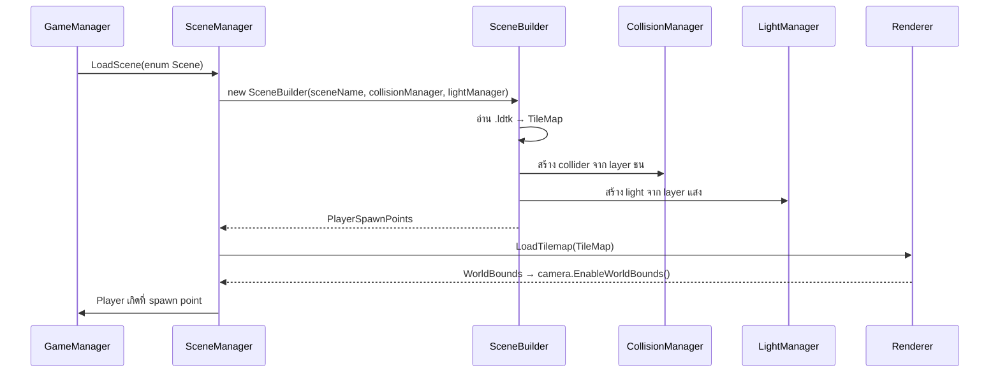

# Imaginophobia — System Design

**Version:** 1.0 | **Last Updated:** 2026-10-14

> เอกสารนี้อธิบายสถาปัตยกรรมจริงของโค้ดใน `src/Imaginophonia/Imaginophonia/`
> อ้างอิง: [Class Diagram](02-class-diagram.md) · [Data Schema](03-data-schema.md)

## 1. ภาพรวม

เกมรันบน **MonoGame (DesktopGL)** ด้วย **.NET 9** โครงสร้างเป็นแบบ **manager-based**: `MainGame` เป็นเจ้าของ manager ทุกตัว และ manager แต่ละตัวดูแล subsystem เดียว

```
Program.Main()
  └── MainGame : Game
        ├── Initialize()    → สร้าง manager ทั้งหมด
        ├── LoadContent()   → โหลด asset (ผ่าน Content Pipeline)
        ├── Update(GameTime) → อัปเดตทุก subsystem ตามลำดับ
        └── Draw(GameTime)   → วาดทุก subsystem ตามลำดับ
```

## 2. Manager และความรับผิดชอบ

| Manager | หน้าที่ | หมายเหตุ |
|---|---|---|
| `GameManager` | ศูนย์กลางของ gameplay — ถือ manager ย่อย, คุม state ของเกม, โหลดฉาก | จุดเริ่มอ่านโค้ด |
| `SceneManager` | ดูแลฉากที่ active อยู่ (`SceneBuilder`) และสั่ง `Update`/`Draw` | `static GetActiveScene()` |
| `SceneBuilder` | สร้างฉากจากไฟล์ `.ldtk` — สร้าง collider และแสงจาก tilemap, เก็บ `PlayerSpawnPoints`, `TileMap` | ตัวเชื่อมระหว่าง LDtk กับเกม |
| `CollisionManager` | ลงทะเบียน collider แบบมี layer, ตรวจการชน | `AddCollider(actor)` / `AddCollider(actor, layer)` |
| `LightManager` | ถือ light ทั้งหมด (Penumbra) และอัปเดตตาม transform ของกล้อง | `AddLight(Light)` / `AddLight(LightArea)` |
| `AudioManager` | เล่น SFX, ambience, และ spatial audio | `PlaySFX`, `Play3DSFX`, `PlayStepsSFX`, `PlayAmbiance` |
| `EnemyManager` | สุ่ม spawn และอัปเดต enemy ทุกตัวภายใน world bound | `SpawnEnemy()`, `Update(Rectangle worldBound)` |
| `UIManager` | HUD (Objective / Sanity / Battery) และเมนู | — |
| `ObjectiveManager` | ติดตามภารกิจที่ต้องซ่อมให้ครบ | — |
| `DialogueManager` | ข้อความในเกม | — |
| `InputManager` | รวมการอ่านคีย์บอร์ดไว้ที่เดียว (`static`) | ที่เดียวที่ผูกปุ่ม |

## 3. ลำดับการอัปเดต (Update Order)

`GameManager.Update(GameTime)` เรียก subsystem ตามลำดับที่กำหนด dependency:

1. `InputManager.Update()` — อ่าน input ก่อนทุกอย่าง
2. `SceneManager` / ฉากปัจจุบัน — อัปเดต object ในฉาก (รวม `Player`)
3. `CollisionManager.Update()` — ตรวจการชนหลัง object ขยับแล้ว
4. `EnemyManager.Update(worldBound)` — ขยับศัตรู (ใช้ผลจากการชน)
5. `LightManager.Update(transformMatrix)` — อัปเดตแสงตามกล้อง
6. `AudioManager.Update(player)` — อัปเดต spatial audio ตามตำแหน่งผู้เล่น
7. `UIManager` / `ObjectiveManager` / `DialogueManager` — อัปเดตสถานะที่แสดง

> **เหตุผลของลำดับ:** input → ขยับ → ชน → แสง → เสียง → UI เพราะแต่ละขั้นต้องใช้ผลจากขั้นก่อนหน้า

## 4. การโหลดฉาก (Scene Loading)



ฉากที่มีอยู่ (`enum Scene`): `tilemap_electrical_room`, `tilemap_electrical_room_2`, `tilemap_sewer`

## 5. Collision Layer

`CollisionManager` รองรับ collider แบบมีชื่อ layer — ใช้แยกประเภทการชน

ตัวที่ implement `ICollisionActor`: `Player`, `Autophobia`, `Scopophobia`, `Wall`, `Trigger`, `Collectible`, `LightArea`

| Actor | ใช้ทำอะไร |
|---|---|
| `Wall` | บล็อกการเดิน |
| `Trigger` | พื้นที่ที่กระตุ้นเหตุการณ์เมื่อผู้เล่นเข้า |
| `Collectible` | ของที่เก็บได้ |
| `LightArea` | พื้นที่ที่มีแสง — ใช้ตัดสินว่า "อยู่ในความมืด" หรือไม่ |

> **หมายเหตุ:** interface `ICollisionActor` ประกาศอยู่ใน `Scripts/Managers/CollisionManager.cs` ไม่ได้แยกเป็นไฟล์ของตัวเอง

## 6. Lighting

- ใช้ **MonoGame.Penumbra** ทำแสง 2D
- `LightManager.Update(Matrix transformMatrix)` อัปเดตแสงตามกล้อง
- `LightArea` ทำหน้าที่เป็นทั้ง collider และแหล่งแสง — ใช้ตรวจว่าผู้เล่นอยู่ในแสงหรือความมืด
- เอฟเฟกต์เสริมใน `Scripts/SpriteEffects/`:
  - `VignetteOverlay` — ขอบจอมืดลง (ใช้ตอนถูกความมืดกลืนกิน / Nyctophobia)
  - `BottomFadeOverlay` — เฟดด้านล่างของจอ

## 7. Audio

- `AudioManager` เป็นเจ้าของ `AudioSource` ทั้งหมด (`AudioSource : GameObject, IDisposable`)
- ตัวที่ implement `IAudioApplicable` จะได้รับเสียงตอบสนอง: `Player`, `Autophobia`, `Scopophobia`
- **Spatial audio:** `Play3DSFX(pos, sound, innerRadius = 10, outerRadius = 80)` — เสียงดังตามระยะห่าง
- `PlayStepsSFX` ใช้กับเสียงฝีเท้า (มี 8 แบบ สุ่ม)
- `PlayAmbiance(ambName)` เล่นบรรยากาศต่อเนื่อง

## 8. Minigame Screens

ทุกหน้าจอสืบทอดจาก `Screen` ของ **MonoGame.Extended.Screens** (`Update(GameTime)` / `Draw(GameTime)`)

| Screen | ใช้กับ | หมายเหตุ |
|---|---|---|
| `GameplayScreen` | หน้าหลักของการเล่น | — |
| `SkillCheckScreen` | ซ่อมท่อ | ใช้ `UI/Needle.png`, `UI/Radial Circle.png`, `UI/ui_spacebar.png` |
| `ConnectTheDotsScreen` | ซ่อมไฟ | ใช้ `DotsGenerator` / `GeneratedDotsMap` / `GridCell` |
| `SpinTheValveScreen` | หมุนวาล์ว | ใช้ `UI/sprite_valve.png` |

`ConnectTheDotsScreen` มี helper: `AddDot(x, y, color)`, `DrawLineSegment(p1, p2, color, thickness)`, `GetCellCenter(Point)`

## 9. Utility

| Class | หน้าที่ |
|---|---|
| `Time` (static) | ตัวจับเวลากลาง — `AddTimer(seconds)` / `AddTimer(Action, seconds)` / `RemoveTimer` |
| `Timer` | ตัวจับเวลาเดี่ยว — `Update()`, `Reset()` |
| `CameraShaker` | สั่นกล้อง (ใช้ตอน Scopophobia เข้าใกล้) |
| `SpawnPoint` | จุดเกิด (ชื่อ + ตำแหน่ง) |
| `GameObject` | base class ของทุกอย่างในฉาก — child/parent, `Update()`/`Draw()` เป็น virtual |

## 10. Extension Points (จุดที่ควรขยาย)

| อยากเพิ่ม | ต้องแตะ |
|---|---|
| Phobia ตัวใหม่ (เช่น Nyctophobia) | สร้างคลาสใน `Scripts/Enemies/` implement `IAudioApplicable` + `ICollisionActor`, เพิ่มการ spawn ใน `EnemyManager` |
| Minigame ใหม่ | สร้างคลาสใน `Scripts/Screen/` สืบทอด `Screen` |
| ฉากใหม่ | เพิ่ม `.ldtk` ใน `Content/Tilemaps/` + เพิ่มค่าใน `enum Scene` |
| เสียงใหม่ | เพิ่มไฟล์ใน `Content/Audio/` + ลงทะเบียนใน `Content.mgcb` + เพิ่มค่าใน `enum Sound` |
| ค่าปรับแต่ง (speed, sanity rate) | **ยังไม่มีศูนย์กลาง** — กระจายอยู่ในโค้ด (ดู [Data Schema](03-data-schema.md)) |

## 11. Known Issues / Technical Debt

| ปัญหา | รายละเอียด |
|---|---|
| ค่าปรับแต่งกระจายอยู่ทั่วโค้ด | ยังไม่มี config/data file กลาง ทำให้บาลานซ์เกมยาก (backlog ระบุว่าต้องการ data file) |
| ยังไม่มีระบบ Save | `Save game` อยู่ในแผน Sprint 3 (draft) |
| ค่า Sanity ยังไม่ผูกกับ gameplay | แสดงเป็นตัวเลขเท่านั้น — ต้องทำให้ส่งผลจริง |
| `Content/bin/` ถูก commit เข้า repo | เป็น build artifact ควรอยู่ใน `.gitignore` |
| `Content/Datas/tutorial.xnb` มีแต่ `.xnb` | ไม่พบไฟล์ต้นทางใน `Content/` — ต้องตรวจสอบว่าหลงหรือถูกลบ |
| ชื่อไฟล์/โฟลเดอร์สะกดไม่ตรงกัน | `spitesheet_player` (ขาด `r`) · โฟลเดอร์ `Imaginophonia` แต่ project `Imaginophobia` |

## Related Documents

- Class Diagram: [Class Diagram](02-class-diagram.md)
- Data Schema: [Data Schema](03-data-schema.md)
- Concept (architecture summary): [Game Concept](../01_GDD/00-concept.md#7-system-architecture)
