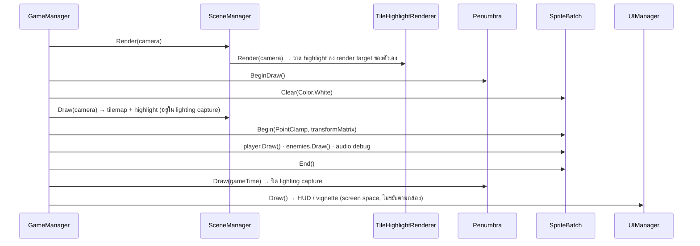
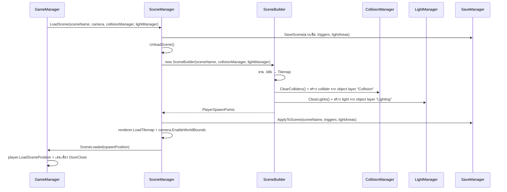

# Imaginophobia — System Design

**Version:** 2.0 | **Last Updated:** 2026-10-24

> เอกสารนี้อธิบายสถาปัตยกรรมจริงของโค้ดใน `src/Imaginophonia/Imaginophonia/`
> อ้างอิง: [Class Diagram](02-class-diagram.md) · [Data Schema](03-data-schema.md)

## 1. ภาพรวม

เกมรันบน **MonoGame (DesktopGL)** ด้วย **.NET 9** โครงสร้างเป็นแบบ **manager-based**: `GameManager` เป็นเจ้าของ manager ส่วนใหญ่ และ manager แต่ละตัวดูแล subsystem เดียว

ชั้นบนสุดเป็น `MainGame : Game` ซึ่งถือ `ScreenManager` ของ MonoGame.Extended และแสดง `GameplayScreen` เป็นหน้าจอเดียวที่ใช้งานจริง — `GameplayScreen` ห่อ `GameManager` อีกชั้นหนึ่ง

```
Program.Main()
  └── MainGame : Game
        ├── Initialize()            → สร้าง ScreenManager + BoxingViewportAdapter (1920×1080)
        │                             แล้ว ShowScreen(new GameplayScreen(...))
        ├── Update(GameTime)        → Time.Update() → ScreenManager.Update()
        └── Draw(GameTime)          → ScreenManager.Draw()
              └── GameplayScreen : Screen
                    └── GameManager
                          ├── Initialize (constructor) → สร้าง manager ทั้งหมด + โหลดฉากแรก
                          ├── Update(GameTime)        → อัปเดตทุก subsystem ตามลำดับ
                          └── Draw(GameTime)          → วาดตามลำดับ (ดู § 4)
```

`MainGame` เปิดเผย static ที่ทุกคลาสใช้ร่วมกัน: `Instance`, `Graphics`, `GraphicsDevice`, `SpriteBatch`, `Content`, `ScreenManager`

## 2. Manager และความรับผิดชอบ

| Manager | หน้าที่ | หมายเหตุ |
|---|---|---|
| `GameManager` | ศูนย์กลางของ gameplay — ถือ manager ย่อย, คุม state, โหลดฉาก, จัดการเหตุการณ์ (ประตู / enemy เกิด-ตาย) | จุดเริ่มอ่านโค้ด |
| `SceneManager` | ดูแลฉากที่ active (`SceneBuilder`), สั่ง `Update`/`Draw`/`Render`, สลับฉาก, sync highlight renderer | `static GetActiveScene()` |
| `SceneBuilder` | สร้างฉากจากไฟล์ `.ldtk` — สร้าง collider + แสง + highlight tile + `PlayerSpawnPoints` | ตัวเชื่อมระหว่าง LDtk กับเกม |
| `CollisionManager` | ลงทะเบียน collider แบบมี layer, ตรวจการชน, จัดการ interaction (ตู้/มินิเกม/ประตู), คำนวณ `FocusedTrigger` | `AddCollider(actor, layer)` · event `DoorInteracted` |
| `LightManager` | ถือ light ทั้งหมด (Penumbra) และ `LightArea`, อัปเดตตาม transform ของกล้อง | `static Penumbra` · `ScopoAlarmAll()` |
| `AudioManager` | เล่น SFX, ambience, spatial audio — **singleton** (`AudioManager.Instance`) | สร้างได้ตัวเดียว ถ้าสร้างซ้ำจะ throw |
| `EnemyManager` | สุ่ม spawn และอัปเดต enemy ทุกตัวภายใน world bound | `SpawnEnemy()`, `HasActiveScopophobia()`, events `EnemySpawned` / `EnemyRemoved` |
| `UIManager` | HUD (แถบ Sanity / Battery / ตัวนับวาล์ว / ตัวจับเวลา), vignette 3 ตัว, blink, ข้อความ tutorial, black screen | ถือ `TutorialManager` + `TextManager` |
| `TextManager` | วาดข้อความในเกม (tutorial + ข้อความชั่วคราว) และตัวเลข HUD | เดิมเอกสารเรียกว่า `DialogueManager` |
| `ObjectiveManager` | **static** — ติดตาม objective แบบ id และความคืบหน้าของวาล์ว/แผงไฟ | `TargetValves = 5` · event `Completed` |
| `TutorialManager` | อ่าน `Datas/tutorial` แล้วเลื่อน step ตาม objective ที่สำเร็จ | ผูกกับ `ObjectiveManager.Completed` |
| `SaveManager` | **static** — save/load สถานะ trigger + ไฟ ต่อฉาก ลง `%APPDATA%/Imaginophobia/save.json` | `SaveScene` / `ApplyToScene` / `ResetScene` / `Delete` |
| `TileHighlightRenderer` | วาด highlight ของวัตถุที่โต้ตอบได้ (วาล์ว / ตู้ / แผงไฟ / ประตู) ด้วย shader 2 ตัว | `Silhouette` + `HighlightComposite` |
| `InputManager` | **static** — รวมการอ่านคีย์บอร์ดไว้ที่เดียว (`A` / `D`) | ยังไม่ใช่ที่เดียวที่ผูกปุ่มทั้งหมด (ดู § 11) |

## 3. ลำดับการอัปเดต (Update Order)

`MainGame.Update` → `Time.Update(gameTime)` → `ScreenManager.Update` → `GameplayScreen.Update` → `GameManager.Update` ตามลำดับนี้:

1. `InputManager.Update()` — อ่าน input ก่อนทุกอย่าง
2. `_player.Update()` — ขยับผู้เล่น, ไฟฉาย, สายตา, sanity
3. `_enemyManager.Update(_camera.WorldBounds)` — ขยับศัตรู + ตั้งเวลา spawn
4. `_camera.LookAt(...)` + lerp zoom ตาม `player.FocusLevel`
5. `_collisionManager.Update()` — ตรวจการชนทั้งหมดหลัง object ขยับแล้ว
6. `_sceneManager.Update(_collisionManager)` — อัปเดต highlight ตาม `FocusedTrigger`
7. `_lightManager.Update(_camera.GetViewMatrix())` — อัปเดตแสงตามกล้อง
8. `AudioManager.Instance.Update(_player)` — อัปเดต spatial audio ตามตำแหน่งผู้เล่น
9. `_uiManager.Update()` — vignette, blink, tutorial text
10. `_cameraShaker.Update(gameTime)` — สั่นกล้อง
11. ถ้า `player.Sanity <= 0` → `Restart()`

> **เหตุผลของลำดับ:** input → ขยับ → ชน → แสง → เสียง → UI เพราะแต่ละขั้นต้องใช้ผลจากขั้นก่อนหน้า

## 4. ลำดับการวาด (Draw Order)

`GameManager.Draw` เรียงชั้นการวาดเพื่อให้ highlight อยู่ "หลังผู้เล่น" แต่ยังอยู่ใน lighting capture ของ Penumbra:



## 5. การโหลดฉาก (Scene Loading)



ฉากที่มีอยู่ (`enum Scene`): `tilemap_electrical_room`, `tilemap_electrical_room_2`, `tilemap_sewer`

- `SceneBuilder` อ่าน object layer ชื่อ **`Collision`** แล้วแยกตาม `entity.Class`: `wall` → `Wall`, `dots` / `hideout` / `skillcheck` → `Trigger`, `door` → `Trigger` (ชื่อ = ค่า property `Destination`), `spawn` → `SpawnPoint` (ชื่อ = property `Origin`)
- อ่าน object layer ชื่อ **`Lighting`** แล้วแยกตาม `entity.Name`: `PointLight` (ได้ `LightArea` + collider layer `lights`), `DoorLight` (ได้ `PointLight` เฉย ๆ ไม่มี collider), `SpotLight`
- `SceneManager.LoadScene` เลือก ambience: ฉาก `tilemap_sewer` → `"sewer"` ที่เหลือ → `"test"` (คือ `amb_electricroom`)

## 6. Collision Layer

`CollisionManager` ใช้ `CollisionWorld2D` ของ MonoGame.Extended และสร้าง layer ใหม่ทุกครั้งที่โหลดฉาก (`ResetLayers()`)

| Layer | Dynamic | ใส่อะไร |
|---|---|---|
| `walls` | ❌ | `Wall` จาก tilemap |
| `triggers` | ❌ | `Trigger` (ตู้ / มินิเกม / ประตู) |
| `enemies` | ✅ | `Autophobia`, `Scopophobia` |
| `lights` | ❌ | `LightArea` |

การตั้งค่าการชนระหว่าง layer:

- ปิดการชนระหว่าง `enemies` ↔ `walls` และ `lights` ↔ `walls`
- เปิดการชนระหว่าง `enemies` ↔ `lights` (เพื่อให้ศัตรูทำให้ไฟกระพริบ/ดับ)

การตรวจการชนที่ทำทุกเฟรม:

| คู่ | ผล |
|---|---|
| Player ↔ `walls` | `player.CollideWithWallMove(MTV)` |
| Player ↔ `triggers` | หา `FocusedTrigger` ที่ใกล้ที่สุด → ตั้ง `CanInteract` / `ReadyToHide` / เปิดมินิเกม / เปลี่ยนฉาก |
| Player ↔ `enemies` | Autophobia → `Sanity −10` แล้วปิด enemy · Scopophobia (ที่ยัง `Visible`) → `Sanity −25` แล้วซ่อน enemy |
| Player `EyeSight` ↔ Autophobia | ถ้าตัดกัน → `AllowMovement = false`, ลบออกจาก collision world, `player.Blink = true` |
| Player ↔ `lights` | ถ้า `LightArea.On == false` และไม่กำลัง flicker → `player.Nyctophobia = true` |
| `enemies` ↔ `lights` | Autophobia → `lightArea.StartFlicker()` · ตัวอื่น → `lightArea.TurnOff()` |

> **หมายเหตุ:** `ICollisionActor` เป็น interface ของ MonoGame.Extended (`CollisionShape2D Shape` + `int Id`) ไม่ได้ประกาศในโปรเจกต์ — ตัวที่ implement คือ `Player`, `Autophobia`, `Scopophobia`, `Wall`, `Trigger`, `Collectible`, `LightArea`

## 7. Lighting

- ใช้ **MonoGame.Penumbra** ทำแสง 2D — `LightManager.Penumbra` เป็น static `PenumbraComponent`
- `Penumbra.AmbientColor = #242323` (แสงแวดล้อมมืด)
- `LightManager.Update(Matrix transformMatrix)` ตั้ง `Penumbra.Transform` ตามกล้อง แล้วอัปเดต `LightArea` ทุกตัว
- `LightArea` ทำหน้าที่เป็นทั้ง collider และแหล่งแสง — ใช้ตรวจว่าผู้เล่นอยู่ในแสงหรือความมืด · มีสถานะ `On` (มีไฟ), `IsFlickering`, และ `ScopoIncoming()` (เปลี่ยนแสงเป็นสีแดง)
- แสงที่ผูกกับผู้เล่น (สร้างใน `Player` แล้วเพิ่มเข้า `Penumbra.Lights` ตรง ๆ): `PointLight` รอบตัว (`_scotopicLight`, scale 500×500) และ `Spotlight` ไฟฉาย (`_flashLight`, scale 600×1250)
- เอฟเฟกต์เสริมใน `Scripts/SpriteEffects/`:
  - `VignetteOverlay` — ขอบจอมืดลง ใช้ 3 ตัวใน `UIManager`: `_vignetteOverlay` (sanity), `_blinkOverlay` (กระพริบตา), `_nyctophobiaOverlay` (ถูกความมืดกลืน) · shader `Shaders/Vignette` เทคนิค `EllipseMask`
  - `BottomFadeOverlay` — เฟดด้านล่างของจอ · shader `Shaders/BottomFade`

## 8. Audio

- `AudioManager` เป็น **singleton** (`Instance`) และเป็นเจ้าของ `AudioSource` ที่ active ทั้งหมด (`AudioSource : GameObject, IDisposable`)
- `NameSFX` เป็น `Dictionary<Sound, SoundEffect>` ที่โหลดจาก `Content/Audio/` — enum `Sound` มี 15 ค่า
- ตัวที่ implement `IAudioApplicable` (มี `MoveSpeed` / `Velocity` / `Direction`) จะใช้คำนวณ spatial audio: `Player`, `Autophobia`, `Scopophobia`
- **Spatial audio:** `Play3DSFX(pos, sound, innerRadius = 10, outerRadius = 80)` — `AudioSource.UpdateSpatialAudio(player)` คำนวณ volume จากระยะห่าง, `Pan` จากแกน X และ `Pitch` จาก Doppler effect (`SPEED_OF_SOUND = 343.5`)
- `PlayStepsSFX` ใช้กับเสียงฝีเท้า (มี 8 แบบ ไล่ตามลำดับ `_stepOrder`)
- `PlayAmbiance(ambName)` เล่น `Song` วนซ้ำผ่าน `MediaPlayer` — `"sewer"` → `amb_sewer` · ค่าอื่น → `amb_electricroom`
- มี `MuteAudio` / `UnmuteAudio` / `ToggleMute` / `PauseAudio` / `ResumeAudio` พร้อมเก็บ volume เดิมไว้

## 9. Highlight System

ระบบ highlight วัตถุที่โต้ตอบได้ ทำงานร่วมกัน 3 คลาส:

| คลาส | หน้าที่ |
|---|---|
| `HighlightSettings` | พารามิเตอร์ของ effect: `ScanSpeed`, `ScanWidth`, `ScanColor`, `PulseSpeed`, `PulseMin`, `PulseColor`, `OutlineRadius`, `OutlineColor` |
| `HighlightGroup` | กลุ่ม tile ที่จะวาด: `Layer`, `Settings`, `FocusTiles`, `ScanTiles`, `PulseTiles` |
| `TileHighlightRenderer` | ถือ 4 กลุ่ม (`ValveGroup`, `LockerGroup`, `PanelGroup`, `DoorGroup`) และวาดผ่าน render target 2 ตัว |

- `SceneBuilder.BuildHighlightTiles` flood-fill tile จาก tile layer ที่ชื่อตรงกับ entity (ตัด `s` ตัวท้ายออก) — ยกเว้น entity `LoadNextScene` ที่ใช้ layer `Doors`
- `SceneManager.UpdateHighlight` เลือกกลุ่มตามชื่อ tile layer (`Valves` / `Lockers` / `ElectricalPanel` / `Doors`) และข้ามวัตถุที่ซ่อมเสร็จแล้วหรือกำลังถูกใช้อยู่
- shader: `Shaders/Silhouette` (เทคนิค `HighlightMask` — เขียน mask ลงช่อง RGBA) + `Shaders/HighlightComposite` (เทคนิค `Highlight` — รวม mask เป็น outline/scan/pulse)

## 10. Minigame Screens

ทุกหน้าจอสืบทอดจาก `Screen` ของ **MonoGame.Extended.Screens** (`Update(GameTime)` / `Draw(GameTime)`) และถูกเปิดผ่าน `MainGame.ScreenManager.ShowScreen(...)`

| Screen | ใช้กับ | หมายเหตุ |
|---|---|---|
| `GameplayScreen` | หน้าหลักของการเล่น | ห่อ `GameManager` · ตั้ง `UpdateWhenInactive` / `DrawWhenInactive = true` |
| `SpinTheValveScreen` | ซ่อมวาล์ว (trigger tag `skillcheck`) | ใช้ `UI/sprite_valve.png` · หมุนด้วยเมาส์ · `MinigameVisible` ถูกปิดชั่วคราวตอน Scopophobia มา |
| `ConnectTheDotsScreen` | ซ่อมไฟ (trigger tag `dots`) | ใช้ `UI/spritesheet_minigame_dot` (TexturePacker atlas) · กระดาน 6×6 · helper `AddDot`, `ScreenToGrid`, `TryExtendPath`, `GetCellTopLeft`, `GetCellTopCenter` |
| `SkillCheckScreen` | *(ไม่ได้ใช้)* | ใช้ `UI/Needle.png` + `UI/Radial Circle.png` — ไม่มีที่ไหนเรียกใช้แล้ว |

## 11. Utility

| Class | หน้าที่ |
|---|---|
| `Time` (static) | ตัวจับเวลากลาง — `DeltaTime`, `ElapsedTime`, `AddTimer(seconds[, name])`, `AddTimer(Action, seconds[, name])`, `RemoveTimer` · `MainGame.Update` เรียก `Time.Update` ให้ทุกเฟรม |
| `Timer` | ตัวจับเวลาเดี่ยว — `TimeLeft`, `Active`, `Repeat`, `ToggleActive()`, `Reset()`, event `OnTimerCompleted` |
| `CameraShaker` | สั่นกล้อง — `Shake(duration, magnitude)` แล้ว `Update(gameTime)` ให้ `ShakeOffset` |
| `SpawnPoint` | จุดเกิด (`Name` + `Position`) |
| `GameObject` | base class ของทุกอย่างในฉาก — `Transform2`, `Parent`/`Children`, `Active`/`Visible`, `Update()`/`Draw()` เป็น virtual, `OnDestroyed()` |

## 12. Extension Points (จุดที่ควรขยาย)

| อยากเพิ่ม | ต้องแตะ |
|---|---|
| Phobia ตัวใหม่ (เช่น Entamaphobia) | สร้างคลาสใน `Scripts/Enemies/` implement `IAudioApplicable` + `ICollisionActor`, เพิ่มโอกาส spawn ใน `EnemyManager` (และแก้ `OnStageChanged` ถ้าต้องผูกกับ sanity), เพิ่ม asset ใน `Content/Phobias/` + `Content.mgcb` |
| Minigame ใหม่ | สร้างคลาสใน `Scripts/Screen/` สืบทอด `Screen` แล้วเปิดจาก `CollisionManager` ตาม tag ของ `Trigger` |
| ฉากใหม่ | เพิ่ม `.ldtk` ใน `Content/Tilemaps/` + ลงทะเบียนใน `Content.mgcb` + เพิ่มค่าใน `enum Scene` |
| เสียงใหม่ | เพิ่มไฟล์ใน `Content/Audio/` + ลงทะเบียนใน `Content.mgcb` + เพิ่มค่าใน `enum Sound` + เพิ่ม entry ใน `AudioManager.NameSFX` |
| ข้อความ tutorial ใหม่ | เพิ่ม step ใน `Content/Datas/tutorial.json` (`Text` + `CompleteOn` = objective id) แล้วเรียก `ObjectiveManager.Complete(id)` ที่จุดที่ต้องการ |
| ค่าปรับแต่ง (speed, sanity rate) | **ยังไม่มีศูนย์กลาง** — กระจายอยู่ในโค้ด (ดู [Data Schema](03-data-schema.md)) |

## 13. Known Issues / Technical Debt

| ปัญหา | รายละเอียด |
|---|---|
| ค่าปรับแต่งกระจายอยู่ทั่วโค้ด | ยังไม่มี config/data file กลาง ทำให้บาลานซ์เกมยาก (backlog ระบุว่าต้องการ data file) — มีแค่ `Datas/tutorial.json` ที่เป็น data จริง |
| `SkillCheckScreen` เป็น dead code | ไม่มีที่ไหนเรียกใช้ — ถูกแทนที่ด้วย `SpinTheValveScreen` แล้ว ควรลบหรือเก็บไว้เป็น reference |
| `InputManager` ไม่ได้เป็นที่เดียวที่ผูกปุ่ม | `A`/`D` อยู่ที่ `InputManager` แต่ `Left Ctrl`, `F`, `Space`, `Q` อ่านตรงใน `Player.cs`, `CollisionManager.cs` และหน้าจอมินิเกม |
| Save ยังไม่ครอบคลุมทุกอย่าง | `SaveManager` บันทึกแค่ trigger (progress / interactable) และสถานะไฟ — **ไม่บันทึก** ตำแหน่งผู้เล่น, Sanity, Battery, ฉากปัจจุบัน (โหลดฉากแรกใหม่เสมอ) และ `GameManager` เรียก `SaveManager.Delete()` ทุกครั้งที่เริ่มเกม/ตาย |
| ตัวจับเวลาหลักไม่รีเซ็ต | `Time.AddTimer(Restart, 600, "MainTimer")` ถูกสร้างใน constructor ของ `GameManager` ครั้งเดียว — เมื่อครบ 600 วินาทีจะเรียก `Restart()` หนึ่งครั้ง แล้ว `Time.Update` จะลบ timer ที่ `TimeLeft <= 0` ออก ตัวนับเวลาใน HUD จึงค้างที่ `00:00` และไม่เริ่มใหม่ |
| ยังไม่มีเมนู / settings / death-win screen | โค้ดปัจจุบันมีแค่ `GameplayScreen` — ไม่มี Main menu, Settings, Credits, Death screen, Win screen (asset `UI/death_screen`, `UI/win_screen` มีเฉพาะใน `bin/` ที่ล้าสมัย) |
| ชื่อไฟล์/โฟลเดอร์สะกดไม่ตรงกัน | `spitesheet_player` (ขาด `r`) · โฟลเดอร์ `Imaginophonia` แต่ project `Imaginophobia` · `TurotialData.cs` / `TurorialDataReader.cs` สะกดผิด · ชื่อไฟล์เสียง `sfx_light_flickering_short_01 .ogg` มีช่องว่างเกิน |
| ไฟล์ใน `Content/bin/` ล้าสมัย | `bin/` มีไฟล์ที่ไม่มีใน `Content/` ต้นทางแล้ว (เช่น `sfx_darkness`, `sfx_heartbeat`, `sfx_light_*`, `sfx_panting`, `sfx_phobias_hit`, `sfx_screen_on/off`, `bgm_mainmenu/death/win_screen`, `Shaders/Saturation`) — เป็น build artifact ที่ค้างมาจากชุด content เก่า ควรลบและเพิ่ม `Content/bin/` ใน `.gitignore` |

## Related Documents

- Class Diagram: [Class Diagram](02-class-diagram.md)
- Data Schema: [Data Schema](03-data-schema.md)
- Concept (architecture summary): [Game Concept](../01_GDD/00-concept.md#7-system-architecture)
- Mechanics: [Mechanics](../01_GDD/03-mechanics.md)
