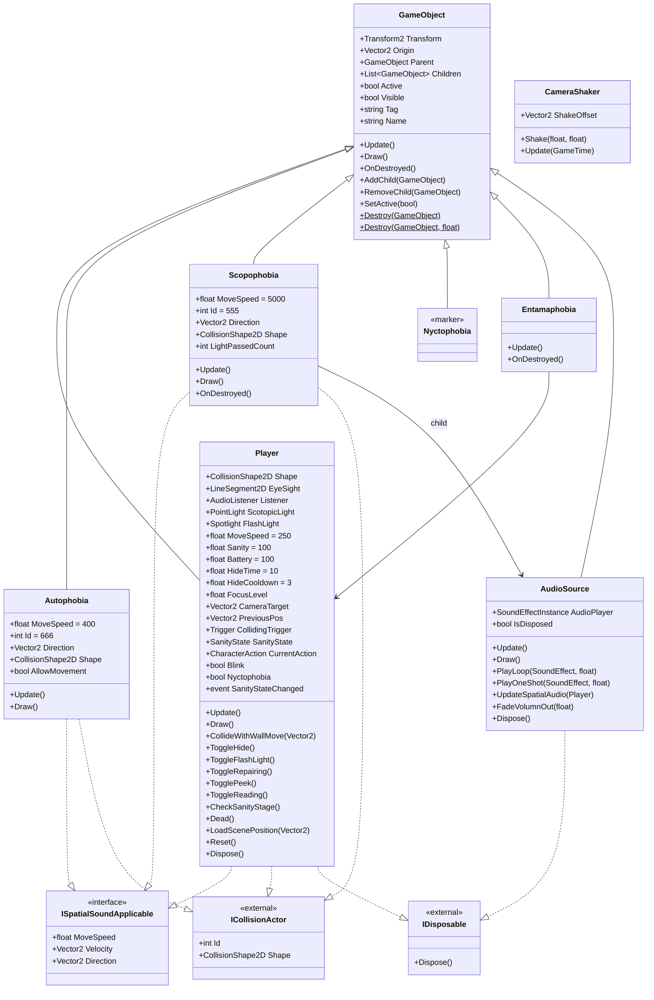
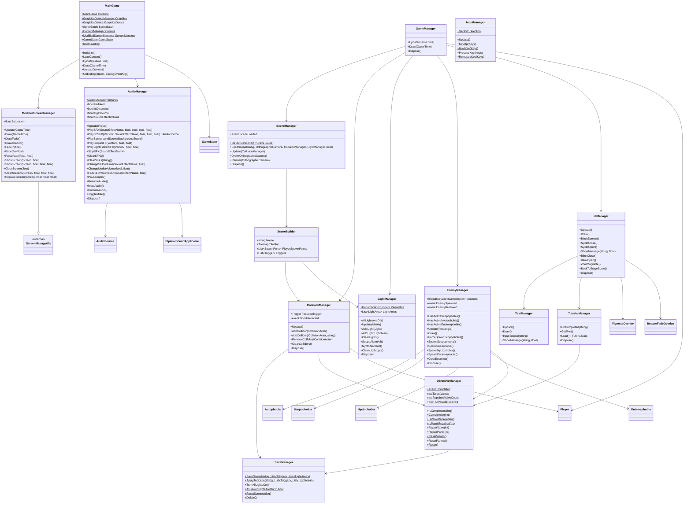
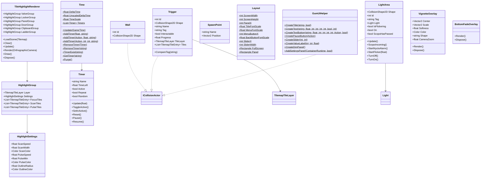
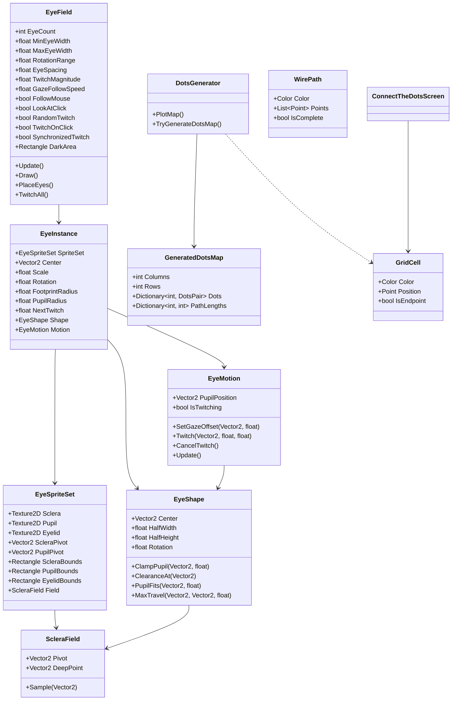
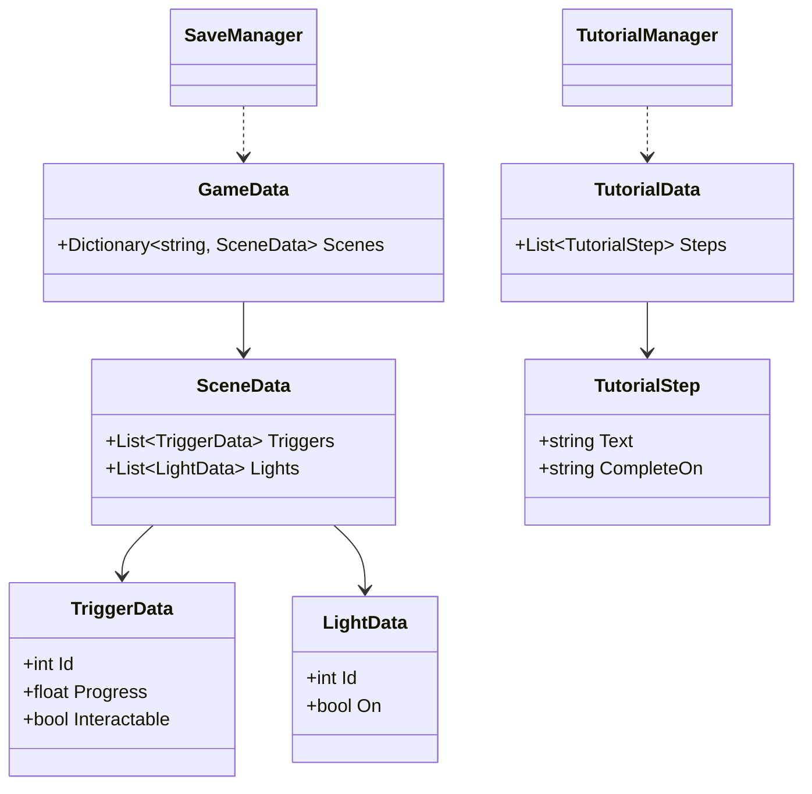
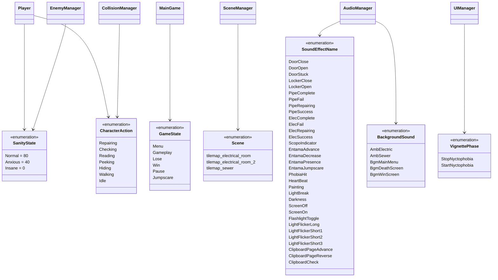

# Imaginophobia — Class Diagram

**Version:** 4.0 (Release 1.0.0) | **Last Updated:** 2026-11-02

> สร้างจากโค้ดจริงใน `src/Imaginophobia/Imaginophobia/` (HEAD `3a300ec`, 2026-11-02) — **71 types · 909 members · 59 ค่า enum · 87 relationships**
> ไฟล์นี้เดิมอยู่ใน `docs/01_GDD/04-class-diagram.md` — ย้ายมาไว้ในหมวด Software Design เพราะเป็นงานออกแบบซอฟต์แวร์
> คลาสที่มาจากไลบรารี (`Game`, `Screen`, `ICollisionActor`, `GameObject` ของ MonoGame.Extended, `Penumbra`) ถูกทำเครื่องหมาย `<<external>>` และ `ISpatialSoundApplicable` ประกาศในโปรเจกต์เองที่ `Scripts/ISpatialSoundApplicable.cs`
> ทุกไดอะแกรมในไฟล์นี้ผ่านการ parse ด้วย Mermaid parser จริง

## Core Hierarchy

> `Nyctophobia` เป็น **marker class เปล่า ๆ** — ใช้ให้ `EnemyManager.HasActiveNyctophobia()` ตรวจได้ว่า "ความมืดกำลังเล่นงานอยู่" พฤติกรรมจริงอยู่ใน `Player.Nyctophobia` + `LightArea.StartNyctoAlarm()` + `UIManager`
> `Entamaphobia` ผูกกับ `Player` และกับ `Trigger` ของประตู (`_door.Progress = _stage`) — ตัวมันเองไม่ implement `ICollisionActor` เพราะไม่ต้องชนกับผู้เล่น
> `CameraShaker` ถูกประกาศในกลุ่มนี้เพราะเป็นผู้ช่วยของกล้องใน gameplay แต่ **ไม่มีที่ไหนเรียกใช้** — บรรทัดเรียกใน `GameManager` คอมเมนต์ไว้

## Managers

> `MainGame` เป็นเจ้าของทุกอย่างในระดับเกม · `GameManager` เป็นเจ้าของทุกอย่างในระดับ gameplay (สร้างใน `GameplayScreen.Initialize`)
> `AudioManager` เป็น singleton ที่ `MainGame.Initialize()` สร้าง — `SfxByName` (33 ค่า) และ `BgsByName` (5 ค่า) อยู่ในตัวมัน
> `ObjectiveManager` / `SaveManager` / `InputManager` เป็น **static ทั้งคู่** — ไม่มี instance ให้ถือ
> `SaveManager` เป็น static ที่ `CollisionManager` และ `GameManager` เรียกใช้ตรง ๆ (เช็ค `AllSewerLightsAreOn` / `ResetScene` / `SaveScene`)

## Screens

```mermaid
classDiagram
    class Screen {
        <<external>>
        +Update(GameTime)
        +Draw(GameTime)
        +Initialize()
        +Dispose()
    }

    class MainMenuScreen {
        +Initialize()
        +Update(GameTime)
        +Draw(GameTime)
        +OnActivated()
        +OnDeactivated()
        +Dispose()
    }

    class SettingsScreen {
        +Update(GameTime)
        +Draw(GameTime)
        +OnActivated()
        +OnDeactivated()
        +Dispose()
    }

    class CreditsScreen {
        +Update(GameTime)
        +Draw(GameTime)
        +OnActivated()
        +OnDeactivated()
        +Dispose()
    }

    class GameplayScreen {
        +Initialize()
        +Update(GameTime)
        +Draw(GameTime)
        +OnActivated()
        +OnDeactivated()
        +UnloadContent()
        +Dispose()
    }

    class DeathScreen {
        +Initialize()
        +Update(GameTime)
        +Draw(GameTime)
        +OnActivated()
        +OnDeactivated()
        +Dispose()
    }

    class WinScreen {
        +WinScreen(float)
        +Initialize()
        +Update(GameTime)
        +Draw(GameTime)
        +OnActivated()
        +OnDeactivated()
        +Dispose()
    }

    class JumpScareScreen {
        +Update(GameTime)
        +Draw(GameTime)
    }

    class SpinTheValveScreen {
        +bool MinigameActive
        +bool MinigameVisible
        +Update(GameTime)
        +Draw(GameTime)
    }

    class ConnectTheDotsScreen {
        +bool MinigameActive
        +Update(GameTime)
        +Draw(GameTime)
        +CreateGrid()
        +AddDot(int, int, Color)
        +ScreenToGrid(Vector2) Point
        +TryExtendPath(WirePath, Point)
        +GetCellTopCenter(Point)
        +GetCellTopLeft(Point)
        +CleanUp()
    }

    class DoorPeekingScreen {
        +Initialize()
        +Update(GameTime)
        +Draw(GameTime)
    }

    class ClipboardScreen {
        +Vector2 ClipboardPos
        +int CurrentPage
        +int MaxPage
        +Update(GameTime)
        +Draw(GameTime)
        +Dispose()
    }

    Screen <|-- MainMenuScreen
    Screen <|-- SettingsScreen
    Screen <|-- CreditsScreen
    Screen <|-- GameplayScreen
    Screen <|-- DeathScreen
    Screen <|-- WinScreen
    Screen <|-- JumpScareScreen
    Screen <|-- SpinTheValveScreen
    Screen <|-- ConnectTheDotsScreen
    Screen <|-- DoorPeekingScreen
    Screen <|-- ClipboardScreen
    MainMenuScreen --> EyeField
    GameplayScreen --> GameManager
    GameplayScreen --> GumUIHelper
    DeathScreen --> GumUIHelper
    WinScreen --> GumUIHelper
    MainMenuScreen --> GumUIHelper
    CreditsScreen --> GumUIHelper
    SettingsScreen --> GumUIHelper
    SpinTheValveScreen --> Trigger
    ConnectTheDotsScreen --> DotsGenerator
    ConnectTheDotsScreen --> WirePath
    DoorPeekingScreen --> Trigger
    ClipboardScreen --> Trigger
```

> หน้าจอทั้งหมดสืบทอด `Screen` ของ MonoGame.Extended และถูกเปิดผ่าน `ModifiedScreenManager` (มี fade ทุกครั้ง)
> `GameplayScreen` ตั้ง `UpdateWhenInactive` / `DrawWhenInactive = true` — gameplay จึงยังเดินอยู่เบื้องหลังหน้าจอที่ push ทับ (เช่น `DoorPeekingScreen`, `ClipboardScreen`, `JumpScareScreen`)
> `SpinTheValveScreen` / `ConnectTheDotsScreen` / `DoorPeekingScreen` / `ClipboardScreen` รับ `Player` และ/หรือ `Trigger` เข้ามาในคอนสตรัคเตอร์และเขียน progress กลับลง trigger ตัวนั้น
> ไม่มี `SkillCheckScreen` หรือ `PauseScreen` ในโปรเจกต์แล้ว (โฟลเดอร์ `Scraped/` ถูกนำออกทั้งโฟลเดอร์) — pause กลายเป็น overlay ที่อยู่ใน `GameplayScreen`

## Colliders, Highlight & Support

> `Trigger` / `Wall` / `LightArea` ทั้งสามเป็น `ICollisionActor` ที่ถูกใส่ลง `CollisionManager` คนละ layer (`triggers` / `walls` / `lights`)
> `TileHighlightRenderer` ถือ 6 กลุ่ม (`ValveGroup`, `LockerGroup`, `PanelGroup`, `DoorGroup`, `ClipboardGroup`, `LadderGroup`) และวาดผ่าน render target 2 ตัว (mask + composite)
> `Layout` และ `GumUIHelper` เป็น static helper ที่หน้าจอ Gum ใช้ร่วมกัน — `Time` / `Timer` เป็นระบบเวลากลางที่ทุก subsystem เรียกใช้

## Menu Eyes & Puzzle Data

> `EyeField` ใช้กับ `MainMenuScreen` เท่านั้น — วางดวงตาลงบนบริเวณมืดของ `UI/background_main.png` (หาโซนมืดด้วย integral image), ให้รูม่านตาจ้องเมาส์ และกระพริบเป็นจังหวะ
> `EyeShape` ใช้ signed-distance field (`ScleraField`) กันไม่ให้รูม่านตาหลุดออกนอกตาขาว — `ClampPupil` / `PupilFits` / `MaxTravel` เป็นตัวคุมการเคลื่อนไหว
> `ConnectTheDotsScreen` เป็นเจ้าของ `GridCell` 6×6, `WirePath` (เส้นที่ผู้เล่นลาก) และเรียก `DotsGenerator` สุ่มแผนใหม่ทุกรอบซ่อม

## Data & Persistence

> `GameData` / `SceneData` / `TriggerData` / `LightData` คือโครงของ `%APPDATA%\Imaginophobia\save.json` (serialize ด้วย `System.Text.Json`)
> `TutorialData` / `TutorialStep` อ่านจาก `Content/Datas/tutorial.json` — ไม่ได้ผ่าน MGCB (copy ไป output ด้วย csproj แล้วอ่านด้วย `File.ReadAllText`)
> ทั้งสองชุดเป็น POCO ล้วน ไม่มี logic

## Enums

> `SanityState` ใช้ค่า enum เป็น threshold จริง (80 / 40 / 0) · `SoundEffectName` มี **33 ค่า** (ไม่นับเสียงฝีเท้า 8 ไฟล์ที่โหลดเป็น array)
> `GameState` ถูกใช้เป็น static `MainGame.GameState` และมีผลกับ `Player.Update`, `GameManager.Update`, `CollisionManager` และ `ConnectTheDotsScreen`
> enum `BlinkPhase` ถูกลบออกจากโปรเจกต์แล้ว

## หมายเหตุ

- จำนวน type ทั้งหมด **71** (นับจาก `extract_csharp_types.py` บน `src/Imaginophobia/Imaginophobia/`) — รวมคลาสใน `Scripts/Eyes/` ที่ไม่ได้อยู่ในไดอะแกรมกลุ่มอื่น
- `PenumbraComponent` / `Light` / `Spotlight` / `PointLight` / `AudioListener` / `Screen` / `ICollisionActor` / `Game` / `Tilemap*` มาจากไลบรารี (MonoGame.Extended, MonoGame.Framework, Penumbra) — ไม่ได้ประกาศในโปรเจกต์
- static members ถูกทำเครื่องหมายด้วย `$` ต่อท้ายชื่อ (ตาม syntax ของ Mermaid)

## Related Documents

- System Design: [System Design](01-system-design.md)
- Data Schema (รายละเอียด enum / level data / save / tuning): [Data Schema](03-data-schema.md)
- Concept (ภาพรวมสถาปัตยกรรม): [Game Concept](../01_GDD/00-concept.md#7-system-architecture)
