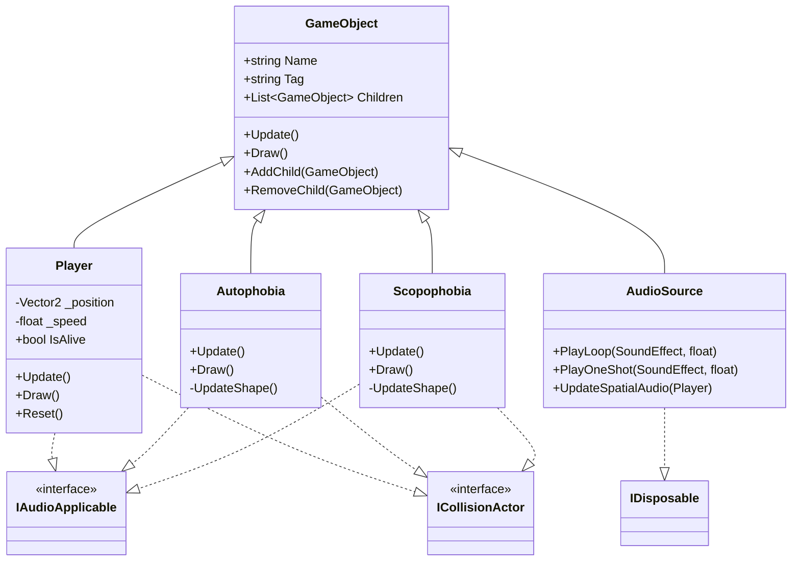
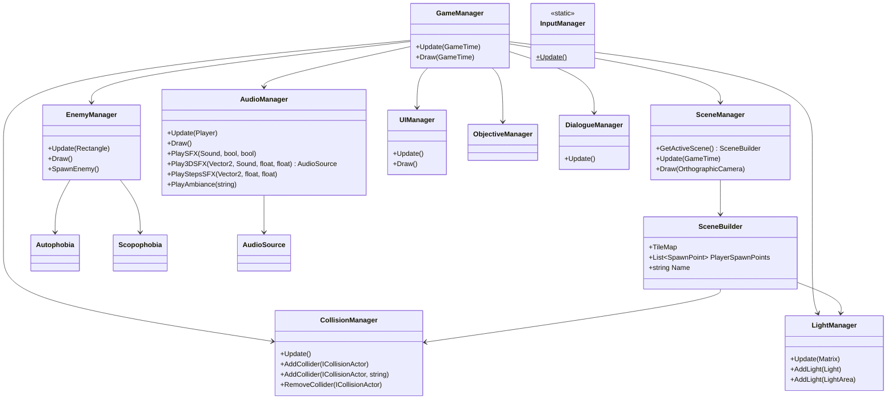
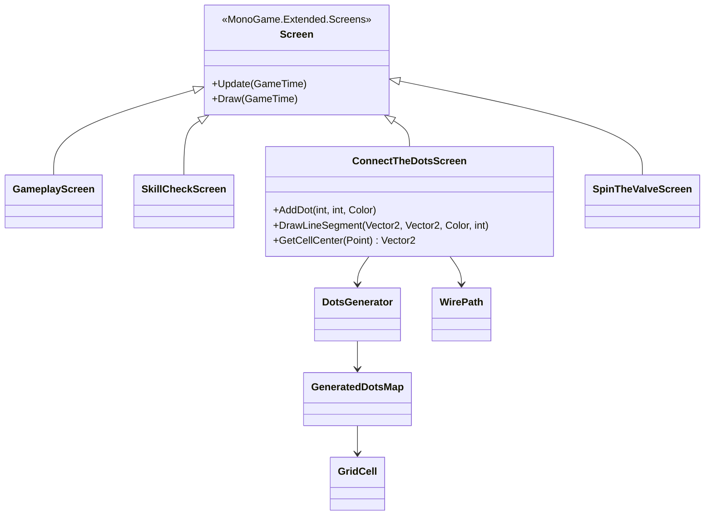
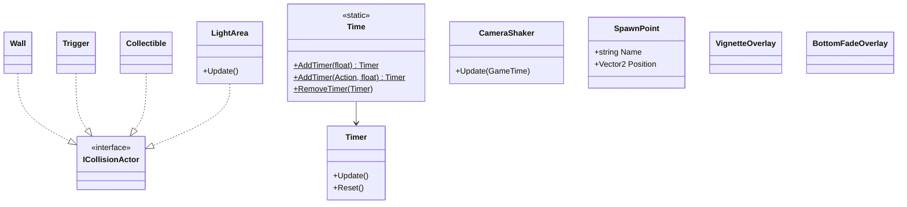
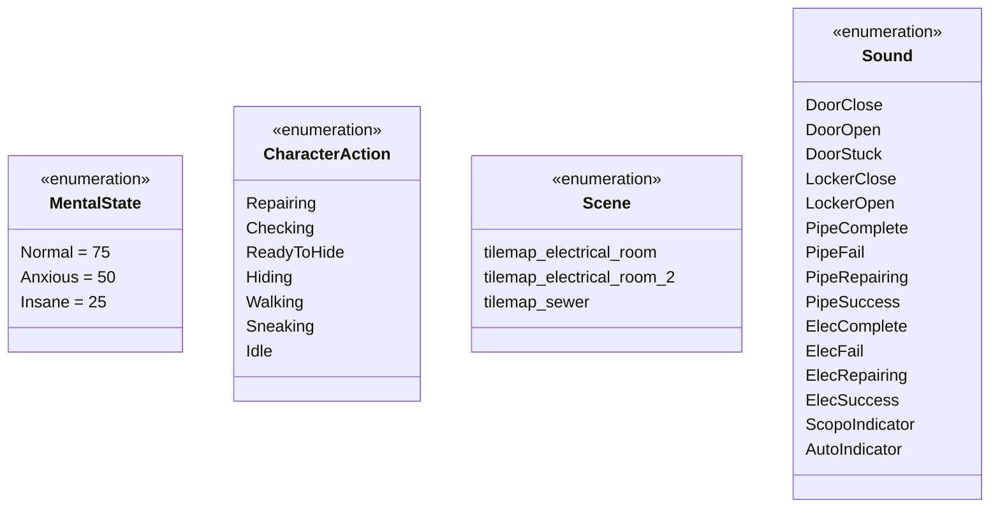

# Imaginophobia — Class Diagram

**Version:** 1.0 | **Last Updated:** 2026-10-14

> สร้างจากโค้ดจริงใน `src/Imaginophonia/Imaginophonia/Scripts/`
> ไฟล์นี้เดิมอยู่ใน `docs/01_GDD/04-class-diagram.md` — ย้ายมาไว้ในหมวด Software Design เพราะเป็นงานออกแบบซอฟต์แวร์

## Core Hierarchy

## Managers

## Screens (Minigames)

## Colliders & Support

## Enums

## หมายเหตุ

- `Screen` มาจากไลบรารี **MonoGame.Extended.Screens** ไม่ได้ประกาศในโปรเจกต์
- `ICollisionActor` ประกาศอยู่ในไฟล์ `Scripts/Managers/CollisionManager.cs`
- `Nyctophobia` และ `Claustrophobia` **ยังไม่มีคลาส** — อยู่ในแผนพัฒนา
- `ObjectiveManager`, `DotsGenerator`, `GeneratedDotsMap`, `GridCell`, `WirePath`, `SceneBuilder`, `VignetteOverlay`, `BottomFadeOverlay` มีรายละเอียดสมาชิกไม่ครบในไดอะแกรมนี้ — ดูโค้ดจริงเมื่อแก้ไข

## Related Documents

- System Design: [System Design](01-system-design.md)
- Data Schema: [Data Schema](03-data-schema.md)
- Mechanics (phobia behavior): [Mechanics](../01_GDD/03-mechanics.md)
