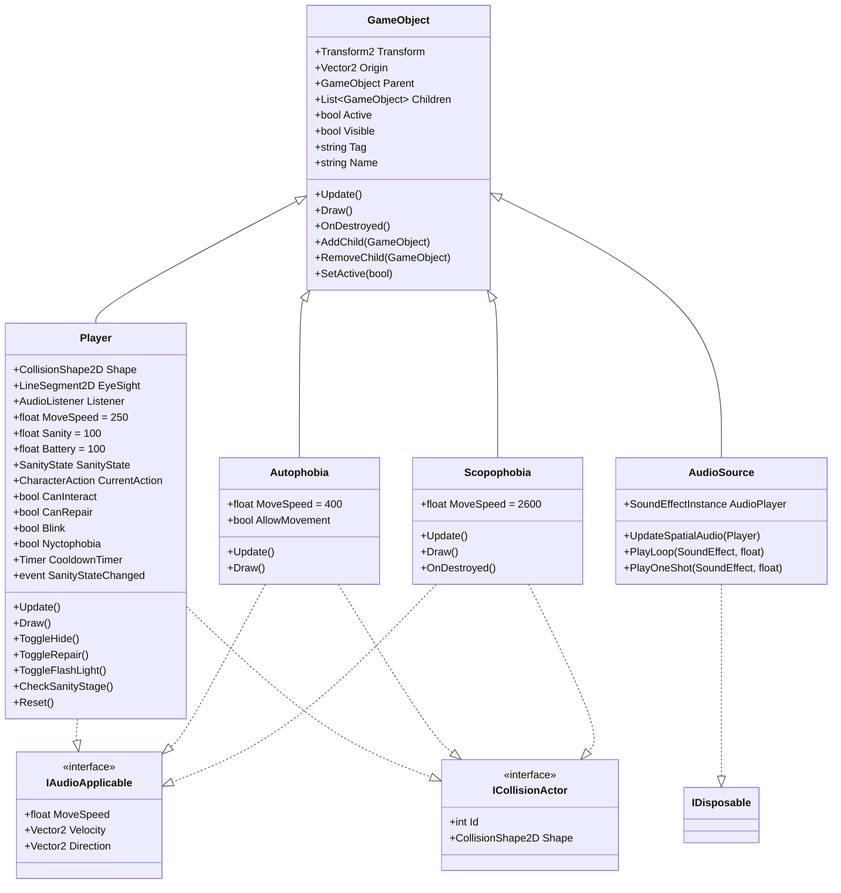
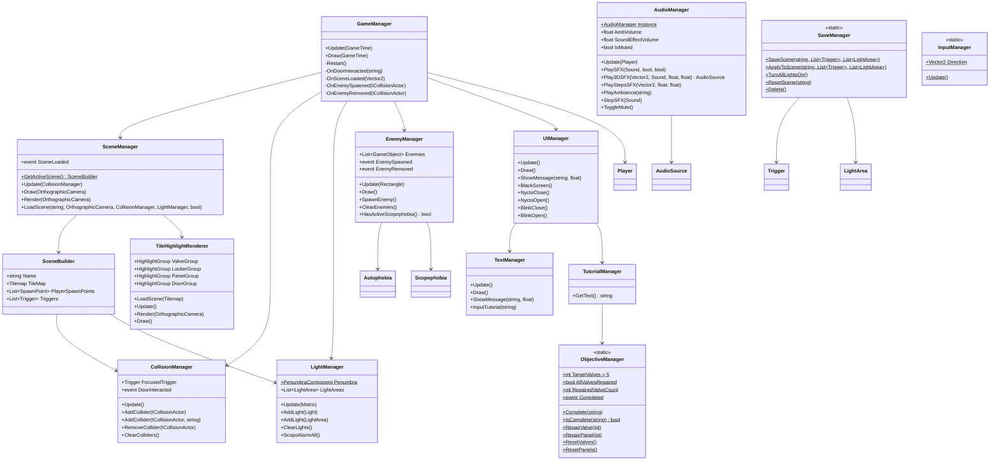
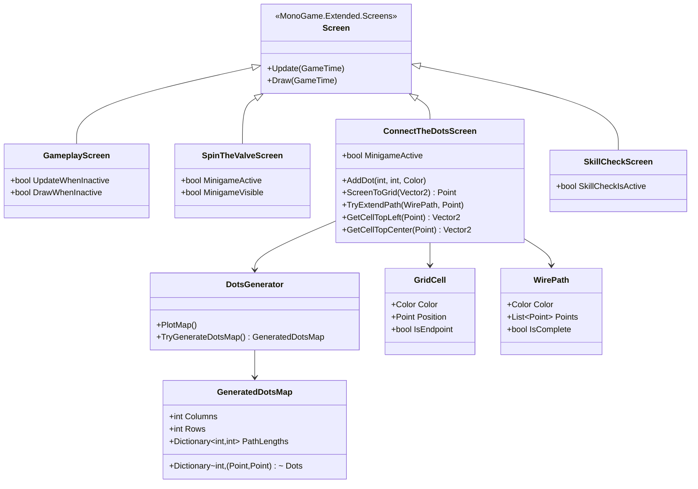
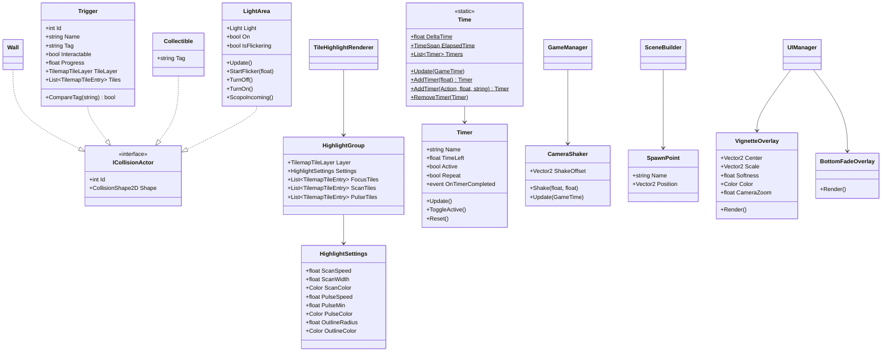
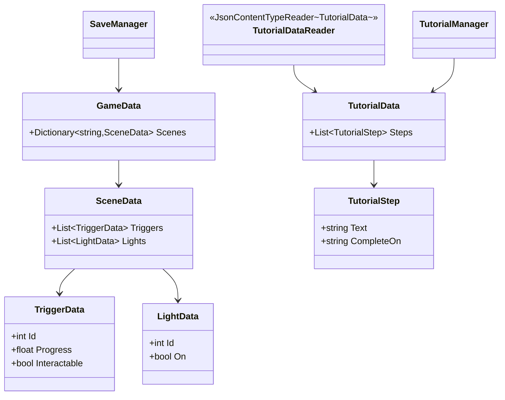
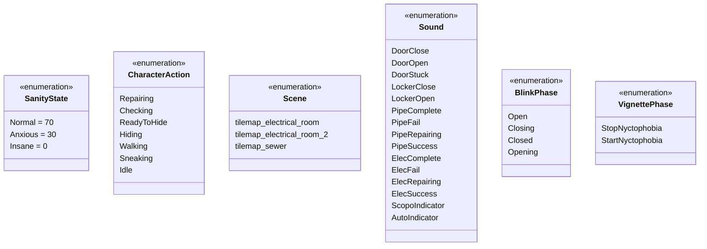

# Imaginophobia — Class Diagram

**Version:** 2.0 | **Last Updated:** 2026-10-24

> สร้างจากโค้ดจริงใน `src/Imaginophonia/Imaginophonia/`
> ไฟล์นี้เดิมอยู่ใน `docs/01_GDD/04-class-diagram.md` — ย้ายมาไว้ในหมวด Software Design เพราะเป็นงานออกแบบซอฟต์แวร์
> `ICollisionActor` และ `Screen` มาจากไลบรารี MonoGame.Extended ไม่ได้ประกาศในโปรเจกต์

## Core Hierarchy

## Managers

## Screens (Minigames)

> `SkillCheckScreen` ไม่มีที่ไหนเรียกใช้แล้ว — เก็บไว้เป็น reference เท่านั้น

## Colliders, Highlight & Support

## Data & Persistence

## Enums

## หมายเหตุ

- `Screen` มาจากไลบรารี **MonoGame.Extended.Screens** · `ICollisionActor` มาจาก **MonoGame.Extended.Collisions** · `Light` / `PointLight` / `Spotlight` / `PenumbraComponent` มาจาก **Penumbra**
- `SanityState`, `Scene`, `Sound`, `BlinkPhase`, `VignettePhase` อยู่ใน `Scripts/Enums/` แต่ `CharacterAction` อยู่ที่ `Scripts/CharacterAction.cs` โดยตรง
- `BlinkPhase` ประกาศใน namespace `Imaginophobia.Scripts.Enums` — ต่างจาก enum ตัวอื่นที่อยู่ใน `Imaginophobia`
- `Nyctophobia`, `Claustrophobia` และ `Entamaphobia` **ยังไม่มีคลาส** — Nyctophobia/Claustrophobia ทำงานผ่าน `LightArea` + `Player` + `UIManager` ส่วน Entamaphobia ยังเป็นข้อเสนอ (ดู [Mechanics](../01_GDD/03-mechanics.md#entamaphobia--รายละเอียดคอนเซปต์))
- `ObjectiveManager`, `SaveManager`, `InputManager`, `Time` เป็น static class ทั้งหมด — ไม่มี instance และไม่ถูก inject
- `AudioManager` เป็น singleton ที่สร้างใน constructor ของ `GameManager` (ตัวแปร local ไม่ได้เก็บเป็น field)

## Related Documents

- System Design: [System Design](01-system-design.md)
- Data Schema: [Data Schema](03-data-schema.md)
- Mechanics (phobia behavior): [Mechanics](../01_GDD/03-mechanics.md)
