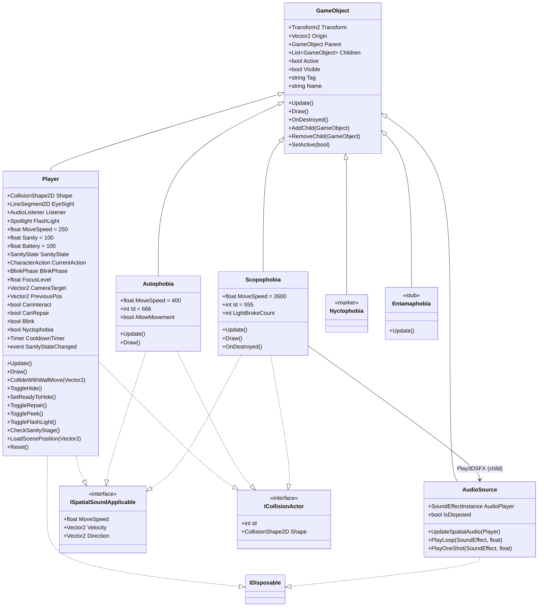
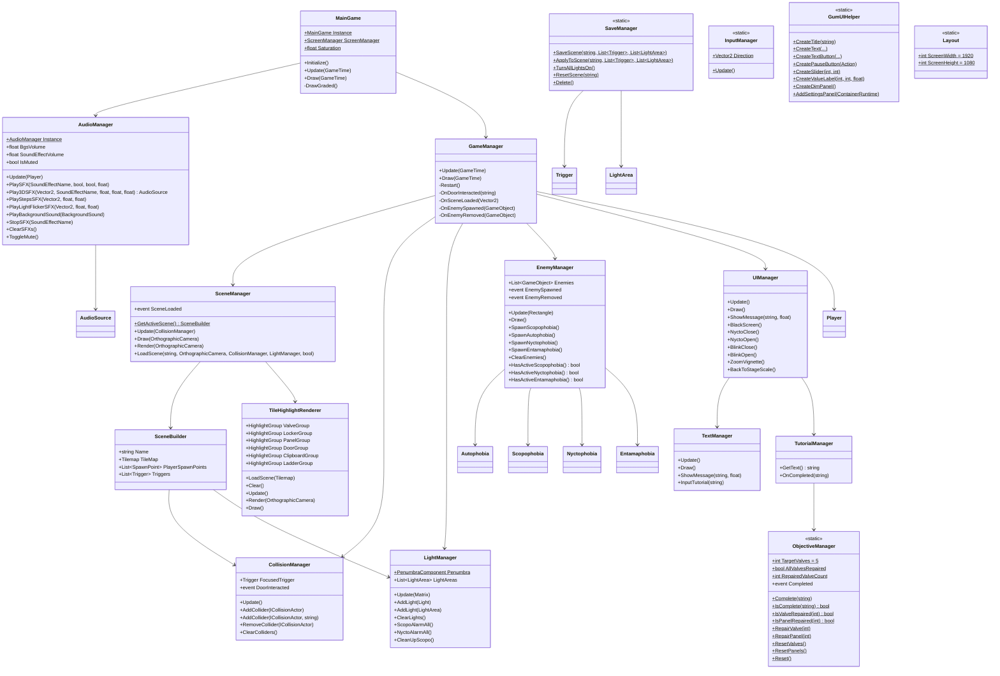
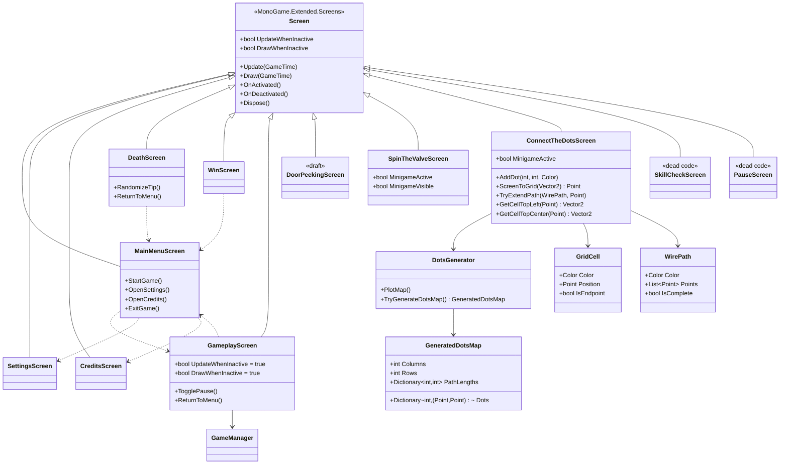
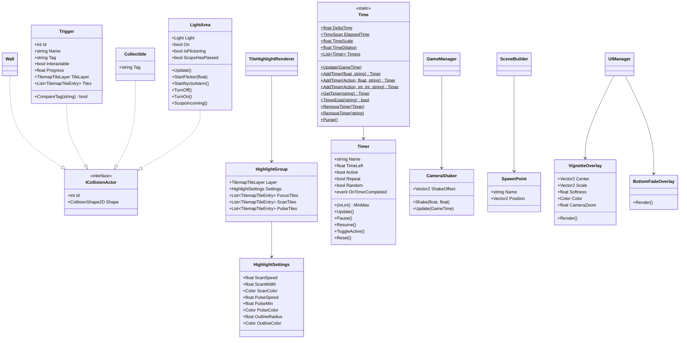
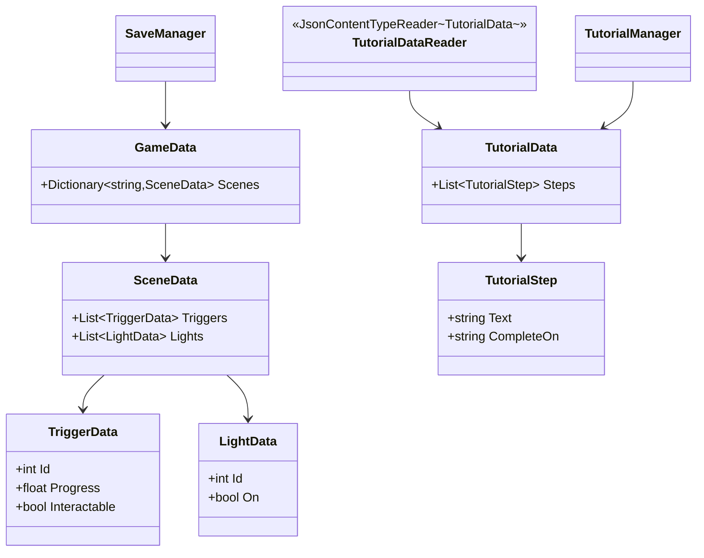
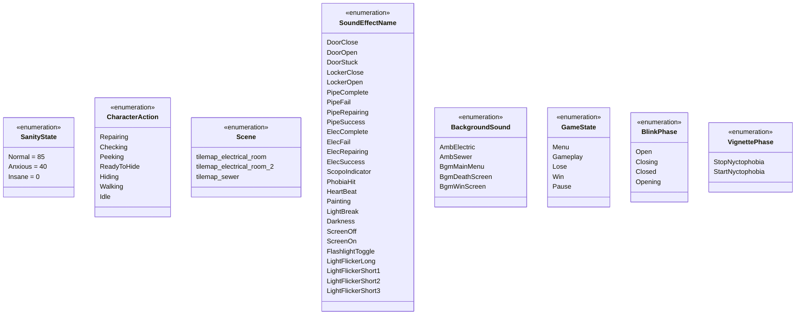

# Imaginophobia — Class Diagram

**Version:** 3.0 | **Last Updated:** 2026-10-25

> สร้างจากโค้ดจริงใน `src/Imaginophonia/Imaginophonia/` (ณ commit `cf024ef`, 2026-10-24)
> ไฟล์นี้เดิมอยู่ใน `docs/01_GDD/04-class-diagram.md` — ย้ายมาไว้ในหมวด Software Design เพราะเป็นงานออกแบบซอฟต์แวร์
> `ICollisionActor`, `Screen`, `Tilemap*` มาจากไลบรารี (MonoGame.Extended) — ไม่ได้ประกาศในโปรเจกต์ ส่วน `ISpatialSoundApplicable` ประกาศในโปรเจกต์เองที่ `Scripts/ISpatialSoundApplicable.cs`

## Core Hierarchy

> `Nyctophobia` เป็น **marker class เปล่า ๆ** — ใช้ให้ `EnemyManager.HasActiveNyctophobia()` ตรวจได้ว่า "ความมืดกำลังเล่นงานอยู่" พฤติกรรมจริงอยู่ใน `LightArea.StartNyctoAlarm()` + `UIManager`
> `Entamaphobia` มี `Update` ครึ่ง ๆ กลาง ๆ (`_stage`, `_value`, `_nextStageValue`, `_speed`) และยังไม่ถูก spawn จาก timer ไหน

## Managers

> `AudioManager` เป็น singleton ที่ถูกสร้างใน **`MainGame.Initialize()`** (ตัวแปร local ไม่ได้เก็บเป็น field) — ไม่ได้สร้างใน `GameManager` อีกแล้ว
> `GameManager` ยังมี `Restart()` แต่ **ไม่มีที่เรียกใช้** (เหลือแค่บรรทัดที่คอมเมนต์ไว้ใน `Update`) — เส้นทางตายคือ `ScreenManager.ReplaceScreen(new DeathScreen())`

## Screens

> `SkillCheckScreen` และ `PauseScreen` อยู่ในโฟลเดอร์ `Scraped/` — ไม่มีที่ไหนเรียกใช้แล้ว (ถูกแทนที่ด้วย `SpinTheValveScreen` และ pause overlay ใน `GameplayScreen`)
> ทุกหน้าจอ UI สร้างด้วย **Gum** (`Panel` → `Dock(Dock.Fill)` → `AddToRoot()`) และประกอบคอนโทรลผ่าน `GumUIHelper` โดยวางตำแหน่งด้วยค่าคงที่ใน `Layout`

## Colliders, Highlight & Support

## Data & Persistence

> `SaveManager.SaveScene` ข้าม trigger ที่ `Tag == "door"` (ประตูไม่ถูกบันทึกสถานะ) และจัดเก็บเป็น JSON ที่ `%APPDATA%\Imaginophobia\save.json`

## Enums

## หมายเหตุ

- `Screen` มาจากไลบรารี **MonoGame.Extended.Screens** · `ICollisionActor` มาจาก **MonoGame.Extended.Collisions** · `Light` / `PointLight` / `Spotlight` / `PenumbraComponent` มาจาก **Penumbra** · `Keyframe`/`SpriteSheet` ของ animation มาจาก **MonoGame.Extended.Graphics**
- คลาสที่ประกาศในโปรเจกต์ทั้งหมด: `GameObject`, `Player`, `AudioSource`, `Autophobia`, `Scopophobia`, `Nyctophobia`, `Entamaphobia`, `ISpatialSoundApplicable`, manager ทั้งหมด, `Screen` ทุกตัวในรายการ, `Trigger`/`Wall`/`Collectible`/`LightArea`, `HighlightGroup`/`HighlightSettings`, `Time`/`Timer`/`CameraShaker`/`Layout`/`GumUIHelper`, `SpawnPoint`, `VignetteOverlay`/`BottomFadeOverlay`, `DotsGenerator`/`GeneratedDotsMap`/`GridCell`/`WirePath`, data class ทั้งหมดใน `Scripts/Datas/`
- enum `SanityState`, `Scene`, `SoundEffectName`, `BackgroundSound`, `GameState`, `VignettePhase` อยู่ใน `Scripts/Enums/` · `CharacterAction` อยู่ที่ `Scripts/CharacterAction.cs` โดยตรง · `BlinkPhase` ประกาศใน namespace `Imaginophobia.Scripts.Enums` — ต่างจาก enum ตัวอื่นที่อยู่ใน `Imaginophobia`
- `GameState` (Menu / Gameplay / Lose / Win / Pause) **ยังไม่มีที่ใช้** — สถานะเกมตอนนี้สื่อผ่าน "หน้าจอที่ active" ของ `ScreenManager` แทน
- `SoundEffectName` มี 26 ค่า แต่ยังมี 2 ค่าที่ "โหลดไว้แต่ไม่เคยเล่น": `DoorOpen` และ `PipeSuccess` (นับจากการเรียก `PlaySFX` ในโค้ด) — `Painting` ผูกกับไฟล์ `sfx_panting.mp3` (ชื่อ enum ไม่ตรงกับไฟล์ ซึ่งชื่อไฟล์ก็พิมพ์ผิดอยู่แล้ว)
- `ObjectiveManager`, `SaveManager`, `InputManager`, `Time`, `Layout`, `GumUIHelper` เป็น static class ทั้งหมด — ไม่มี instance และไม่ถูก inject
- `Nyctophobia` / `Entamaphobia` ยังไม่มี asset และยังไม่ถูกผูกเข้า spawn timer (ดู [System Design § 14](01-system-design.md#14-known-issues--technical-debt))

## Related Documents

- System Design: [System Design](01-system-design.md)
- Data Schema: [Data Schema](03-data-schema.md)
- Mechanics (phobia behavior): [Mechanics](../01_GDD/03-mechanics.md)
